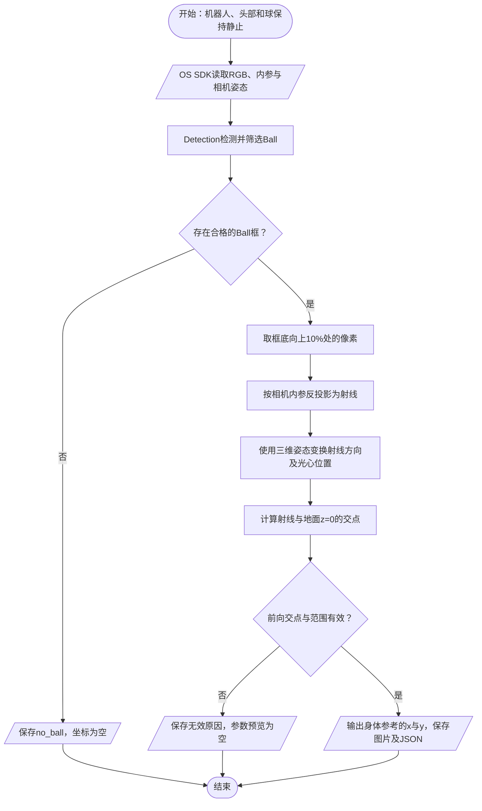

# K1 足球像素到米制坐标：工训课算法的 OS SDK 测试版

本版按用户要求沿用工训课 chapter12 的单目几何定位：检测框底部取点 → 相机射线 → 变换射线方向 → 与地面求交。主程序为 [geometry_ball_coordinates.py](geometry_ball_coordinates.py)，操作入口为 [K1足球坐标_单目几何测试.ipynb](K1足球坐标_单目几何测试.ipynb)，可直接复制 [单目几何工具包](K1足球坐标_单目几何工具包_v0.2.0.zip) 到已有 OS SDK 视觉环境。

本版采集静态快照并输出 `x/y`，没有运动、转头或踢球调用。原深度测试及现场结果保留，供追溯问题；本次定位主线改为工训课几何算法。

## 1. get_transform 在哪里使用

`get_transform(target_frame, source_frame)`提供两个三维坐标系之间的旋转和平移。像素 `(u,v)` 只确定一条视线，无法直接作为三维点传给 TF；需要额外的距离、已知平面或物体尺寸约束，才能确定米制位置。本次沿用旧程序中的“球接触地面”约束。



图中起止使用终止符、数据使用平行四边形、计算使用矩形、判断使用菱形。程序也会记录姿态查询失败等异常。

## 2. 沿用的代码与调整

原始路径：`D:\A_Project\BoosterRobotics\课程&资源\工训课\CourseCode\chapter_12_spatial_ball_localization\`。

| 原程序 | 本版处理 |
| --- | --- |
| `choose_ball_pixel()`，底部偏移比例 `0.10` | 沿用；将 SDK 的 `(x,y,width,height)` 框转换为同一像素位置 |
| `pixel_to_ray_camera()` | 沿用针孔公式；存在非零畸变时按实际模型先去畸变 |
| `ray_to_ground_base()` | 沿用射线与 `z=0` 地面求交公式 |
| `/head_pose` → `T_head_to_base` | 常用入口改用完整的 optical→trunk TF，并补入实测镜头离地高度；也保留显式输入旧头部位姿的入口 |
| `T_head_to_base @ T_compensation @ T_cam_to_head` | 旧位姿入口原样保留组合顺序和默认相机外参；完整相机TF入口不再叠加旧外参 |
| 默认 `fx/fy/cx/cy` 或视觉 YAML | 常用入口读取当前 OS SDK `get_camera_info()`，核对帧与图像尺寸 |
| ROS订阅、JSON话题、定时发布 | 本次用 OS SDK 取数和检测，保存一份本地测试记录 |
| 旧范围 `0≤x≤10、abs(y)≤5`，默认不滤波 | 沿用异常范围筛查，保留单帧原始结果供核对 |

原工训课文件已留存[来源与SHA256记录](../../../99-task-contexts/20261103-足球单目几何迁移/legacy_sources/来源.json)。数学对照检查直接提取原文件中的函数，未重写一份“预期公式”作为对照。

原节点有一个 `z_compensation` 参数，默认 `0.0`，它表示安装补偿，不是镜头离地高度。实际高度由 `/head_pose` 转成的 `T_head_to_base` 与补偿、相机外参相乘后取得，即 `T_base_camera[2,3]`。

## 3. 实际使用

将工具包中的 py 与 Notebook 放在同一目录。在 Notebook 中填写：

```python
from geometry_ball_coordinates import run_geometry_probe

CAMERA_HEIGHT_M = None  # 改为镜头中心到地面的实测垂直高度，单位米

report = run_geometry_probe(
    camera_height_m=CAMERA_HEIGHT_M,
    note="静止，球位于身体前方；记录卷尺起点与球上终点",
)
```

只需填写镜头离地高度，无需教师 JSON。不要直接把整机身高 `0.90` 填进去：头顶高度、镜头光心高度和躯干原点高度不同。当前程序没有给镜头高度设一个未经测量的默认值。

取图与姿态查询后才进行检测，避免把检测耗时再叠加到姿态查询前；它们仍不是严格同步测量，因此测试时保持静止。程序会保存图像时间戳、TF时间戳和检测耗时，便于后续检查动态条件。

计算成功时，例如可读取：

```python
print(report["status"])              # geometry_candidate
print(report["pixel_uv"])            # 本次用于求交的像素
print(report["geometry"]["point_base_m"])  # 身体原点在地面的投影参考，z≈0
print(report["kick_input_preview"])   # {"x": ..., "y": ...}，单位m
```

这里的 `x` 向前为正、`y` 向左为正。`distance_xy_m` 是地面平面距离，`ray_length_m` 是光心到求交点的斜距，不能把后者与卷尺沿地面量得的距离直接比较。

`known_xy=(x,y)` 是可选的卷尺对照输入，只参与结果比较，不参与高度、姿态或坐标计算。用户之前的约2.5米是从脚底量起，起点与球上终点尚未统一，本版不把它直接填成 `known_xy=(2.5,0)`。

每次运行生成 `足球几何坐标测试结果/几何球位_时间/` 和同名 ZIP，包含原图、标注图、RGB数组、原始JSON、采集汇总和实际运行脚本。标注图中的红点是求交像素。

## 4. 身体原点与地面高度

旧版使用的地面基座 `base.z=0`，与躯干 `trunk.z=0` 的含义不同。本版在静止直立、身体z轴竖直的条件下，保留完整TF的旋转和x/y平移，将z原点平移到地面：

```text
身体原点离地高度 = 实测镜头离地高度 - TF中镜头相对身体的z
地面参考相机位姿 = 身体参考相机位姿 + 上述z平移
```

因此地面参考与身体参考的 **x/y相同**。`point_body_m` 的z可能为负，表示求交点位于躯干原点下方；这不是把眼睛斜距冒充身体前向距离。

该简化适用于本次静止直立检查。身体有明显俯仰、侧倾或行走起伏时，需要同一时刻的地面法向与身体姿态，不能只沿身体z轴减一个固定高度。代码不会将这次静态结果标成动态定位通过。

## 5. 如果确实只有五个头部帧

用户列出的五个名称都是头部相关帧，未包含身体或地面参考。它们之间的TF不能独立确定头部相对身体的转动与位置。此前另一份现场记录曾成功查询 optical→trunk；这不能保证当前连接也有同样的帧树。

本版会先读当前 `list_frames()`，找不到 `trunk` 时保存明确错误，`kick_input_preview` 保持为空，不会把头部坐标当作身体坐标。

旧程序依赖系统话题 `/head_pose` 或 `/head_pose_stamped`。已提供的工训课 chapter12～18 程序只有这些话题的订阅端，未包含其发布端；当前 OS SDK 公开接口也没有同名的头部位姿读取方法。不能把整机高度或单位矩阵当作缺少的位姿。

若已有可信的旧头部到地面基座位姿，可显式输入：

```python
report = run_geometry_probe(
    head_to_ground=T_head_to_base,  # 原程序使用的4×4位姿，已包含离地高度
    T_cam_to_head=T_cam_to_head,    # 与上述头部帧匹配的相机外参
)
```

此入口沿用原来的矩阵组合；不再同时填 `camera_height_m`。旧外参有默认值，但真实系统若由视觉 YAML 覆盖，需传入当时实际使用的外参。测试工具自身没有新增 ROS/DDS 接口或重做一套关节正运动学。

## 6. 公式与当前证据

选点后，原算法为：

```text
相机射线 r = normalize([(u-cx)/fx, (v-cy)/fy, 1])
相机光心 O = T_base_camera[:3,3]
基座射线 D = normalize(T_base_camera[:3,:3] @ r)
地面交点 P = O + sD，s = -O.z / D.z
```

要求相机在地面上方、射线非平行地面且 `s>0`。这一步用已知地面约束消除了射线长度的不确定性。

这套旧规则估计的是接地点附近像素对应的地面位置，有限大小足球的底部偏移会造成近似误差；它不等同于精确球心的垂直投影。这里保留旧取点规则供对照，未额外加球半径去改结果。

当前现场记录的Ball框为 `[289,263,19,18]`，沿用旧规则得到 `(u,v)=(298.5,279.2)`。已有RGB、内参和TF足以离线计算射线；**尚缺当时的镜头离地高度，不能给这份旧快照确定唯一的几何米制球位**。[离线复算](几何迁移_旧快照复算.json)记录该关系，未利用2.5米倒调高度。

20项离线检查通过，含原算法跨高度/头部方向数值对照、左右符号、地面高度平移、异常求交、SDK只读接线、五帧缺失与订阅释放。它们验证数学和代码接线，不代替真机定位精度。`SoccerKickManager` 的身体原点是否与 `trunk` 一致、连续视觉供数与最终踢出效果仍未确认，本测试只输出参数预览。
