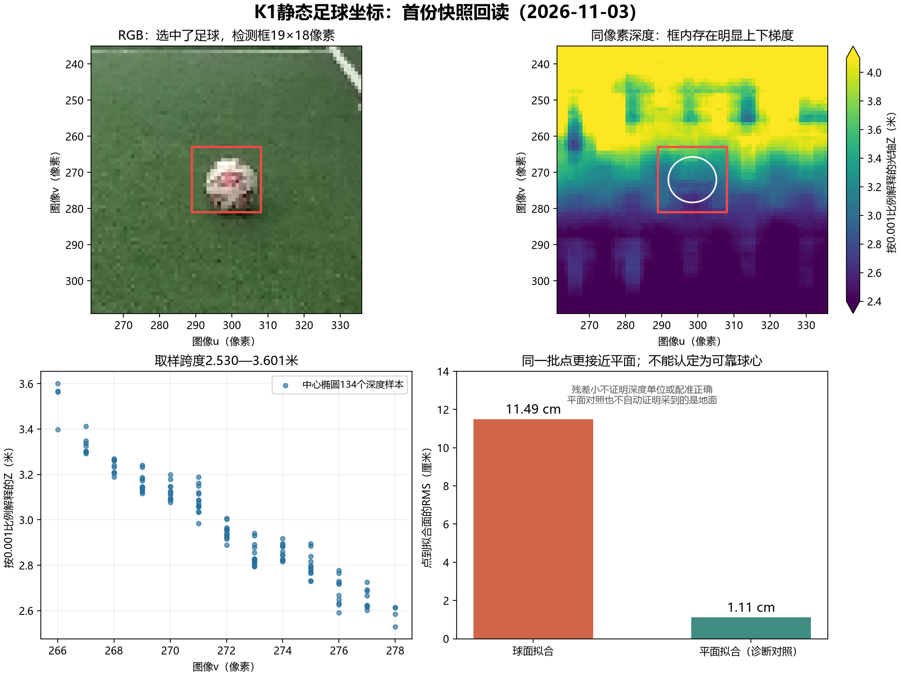

# K1足球坐标首份现场结果回读

回读日期：2026-11-03。原始采集：`球位_20261103_113057_624030`，SDK 1.2.2，测试程序v0.1.0。用户补充：足球在机器人前方约2.5米，直径约20cm；随后说明机器人身高90cm，量测从脚底到球。这些为近似现场参考，不能等同trunk原点下的x；不反写原始JSON中为空的known_xy和measured_ball_radius。

## 1. 结论

**足球检测与TF查询已经完成，三维点乘TF矩阵的计算可复现；本次拟合球心不可靠，不能把输出直接传给update_ball。**

RGB中的检测框选中了实际足球，置信度约0.866。按0.001比例解释深度，原程序算出trunk球心约`[3.072, -0.207, -0.526] m`。x与用户给的脚底到球约2.5米数值相差约0.572米，但参考点和度量不同，不能把它直接记成定位误差。拟合直径约0.481米，与实球约0.20米明显不符。

这份数据主要暴露了足球区域深度与球心拟合的质量问题。用相同点云作诊断对照，球面残差约11.49cm，平面残差约1.11cm；该批点更接近平面。它支持“未获得清晰、可信的球面点云”，尚不能区分地面混入、深度噪声、彩深像素对应或其他成像处理问题。

## 2. 本次实际记录

| 项目 | 原始值/离线复算值 | 解释 |
| --- | --- | --- |
| Ball框 | `[289,263,19,18]`，置信度0.86555 | 已查看原图，框内为足球；目标在图像中较小 |
| distance_m | null | 检测器本次没有直接提供距离 |
| RGB/深度 | 544×448，RGB bgr8，深度mono16/uint16 | 同尺寸和编码不能独立证明单位/配准 |
| RGB/深度时间差 | 0秒，帧名均head_color_optical_frame | 本次消息头一致；不延伸为所有帧同步或已证明硬件配准 |
| 中心椭圆 | 134个样本，134个通过0/65535等过滤 | 像素数值有效不代表来自球面 |
| 区域深度 | 按0.001假设为2.530—3.601m，中位2.9465m | 取样区域存在明显上下梯度，跨度约1.071m |
| 相机拟合球心 | `[0.231768,0.815756,3.012614] m` | 受当前深度假设与拟合质量影响 |
| trunk拟合球心 | `[3.072102,-0.206949,-0.525715] m` | 原始输出，现已判为拒用诊断值 |
| 拟合半径/直径 | 0.240631 / 0.481262m | 实球直径约0.20m，拟合直径约为其2.41倍 |
| 球面RMS | 0.114865m，约11.49cm | 明显超出原工具已有的0.02m诊断限制 |
| 同点云平面RMS | 0.011092m，约1.11cm | 平面较吻合；这不自动证明取到的是地面 |
| TF比RGB晚 | 1.069343秒 | 本次按静态条件分析；运动时不能直接拼接使用 |
| 正反TF乘积偏差 | 约4.44×10⁻¹⁶ | 两次矩阵数值互逆；不能单独证明物理方向与原点 |
| 检测耗时 | 1.926035秒 | 接近既有约2秒记录 |
| 结果产生时图像年龄 | 约5.761446秒 | 除检测外还包含采集后的保存与接口过程；未分别计时，不能全部归因给检测 |

用户已说明2.5米从脚底量起，但trunk相对脚底的偏移、球位量到球心还是近球面仍未记录，因此0.572米只保留为数值差。拟合直径不符及残差过大已足以拒用本次球心。

### 脚底量测、光轴深度与斜距的区别

| 数值 | 对应的量 | 能否直接等同脚底量测 |
| --- | --- | --- |
| 2.5m（用户） | 从脚底到足球的现场近似距离 | 需明确地面投影、球心/球面取点等量法 |
| 3.013m（拟合） | 相机光学坐标Z分量，沿相机前向轴 | 不能，原点与轴向不同 |
| 3.130m（复算） | 相机到拟合球心的欧氏斜距，sqrt(Xc²+Yc²+Zc²) | 不能，包含竖直和横向分量 |
| 3.072m（原显示x） | 经TF转换后，球点沿trunk.x的分量 | 不能，仍需trunk与脚底参考关系 |

因此“3.072米”并不是程序直接显示的眼睛到球的斜距。本轮也没有把机器人身高0.9米作为TF外参；TF提供的相机相对trunk平移已包含安装关系，不能再手动给x减去0.9米或重复补偿高度。

作为高度影响的示意，假设2.5米是脚底地面参考到球心投影的水平距离，眼睛高0.9米、球半径0.1米，那么斜距约为`sqrt(2.5²+(0.9-0.1)²)=2.625米`。实际眼睛高度应单独量，不能直接等同身高；若卷尺量到近球面，还需说明球半径的取点修正。这个示意说明高度会影响斜距，但不能凭身高把当前输出解释成准确结果。当前拟合质量的拒用依据不受量测原点区别影响。

## 3. TF这一段怎样理解

本次请求：

```python
robot.get_transform(
    target_frame="trunk",
    source_frame="head_color_optical_frame",
)
```

矩阵旋转部分近似：

```text
相机x（向右） → trunk的-y
相机y（向下） → trunk的-z
相机z（向前） → trunk的+x
```

相机原点在目标帧中的平移约为`[0.0752,0.0404,0.3415] m`。这个数值结构与光学坐标转身体坐标的常见关系相符；结合已保存RosAdapter实现中lookup_transform(target,source)的调用，应按请求方向应用矩阵，不因返回对象标签“trunk→head_color_optical_frame”就额外求逆。

离线按原始矩阵重新计算，完全复现了本次输出，未发现矩阵乘法写反或漏平移。它说明“已经有相机三维点时，如何表达在trunk中”这段计算可运行；三维点本身错误时，TF也会把这个错误点转换过去。

当前仍没有证据证明trunk原点与SoccerKickManager控制原点完全相同。z=-0.526米也不能独立判错，因为trunk.z=0不自动等于地面；本次拒用依据是深度/球面质量与现场参考不符。

## 4. 深度与球面的诊断图



左上为实际足球和19×18框；右上为同像素深度及采样椭圆。框内深度随图像v增加而明显减小。下方对照同批点的球面和平面残差。图中单位均沿用0.001比例假设，不因画图而确认该单位。

不能仅通过缩小depth_scale_m将x调整到2.5米：比例变化会一起缩放点云和残差，并不会补出原本没有分离出的球面，也不能证明彩深配准正确。

## 5. 测试程序修正

原版已在球面RMS超0.02米时提示异常，但仍将结果写成candidate_only。这会让差拟合看起来仍是可用候选，本轮已修正。

- 当前v0.1.1沿用原有球面半径0.02—0.25米、RMS不超过0.02米的诊断限制，超出时返回fit_rejected。
- `candidate_center_target_m`置空，原拟合数值仅写入`diagnostic_center_target_m`，并保留明确拒用原因。
- 增加同批点的平面残差作诊断对照；不据此自动认定地面或生成替代球位。
- 球位比较也区分有效候选和拒用诊断值，不将后者误列为有效定位结果。

已对本次原始快照离线复算：数值与旧结果一致，新质量检查将其拒用。19项离线检查通过，新增差拟合拒用及结果字段检查。这里的限制仍是工具计算检查，不是新设的真机验收精度。

更新的是共享目录中的py和空白测试Notebook；用户解压目录里的原始py、已执行Notebook、JSON、图像、NPY和结果ZIP均未改。更新包为[测试工具v0.1.1](../K1足球坐标_测试工具包_v0.1.1.zip)。用户已删除的旧工具ZIP未恢复。使用新版时需更换py并重启内核或重新加载模块。

## 6. 按用户要求改用工训课几何定位

用户指出get_transform不承担像素到米的转换，并要求沿用工训课已有K1几何定位。本次后续已改为[单目几何测试版](../单目几何测试说明.md)：沿用框底向上10%取点、相机射线和地面求交，OS SDK提供图像、检测、内参及姿态。

原工训课的高度来自/head_pose与相机外参组合，没有独立写死90cm或其他固定相机高度。当前SDK测试可使用完整相机→trunk TF加实测镜头离地高度，或显式传入已有可信的旧头部位姿。只有头部帧之间的TF时，仍缺身体/地面参考，不能把头部坐标改称身体坐标。

本次旧快照未保存镜头离地高度，几何复算保留“高度—球位”的关系式，不利用脚底量得的约2.5米反推或调参。深度问题继续保留为本次数据诊断记录，不再要求先补一轮深度球面测试才能使用几何工具。

## 7. 原始依据与复算

- [现场原始记录](../K1足球坐标_测试工具包/足球坐标测试结果/球位_20261103_113057_624030/原始记录.json)
- [现场执行Notebook](../K1足球坐标_测试工具包/K1足球坐标_只读测试.ipynb)
- [离线复算JSON](球位_20261103_113057_624030_复算.json)
- 本轮用户补充：“足球在机器人前方2.5米，足球直径大约20cm”；“机器人身高90cm……我量的是脚底到足球的距离”。

本轮助手只读取和离线处理既有数据，没有运行机器人，没有新增课程确认。
