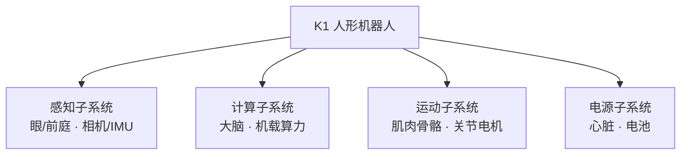
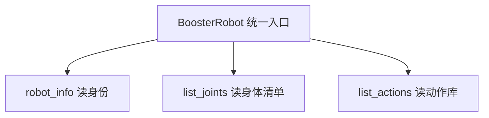
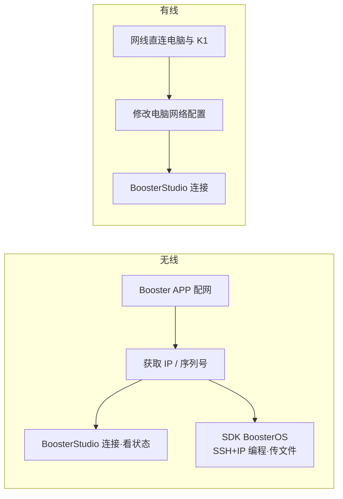

# U1-L1 PPT 内容大纲（确认⑤审核用）

> **课时**：45 分钟　**结构**：五部分 · 约 30 页

---

## 一、标题系统设计（课件规范）

每页 PPT 采用三层标识，使标题既对应课程部分、又呈现本页独立焦点：

1. **章节标签（页眉小字 / 色块）**：对应课程大块，如 `第一部分 · 初识具身智能`。
2. **页面主标题（大字）**：本页核心内容，如 `什么是具身智能`。
3. **副标题（主标题下一行，以「——」引出本页聚焦点）**：如 `—— 从数字大脑到会动的身体`。

> 约定：章节标签决定"在课程的哪一段"，主标题+副标题决定"本页讲什么"。**不把课程设计的内部思考逻辑写进课件标题**（如"双口味""双口位""能落地""与后续课程直接相关"等），学生只见学习内容与问题。

---

## 二、页面清单（约 30 页）

| #   | 章节标签                  | 页面主标题            | 副标题（——）                 | 类型   | 核心内容要点                                                                                  |
| --- | --------------------- | ----------------- | ------------------------- | ---- | --------------------------------------------------------------------------------------- |
| 1   | 导学                    | 具身智能概览与连接 K1      | —— 第一堂人形机器人课              | 封面   | 单元 U1 人形机器人初探与运动控制／课时 L1／主讲人                                                       |
| 2   | 导学                    | 本课目标              | —— 一节课我们要带走什么             | 目标页  | ① 认识具身智能与人形机器人的组成　② 用 BoosterOS SDK 连接 K1 读取"身体清单"　③ 理解"用程序操控实体机器人"                  |
| 3   | 第一部分 · 初识具身智能        | 机器人的"智能"在哪        | —— 会算，还是会动？               | 互动页  | 短片（展厅/足球/搬运）提问"智能在哪" → 离身 vs 具身：豆包/Seedance/WorkBuddy 是数字大脑，K1 是有身体的                        |
| 4   | 第一部分 · 初识具身智能        | 什么是具身智能           | —— 从数字大脑到会动的身体            | 知识页  | 定义：智能"长"在能感知、能行动的身体上；人形机器人是其中代表载体                                                         |
| 5   | 第一部分 · 初识具身智能        | 智能是怎么一步步"长"出来的    | —— 四段发展脉络一览                | 知识页  | 四阶段总览图：符号智能 → 行为主义与机器人学 → 深度学习赋能感知 → 大模型与 VLA（后续 4 页逐一展开）                              |
| 6   | 第一部分 · 初识具身智能        | 发展一 · 符号智能         | —— 把智能当作"推理"               | 知识页  | 1950s–1980s；智能 = 符号推理（Newell & Simon）；机器人多为固定程序、无自主学习。图文：早期计算机/逻辑机                         |
| 7   | 第一部分 · 初识具身智能        | 发展二 · 行为主义与机器人学    | —— 让机器人"感知—行动"            | 知识页  | 1980s–2000s；Brooks"无表征"；真实机器人进入研究，强调感知—行动闭环。图文：早期移动机器人                                      |
| 8   | 第一部分 · 初识具身智能        | 发展三 · 深度学习赋能感知     | —— 机器人终于"看得清"             | 知识页  | 2010s；AlexNet 突破；视觉/语音识别让机器人"看得清、听得懂"。图文：神经网络/摄像头                                          |
| 9   | 第一部分 · 初识具身智能        | 发展四 · 大模型与 VLA      | —— 看、想、动连成一体              | 知识页  | 2020s 至今；大模型带来通用推理，VLA 把"看—想—动"连成一体（PaLM-E、RT-2）。图文：大模型+机器人执行任务                             |
| 10  | 第二部分 · 研究重心与方向       | 今天的研究往哪用力         | —— 既要开眼界，也要能上手            | 知识页  | 研究重心两面向：前沿方向（开眼界）＋应用方向（能上手）；本课先建立整体印象                                                  |
| 11  | 第二部分 · 研究重心与方向       | 前沿一 · 视觉语言导航 VLN    | —— 听懂"去那边把杯子拿来"           | 知识页  | 理解语言 + 看见环境 + 规划路径。图文：机器人按语言指令导航示意图                                                       |
| 12  | 第二部分 · 研究重心与方向       | 前沿二 · 视觉语言动作 VLA    | —— 看见画面，直接输出动作            | 知识页  | 端到端：画面 + 指令 → 动作。图文：VLA 端到端框图                                                          |
| 13  | 第二部分 · 研究重心与方向       | 前沿三 · 世界模型         | —— 在脑内先"演一遍"              | 知识页  | 模拟"如果我这么动会怎样"，在想象中预演。图文：预测/模拟示意图                                                         |
| 14  | 第二部分 · 研究重心与方向       | 应用一 · 机器人操作        | —— 稳稳抓放、精准装配              | 知识页  | 让机械臂稳定抓取、装配零件。图文：机械臂抓取/装配图片（三应用板块式设计之一）                                                |
| 15  | 第二部分 · 研究重心与方向       | 应用二 · 运动控制         | —— 在不平地面站稳走好              | 知识页  | 双足机器人保持平衡、稳定行走。图文：双足行走图片（三应用板块式设计之二）                                                    |
| 16  | 第二部分 · 研究重心与方向       | 应用三 · 手眼协调         | —— 眼睛看到的，实时修正手的动作         | 知识页  | 摄像头反馈实时引导动作（如对准插孔）。图文：手眼协调闭环示意图（三应用板块式设计之三）                                           |
| 17  | 第三部分 · 认识 K1 与开发工具    | 回到我们手边的这台 K1       | —— 它到底由什么组成？              | 过渡页  | 问题式过渡：认识了智能与研究，回到 K1——它的"身体"由什么组成？引出下两页                                                    |
| 18  | 第三部分 · 认识 K1 与开发工具    | 人形机器人的系统组成        | —— 感知、计算、运动、电源           | 知识页  | 四大子系统：感知（眼/前庭）／计算（大脑）／运动（肌肉骨骼）／电源（心脏）。图文：四宫格架构图                                    |
| 19  | 第三部分 · 认识 K1 与开发工具    | 走近 K1（一）          | —— 外观、硬件与"身体参数"           | 知识页  | Booster Robot 公司的人形机器人；身高/22 关节自由度/相机·IMU 等传感器；有芯片、有操作系统。图文：K1 全身图 + 关节/传感器标注              |
| 20  | 第三部分 · 认识 K1 与开发工具    | 走近 K1（二）          | —— 它能做什么，我们能对它做什么        | 知识页  | 本课的操作对象：可连接编程、读取信息、后续驱动运动；本课时先"只读认识"。图文：K1 执行动作/结构爆炸图                              |
| 21  | 第三部分 · 认识 K1 与开发工具    | 怎么用一行代码让它"听话"     | —— 从手动到程序控制               | 过渡页  | 问题式过渡：看完了"身体"，怎么用程序操控它？引出 SDK                                                        |
| 22  | 第三部分 · 认识 K1 与开发工具    | SDK 是什么            | —— 操作机器人的"说明书+钥匙"         | 知识页  | SDK（BoosterOS）是 Booster Robot 公司提供的开发工具包；`BoosterRobot` = 代码版遥控器（统一入口）。图文：遥控器类比 + SDK 读写范式 |
| 23  | 第三部分 · 认识 K1 与开发工具    | K1 与电脑怎么连上         | —— 无线 / 有线两种方式             | 知识页  | K1 是实体机器人（有芯片/OS）；电脑经网络 SSH 远程连接编程；两种连接方式。图文：连接示意（无线/有线）                              |
| 24  | 第四部分 · 动手连接与读取       | 用 BoosterStudio 先连上  | —— 图形界面建立第一印象             | 演示页  | 开机 → 配网/接网线 → 查 IP/序列号 → Studio 连接 → 看实时画面。图文：Studio 界面三步标注                                  |
| 25  | 第四部分 · 动手连接与读取       | 实操任务卡             | —— 分组连接，记好"身份证"           | 互动页  | 分组连接 K1，记录 IP 与序列号；多机同场按序列号核对防连错。图文：任务清单卡片                                                  |
| 26  | 第四部分 · 动手连接与读取       | 用代码连接 K1          | —— 第一行：建立连接               | 代码页  | `from boosteros... import BoosterRobot`；`robot = BoosterRobot()`。对应 notebook 步骤1                  |
| 27  | 第四部分 · 动手连接与读取       | 读取它的"身份证"         | —— 型号·序列号·固件版本            | 代码页  | `robot.robot_info`；重点 `serial_number` = 身份证号（多机区分）。图文：代码 + 输出示例                              |
| 28  | 第四部分 · 动手连接与读取       | 浏览关节清单            | —— 22 个关节与它们的"身体结构"       | 代码页  | `list_joints()` → 22 关节；`limits` / `max_velocity`。图文：关节表 + 实物对应图                          |
| 29  | 第四部分 · 动手连接与读取       | 浏览动作库与当前状态        | —— 它会哪些动作，现在什么状态         | 代码页  | `list_actions()` 字段（id/type/duration/interruptible）；`get_mode()` / `get_battery()`。图文：动作表+状态输出       |
| 30  | 第五部分 · 小结与评价          | 本课小结与学习评价         | —— 带走三件东西，测一测              | 总结页  | 回顾：身份证/身体清单/连接工具；下发 3 题评价（判断/填空/选择，与实训手册一致）                                               |

---

## 三、重点页详述（图文并茂 / 过渡设计）

### 发展时间线四页（页 6–9，逐页图文）
- 每页统一版式：**左文右图**（或上图下文）：左为时期 + 代表进展 + 一句话意义；右为对应历史/概念配图。
- 页 6：早期计算机与逻辑推演机图片，标注"智能=符号推理"。
- 页 7：早期移动机器人照片，标注"感知—行动闭环"。
- 页 8：神经网络结构图 + 摄像头，标注"看得清、听得懂"。
- 页 9：大模型对话界面 + 机器人执行任务图，标注"看—想—动一体"。

### 研究重心·应用三页（页 14–16，三板块式）
- 三页共用同一版式语言（板块卡片 + 大图）：`[图标] 方向名` + 一句解释 + 一张场景配图。
- 页 14 机器人操作：机械臂抓取/装配图。
- 页 15 运动控制：双足在不平地面行走图。
- 页 16 手眼协调：摄像头闭环引导机械臂对准插孔示意图。
- 页 11–13 前沿三页同此"图标+解释+图"版式，但配图偏概念示意（导航路径 / 端到端框图 / 预测模拟）。

### 过渡页（页 17、页 21）
- 页 17：`回到我们手边的这台 K1 —— 它到底由什么组成？`（大号问句 + 背景虚化 K1 图）
- 页 21：`看完了它的"身体"，怎么用一行代码让它听话？`（大号问句 + 代码符号意象）
- 作用：抛出话题/问题/情景，自然衔接上一段与下一段，避免"突然跳到 SDK"。

### K1 介绍两页（页 19–20，图文并茂）
- 页 19：K1 全身照片，叠加标注（头部相机、IMU、关节自由度、电池），配硬件参数短句。
- 页 20：K1 执行某动作/结构爆炸图，说明"本课它是被连接、被读取的对象；后续单元才驱动它运动"。

---

## 四、关键页视觉（Mermaid，供 PPTX 直接渲染）

**页 5 · 发展脉络总览（Mermaid flowchart）**

**页 18 · 四大子系统（Mermaid graph）**

**页 22 · SDK 读写范式（Mermaid graph）**

**页 23 · 电脑与 K1 连接（Mermaid flowchart）**

**页 4 · 离身 vs 具身（表格）**

| 维度 | 离身智能 | 具身智能 |
|---|---|---|
| 核心 | 只会算 / 生成 | 既能算，也有身体 |
| 位置 | 藏在屏幕后 | 能看 · 能动 · 能交互 |
| 例子 | 豆包 / Seedance / WorkBuddy | K1 |

---

## 五、代码展示页对应 cell（高亮建议）

| 页面 | notebook cell | 高亮 |
|---|---|---|
| 26 | 步骤 1（cell-9） | 高亮 `BoosterRobot()` 一行 |
| 27 | 步骤 2（cell-11/13） | 高亮 `robot.robot_info` 与 `info.serial_number` |
| 28 | 步骤 3（cell-15/17） | 高亮 `list_joints()` 与 `j.limits` 遍历 |
| 29 | 步骤 4-5（cell-19/21/23/25） | 高亮 `list_actions()` / `get_mode` / `get_battery` |

---

## 六、互动 / 演示页设计

- **页 3 导入**：先播短片，暂停追问，用投票/口头回答收集"会算 vs 会动"。
- **页 24–25 演示+实操**：教师先演示 Studio 连接（投影），学生分组照做，教师巡场核对 IP/序列号防连错。
- **页 30 评价**：当堂独立完成 3 题（判断/填空/选择，题目与实训手册「三、学习评价」一致），教师收后讲评。

---

## 七、备注

- 全册统一视觉模板（封面/配色/字体/页脚 + 章节标签样式）待确认⑤后定风格；本大纲先用占位版式描述。
- 所有图文并茂页（发展四页、应用三页、K1 两页）需配实拍/示意图，图片素材后续统一准备（与实训手册附件《K1 连接与 BoosterStudio 操作图示》协同）。
- 页 23 强调 K1 是实体机器人、通信走 SSH，避免误述为"网络设备 / IP:端口直连"。
- 代码页（页 26–29）保持与 notebook 完全一致，避免学生抄错；cell 编号以当前 notebook 为准。
