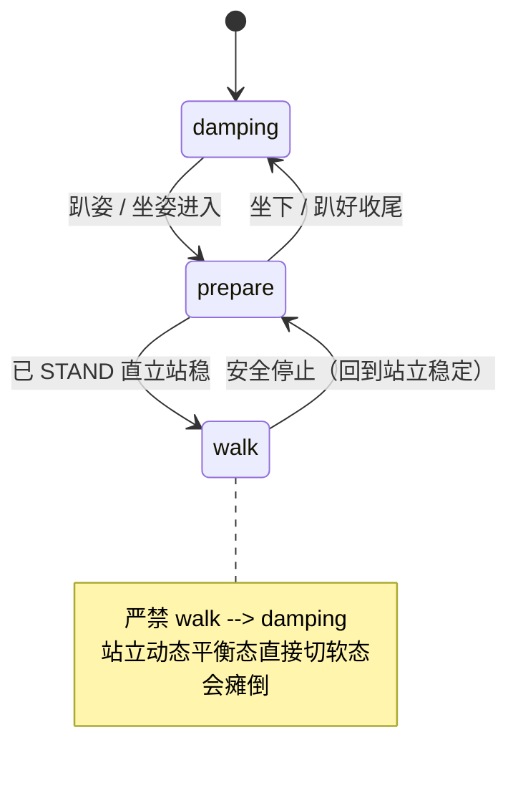
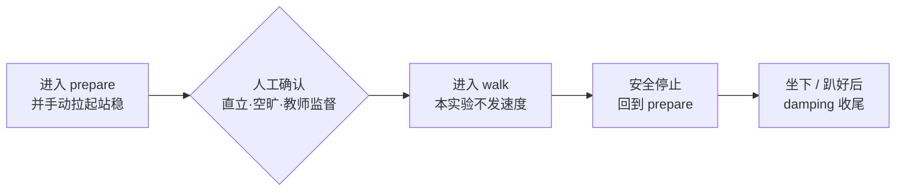

# U1-L2 PPT 内容大纲（确认⑤审核用）

> **课时**：45 分钟　**结构**：五部分 · 约 26 页

---

## 一、标题系统设计（课件规范）

每页 PPT 采用三层标识，使标题既对应课程部分、又呈现本页独立焦点：

1. **章节标签（页眉小字 / 色块）**：对应课程大块，如 `第一部分 · K1 的运行模式`。
2. **页面主标题（大字）**：本页核心内容，如 `模式三 · walk 行走模式`。
3. **副标题（主标题下一行，以「——」引出本页聚焦点）**：如 `—— 靠动态平衡维持站立`。

> 约定：章节标签决定“在课程的哪一段”，主标题+副标题决定“本页讲什么”。**不把课程设计的内部思考逻辑写进课件标题**，学生只见学习内容与问题。本课含安全强约束内容，警示类页面用警示红 `#E5484D` 作点缀（其余仍守清新白底基调）。

---

## 二、页面清单（约 26 页）

| #   | 章节标签              | 页面主标题              | 副标题（——）                              | 类型  | 核心内容要点                                                                                       |
| --- | ----------------- | ------------------ | ------------------------------------ | --- | -------------------------------------------------------------------------------------------- |
| 1   | 导学                | 运行模式与安全            | —— 让 K1 安全地站起来                       | 封面  | 单元 U1 人形机器人初探与运动控制／课时 L2／主讲人                                                                 |
| 2   | 导学                | 本课目标               | —— 一节课我们要带走什么                        | 目标页 | ① 认识四种运行模式的物理含义与安全要点　② 用 SDK 查看并切换运行模式　③ 掌握模式间的安全切换顺序，养成规范操作习惯                               |
| 3   | 第一部分 · K1 的运行模式   | 从“连上”到“动起来”        | —— 控制方式一样吗？                          | 互动页 | 回顾上节课已连接 K1、读到基本参数；提问“机器人从趴着，到站起来、准备走，底层的控制方式一样吗？”【想一想】                                      |
| 4   | 第一部分 · K1 的运行模式   | 什么是运行模式            | —— 不同工作状态，不同控制策略                     | 知识页 | 运行模式 = 机器人在某种工作状态下采用的整套控制策略；趴着、站着、走着，关节的控制目标完全不同。图文：三种姿态对照                                   |
| 5   | 第一部分 · K1 的运行模式   | K1 的四种运行模式         | —— damping / prepare / walk / custom | 知识页 | 四模式总览对照表（含义 / 能否运动 / 安全要点）；后续 4 页逐一展开                                                        |
| 6   | 第一部分 · K1 的运行模式   | 模式一 · damping 阻尼软态 | —— 开机默认，关节软、不支撑站立                    | 知识页 | 关节有阻尼但整体“软”，无法维持站立；只能在坐姿 / 趴姿下进入；也是关机前的收尾状态。图文：K1 趴姿实拍                                       |
| 7   | 第一部分 · K1 的运行模式   | 模式二 · prepare 准备就绪 | —— 行走之前的必经状态                         | 知识页 | 维持站立就绪姿态，关节变硬但不主动运动；进入 walk 前必须先到达此模式且已直立站稳。图文：K1 直立站姿实拍                                     |
| 8   | 第一部分 · K1 的运行模式   | 模式三 · walk 行走模式    | —— 靠动态平衡维持站立                         | 知识页 | 机器人持续微调关节维持平衡，可配合速度指令行走；只能由已直立的 prepare 进入。图文：K1 行走中实拍                                       |
| 9   | 第一部分 · K1 的运行模式   | 模式四 · custom 自定义   | —— 进阶模式，本课不实操                        | 知识页 | 需自行编程实现控制逻辑；未编程前比 damping 更软；属进阶内容，本课时只作认识。图文：进阶编程示意                                         |
| 10  | 第二部分 · 用程序查看与切换模式 | 机器人现在是什么模式？        | —— 从手动按钮到程序控制                        | 过渡页 | 问题式过渡：模式看得见，但怎么让程序知道、让程序去切？引出 SDK 的 `get_mode()` / `set_mode()`                              |
| 11  | 第二部分 · 用程序查看与切换模式 | 手动切换 vs 程序切换       | —— 即时操作与流程自动化                        | 知识页 | 对照表：按钮/手柄适合人即时操作；程序适合按流程自动执行、可复现、可批量——这就是学机器人编程的意义                                           |
| 12  | 第二部分 · 用程序查看与切换模式 | 用代码连接 K1           | —— 第一行：建立连接                          | 代码页 | `from boosteros.robots.booster import BoosterRobot`；`robot = BoosterRobot()`。对应 notebook 2.1 |
| 13  | 第二部分 · 用程序查看与切换模式 | 读取当前运行模式           | —— get_mode() 读出状态                   | 代码页 | `robot.get_mode()` 读出当前模式字符串；对照机器人实际姿态验证。对应 notebook 2.2                                     |
| 14  | 第二部分 · 用程序查看与切换模式 | 观察记录任务             | —— 把“模式—姿态”对应记下来                     | 互动页 | 不写代码：观察 damping / prepare / walk 三种模式下的姿态、能否运动，填入实训手册 2.3 表格；同桌交叉核对【动手试试】                    |
| 15  | 第二部分 · 用程序查看与切换模式 | 趴姿下切换模式            | —— damping ↔ prepare 练手              | 代码页 | `set_mode("prepare")` / `set_mode("damping")`；趴姿最安全，切换失败也不会摔倒。对应 notebook §三                 |
| 16  | 第三部分 · 安全切换与行走    | 能切换了，是不是就能随便切？     | —— 模式之间有安全顺序                         | 过渡页 | 问题式过渡：切换不是任意的，走错顺序会摔机、伤人；引出状态机与安全红线                                                          |
| 17  | 第三部分 · 安全切换与行走    | 运行模式状态机            | —— 哪些能切，哪些不能切                        | 知识页 | 状态机图：damping ↔ prepare、prepare → walk、walk → prepare；标注禁止 walk → damping。图文：状态机框图            |
| 18  | 第三部分 · 安全切换与行走    | 安全红线               | —— 严禁 walk → damping                 | 知识页 | 站立靠动态平衡，直接切软态会瞬间瘫倒：伤及邻近人员、损坏物品与机器人本体。停止行走必须先回 prepare。图文：瘫倒后果警示示意（警示红点缀）                     |
| 19  | 第三部分 · 安全切换与行走    | 行走安全路径             | —— 四步时序，每步之间留人工窗口                    | 知识页 | 时序图：进入 prepare 并手动拉起 → 人工确认（直立/空旷/教师监督）→ 进入 walk → 安全停止回 prepare → 坐下趴好后 damping 收尾          |
| 20  | 第三部分 · 安全切换与行走    | 步骤 1 · 进入准备模式      | —— 先站稳，再谈行走                          | 代码页 | `set_mode("prepare")`；随后手动把机器人拉起到 STAND 直立站稳。对应 notebook 4.2 步骤 1                            |
| 21  | 第三部分 · 安全切换与行走    | 步骤 2 · 确认后进入行走     | —— 人工确认窗口，不可跳过                       | 代码页 | 确认直立站稳、周围空旷、教师在场后，才运行 `set_mode("walk")`（本实验不发速度，机器人原地）。对应 notebook 4.2 步骤 2                 |
| 22  | 第三部分 · 安全切换与行走    | 步骤 3–4 · 安全停止与收尾   | —— 先回 prepare，再软态收尾                  | 代码页 | `set_mode("prepare")` 安全停止；确认已坐下 / 趴好后再 `set_mode("damping")` 收尾。对应 notebook 4.2 步骤 3–4      |
| 23  | 第四部分 · 手柄手动遥控     | 不写代码，也能让它动         | —— 换控制方式，不换安全原则                      | 过渡页 | 问题式过渡：除了程序，还有手柄这种“人直接操作”的方式；但安全顺序完全一样                                                        |
| 24  | 第四部分 · 手柄手动遥控     | 用手柄操控 K1           | —— 按键布局与操作流程                         | 演示页 | 操作目标 / 前置（配对、开机、站位）/ 关键步骤 / 安全要点；详细按键布局与界面步骤见附件《K1 手柄遥控操作图示》。图文：手柄按键标注                       |
| 25  | 第四部分 · 手柄手动遥控     | 分组实操任务卡            | —— 在监督下完成一次完整操控                      | 互动页 | 分组轮换：prepare → 直立站稳 → walk → 回 prepare；每组一名安全员盯全程，禁止 walk → damping【动手试试】                    |
| 26  | 第五部分 · 小结与评价      | 本课小结与学习评价          | —— 带走三件东西，测一测                        | 总结页 | 回顾：四种模式 / 程序切换 / 安全顺序；下发 3 题评价（判断/填空/选择，与实训手册一致）                                             |

---

## 三、重点页详述（图文并茂 / 过渡设计）

### 四种模式四页（页 6–9，逐页图文）
- 统一版式：**左文右图**。左侧 = 模式名（代码体）+ 一句物理含义 + 能否运动 + 安全要点；右侧 = 该模式下 K1 的真实姿态照片。
- 页 6 damping：K1 趴姿实拍，标注“关节软 · 不支撑站立 · 开机默认”。
- 页 7 prepare：K1 直立站姿实拍，标注“关节变硬 · 站立就绪 · 行走前必经”。
- 页 8 walk：K1 行走中实拍（可带运动轨迹箭头），标注“持续微调 · 动态平衡”。
- 页 9 custom：进阶编程示意图（代码 + 自定义控制框图），标注“需单独编程 · 本课不实操”。
- 四页视觉节奏一致，学生一眼能横向对比四种模式的姿态差异。

### 安全三页（页 17–19，本课核心）
- 页 17 状态机：框图呈现允许的切换路径，禁止路径用警示红叉标注，是本课最重要的一页板书对应页。
- 页 18 安全红线：大字“严禁 `walk` → `damping`”+ 后果三条（伤人 / 损物 / 损机），配瘫倒示意图；使用警示红点缀，与其他页形成视觉区分。
- 页 19 行走安全路径：横向四步时序图，每步之间画出“人工窗口”标记，强调不可连续运行、必须留人工操作时间。

### 过渡页（页 10、16、23）
- 页 10：`机器人现在是什么模式？ —— 从手动按钮到程序控制`（大号问句 + 手/代码对比意象）
- 页 16：`能切换了，是不是就能随便切？`（大号问句 + 状态机剪影虚化背景）
- 页 23：`不写代码，也能让它动`（大号问句 + 手柄剪影）
- 作用：三处大块衔接不断裂——从“认识模式”到“程序操作”、从“会切换”到“安全切换”、从“程序控制”到“手动遥控”。

### 演示与实操页（页 24–25）
- 页 24：手柄照片 + 按键功能标注（左摇杆 / 右摇杆 / 模式键 / 急停），并在页面右下标注“详细图示见附件《K1 手柄遥控操作图示》”。
- 页 25：任务卡版式（勾选列表 + 分组轮换提示 + 安全员职责），与实训手册 §五 一致。

---

## 四、关键页视觉（Mermaid / 表格，供 PPTX 直接渲染）

**页 5 · 四种运行模式总览（表格）**

| 模式 | 含义 | 能否运动 | 安全要点 |
|---|---|---|---|
| `damping` | 阻尼 / 软态，关节有阻尼但不支撑站立 | 否 | 开机默认状态 |
| `prepare` | 准备模式，维持站立就绪姿态 | 否（仅就绪） | 行走前必须先到达此模式 |
| `walk` | 行走模式，靠动态平衡维持站立 | 是（需配合速度） | 只能由已直立的 prepare 进入 |
| `custom` | 进阶自定义模式，需单独编程 | 取决于编程 | 未编程前比 damping 更软，本课不实操 |

**页 11 · 手动切换 vs 程序切换（表格）**

| 维度 | 手动切换（按钮 / 手柄） | 程序切换（SDK） |
|---|---|---|
| 适用 | 人在现场即时操作 | 按流程自动执行 |
| 特点 | 直观、响应快 | 可复现、可批量、可组合成任务 |
| 局限 | 每次都要人动手 | 需提前写好并验证 |

**页 17 · 运行模式状态机（Mermaid stateDiagram）**

**页 19 · 行走安全路径时序（Mermaid flowchart）**

**页 18 · 安全红线（版式说明）**

| 元素 | 内容 |
|---|---|
| 主视觉 | 大字 `walk → damping` 上叠加警示红叉 |
| 后果三条 | 机器人瞬间瘫倒；可能伤及邻近人员；损坏物品与机器人本体 |
| 正确做法 | 停止行走必须先回 `prepare`，确认坐下 / 趴好后再 `damping` |

---

## 五、代码展示页对应 cell（高亮建议）

| 页面 | notebook 位置 | cell | 高亮 |
|---|---|---|---|
| 12 | 2.1 连接 K1 | cell-5 | 高亮 `BoosterRobot()` 一行 |
| 13 | 2.2 读取当前运行模式 | cell-7 | 高亮 `robot.get_mode()` |
| 15 | 三、趴姿切换 | cell-10 / cell-11 | 高亮 `set_mode("prepare")` 与 `set_mode("damping")` |
| 20 | 4.2 步骤 1 | cell-16 | 高亮 `set_mode("prepare")` |
| 21 | 4.2 步骤 2 | cell-18 | 高亮 `set_mode("walk")`，并在页面顶部标注“人工确认后方可运行” |
| 22 | 4.2 步骤 3–4 | cell-20 / cell-22 | 高亮 `set_mode("prepare")`（停止）与 `set_mode("damping")`（收尾） |

> 代码页顶部统一注明 `对应 notebook <小节>（cell-N）`，与实训手册完全一致，便于学生对照抄写。页 21、22 因涉及安全强约束，代码块上方加一行警示红提示条。

---

## 六、互动 / 演示页设计

- **页 3 导入**：口头提问“从趴着到站起来、走起来，控制方式一样吗”，让学生先猜再讲；不给答案，留到页 4–5 揭示。
- **页 14 观察记录**：全班暂停写码，只做观察填表；教师逐组巡看，要求同桌互报核对后签字，确保“模式—姿态”对应关系真正建立。
- **页 21 进入 walk**：投影此页时同步宣布安全纪律，确认全班站位后统一操作；教师逐组核对“已直立站稳”后才允许运行。
- **页 25 手柄实操**：分组轮换，每组指定一名安全员；教师先完整示范一遍再放手。
- **页 26 评价**：当堂独立完成 3 题（判断/填空/选择，题目与实训手册「六、检查点、思考题与学习评价」一致），教师收后讲评。

---

## 七、备注

- 全册沿用 U1-L1 已确认的视觉模板（§8.12：清新白底 · 微软雅黑 · 页脚仅页码 · 代码页浅色底）；本课新增**警示红点缀**仅用于页 18、21、22 的安全提示元素，不改变整体基调。
- 图文并茂页（四模式四页、手柄页）需配 K1 四种姿态实拍与手柄按键照片，图片素材后续统一准备（与实训手册附件《K1 手柄遥控操作图示》协同）。
- 页 8、19、21 涉及行走，配图须选取周围空旷、有人监督的规范场景照片，避免示范出不安全画面。
- 代码页（页 12、13、15、20、21、22）保持与 notebook 完全一致；cell 编号以当前 notebook（30 cells）为准。
- 手柄操作的详细按键布局与界面步骤不进课件正文，仅在页 24 作附件提示，与实训手册 §五 的处理方式一致。
