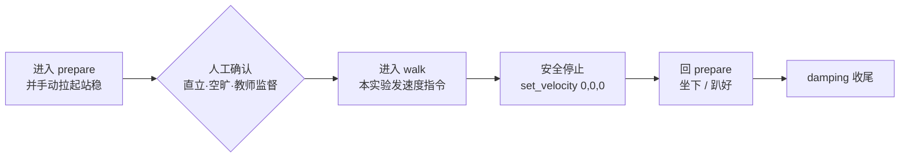

# U1-L3 PPT 内容大纲（确认⑤审核用）

> **课时**：45 分钟　**结构**：五部分 · 约 26 页

---

## 一、标题系统设计（课件规范）

每页 PPT 采用三层标识，使标题既对应课程部分、又呈现本页独立焦点：

1. **章节标签（页眉小字 / 色块）**：对应课程大块，如 `第二部分 · 速度指令与坐标系`。
2. **页面主标题（大字）**：本页核心内容，如 `set_velocity 的三个参数`。
3. **副标题（主标题下一行，以「——」引出本页聚焦点）**：如 `—— 一个指令，三个数，决定往哪走`。

> 约定：章节标签决定“在课程的哪一段”，主标题+副标题决定“本页讲什么”。**不把课程设计的内部思考逻辑写进课件标题**，学生只见学习内容与问题。本课涉及真机移动，安全强约束页面用警示红 `#E5484D` 作点缀（其余仍守清新白底基调）。

---

## 二、页面清单（约 26 页）

| #   | 章节标签                  | 页面主标题              | 副标题（——）                                    | 类型  | 核心内容要点                                                                                         |
| --- | --------------------- | ------------------ | ------------------------------------------ | --- | ---------------------------------------------------------------------------------------------- |
| 1   | 导学                    | 基本运动控制            | —— 让 K1 按指令行走                             | 封面  | 单元 U1 人形机器人初探与运动控制／课时 L3／主讲人                                                                     |
| 2   | 导学                    | 本课目标             | —— 一节课我们要带走什么                            | 目标页 | ① 理解自身坐标系与 `set_velocity` 的三个参数　② 用 SDK 发出速度指令，让 K1 前进 / 后退 / 转向　③ 认识开环控制的偏差，学会观察与记录                    |
| 3   | 第一部分 · 速度指令与坐标系       | 从“能切换”到“能移动”      | —— 怎么告诉机器人往哪走？                           | 互动页 | 回顾上节课已让 K1 进入 walk；提问“站立会了，那怎么让它真的走起来、往指定方向走？”【想一想】                                          |
| 4   | 第一部分 · 速度指令与坐标系       | 什么是自身坐标系         | —— 以机器人自己的前后左右为准                         | 知识页 | 自身坐标系 = 以机器人自身为原点建立的方向基准；前后左右随机器人朝向变化，不是固定的“上北下南”。图文：机器人坐标轴                                                |
| 5   | 第一部分 · 速度指令与坐标系       | 三个轴的方向           | —— x 前进 · y 左移 · yaw 左转                  | 知识页 | x 轴：机器人正前方为“前进正方向”；y 轴：机器人左侧为“左移正方向”；yaw：绕竖直轴逆时针（向左）转为正。图文：坐标系正方向标注图                          |
| 6   | 第一部分 · 速度指令与坐标系       | set_velocity 的三个参数 | —— 一个指令，三个数，决定往哪走                       | 知识页 | `set_velocity(vx, vy, vyaw)`：vx 前后（m/s）、vy 左右（m/s）、vyaw 转向（rad/s）；三个数同时生效。表格：参数 / 含义 / 单位 / 正方向          |
| 7   | 第一部分 · 速度指令与坐标系       | 三参数动作对照          | —— 正数往哪走，负数往哪走                           | 知识页 | 对照表：vx>0 前进 / vx<0 后退；vy>0 左移 / vy<0 右移；vyaw>0 左转（逆时针）/ vyaw<0 右转（顺时针）。图文：六向箭头示意            |
| 8   | 第一部分 · 速度指令与坐标系       | 速度与移动距离          | —— 0.5 m/s × 2 s ≈ 1 m                    | 知识页 | 速度 × 时间 = 移动距离；本课安全降速：大纲 1 m/s × 2 s，课堂取 0.5 m/s × 2 s（约 1 m），留出反应与急停空间。图文：距离估算示意              |
| 9   | 第二部分 · 开环控制与偏差        | 指令发出去，就万事大吉了？    | —— 引出“开环”                               | 互动页 | 问题式过渡：程序发完速度指令就结束了，机器人真的走到预想位置了吗？引出开环与偏差。【想一想】                                                |
| 10  | 第二部分 · 开环控制与偏差        | 开环控制是什么          | —— 发指令，但不测量结果                           | 知识页 | 开环 = 只发出控制指令，不读取执行结果、不做修正（核心概念 B09）；优点简单，缺点无法应对干扰。图文：开环控制流向（指令→执行→结束）                      |
| 11  | 第二部分 · 开环控制与偏差        | 偏差从哪来            | —— 实际轨迹，往往不等于预期                        | 知识页 | 偏差 = 实际 − 预期（核心概念 A05）；来源：地面不平整 / 轮子打滑 / 参数误差 / 惯性。图文：预期直线 vs 实际偏斜两条轨迹对照                       |
| 12  | 第二部分 · 开环控制与偏差        | 开环 vs 闭环         | —— 本课只做开环，闭环留待后续                        | 知识页 | 对照表：开环（发指令不管结果，简单）vs 闭环（测结果再修正，精确但复杂）；本课采用开环，偏差测量作为后续闭环的基础。图文：两控制回路对照                  |
| 13  | 第二部分 · 开环控制与偏差        | 为什么本课要观察偏差       | —— 先会测量，才有改进                             | 知识页 | 本课目标不是“绝对精准”，而是建立“发指令—测偏差—记录”的实验习惯；测量到的偏差，是后续课程引入传感器闭环时的输入。图文：偏差记录→后续改进链路            |
| 14  | 第三部分 · 运动实验与安全        | 动手前，先守规矩         | —— 真机移动的安全底线                             | 过渡页 | 问题式过渡：接下来 K1 会真的动起来，比“原地切换”更需谨慎；引出实验安全规范                                                  |
| 15  | 第三部分 · 运动实验与安全        | 实验安全规范           | —— 空旷 · 在场 · 有预案                          | 知识页 | 四条：① 场地空旷、无易撞物　② 教师与同伴在场，保持安全距离　③ 明确急停与收尾手势　④ 先预判轨迹再发指令。【⚠ 安全提示】红点缀（警示红）                |
| 16  | 第三部分 · 运动实验与安全        | 实验准备：连接与确认模式     | —— 先连上，再确认它站好了                         | 代码页 | `BoosterRobot()` 建立连接；`get_mode()` 确认当前为已直立的 `prepare`。对应 notebook 2.1 / 2.2（cell-7 / cell-9）          |
| 17  | 第三部分 · 运动实验与安全        | 进入行走态（多步 + 人工窗口） | —— 确认后才发 walk，不可连点                       | 知识页 | 时序：进入 prepare 并手动拉起站稳 → 人工确认（直立·空旷·教师监督）→ 进入 walk → 安全停止回 prepare → 收尾 damping。Mermaid 时序图；【⚠ 安全提示】人工确认红点缀 |
| 18  | 第三部分 · 运动实验与安全        | 代码 · 前进           | —— set_velocity(0.5, 0, 0)                 | 代码页 | 发前进速度 0.5 m/s，约 2 s 后 `set_velocity(0, 0, 0)` 停止；对应 notebook 3.3（cell-19）。顶部注明“人工确认后再运行”              |
| 19  | 第三部分 · 运动实验与安全        | 代码 · 后退           | —— set_velocity(-0.5, 0, 0)                | 代码页 | 发后退速度 0.5 m/s，约 2 s 后归零停止；对应 notebook 3.4（cell-21）。注意：后退前确认后方空旷                              |
| 20  | 第三部分 · 运动实验与安全        | 代码 · 左转与右转        | —— set_velocity(0, 0, ±0.5)                 | 代码页 | 左转 `set_velocity(0, 0, 0.5)`（逆时针），右转 `set_velocity(0, 0, -0.5)`（顺时针）；转约 90° 后归零。对应 notebook 3.5（cell-23 / cell-24） |
| 21  | 第三部分 · 运动实验与安全        | 代码 · 停止与安全收尾      | —— 先停，再回 prepare，最后 damping             | 代码页 | `set_velocity(0, 0, 0)` 停；确认站稳后 `set_mode("prepare")`；坐下 / 趴好后 `set_mode("damping")`。对应 notebook 3.6（cell-26 / cell-28） |
| 22  | 第三部分 · 运动实验与安全        | 观察记录任务           | —— 把“预期”和“实际”的差记下来                      | 互动页 | 不写代码：每组按指令移动后，测量实际落点，填入实训手册 §四 偏差表（预期位置 / 实际位置 / 偏差方向与大小）；同桌交叉核对【动手试试】                     |
| 23  | 第四部分 · 拓展与评价          | 拓展：场地布置与测量       | —— 见附件《K1 运动实验场地布置与测量图示》                | 知识页 | 非代码情景：用胶带 / 标志物布置正方形或十字场地，标出起点与预期终点；详细图示见实训手册附件提示。图文：场地布置示意占位框                            |
| 24  | 第四部分 · 拓展与评价          | 分组实操任务卡          | —— 在监督下完成一次完整移动                        | 互动页 | 分组轮换：prepare → 确认 → 前进 → 后退 → 左转 → 右转 → 停止收尾；每组一名安全员盯全程【动手试试】                                  |
| 25  | 第四部分 · 拓展与评价          | 本课小结             | —— 带走三件东西                               | 总结页 | ① 自身坐标系：x 前 / y 左 / yaw 左转　② `set_velocity` 三参数与正负方向　③ 开环与偏差：发指令、测偏差、做记录                       |
| 26  | 第四部分 · 拓展与评价          | 学习评价             | —— 测一测，带得走多少                           | 总结页 | 下发 3 题评价（判断 / 填空 / 选择，与实训手册「六、检查点、思考题与学习评价」一致）；左小结三卡 / 右评价题卡                                    |

---

## 三、重点页详述（图文并茂 / 过渡设计）

### 坐标系三页（页 4–6，由浅入深）
- 页 4 什么是自身坐标系：用一张“机器人站在房间中间，前方不是门也不是窗，而是它自己脸朝的方向”的示意图，建立“相对自身”的直觉。
- 页 5 三个轴的方向：左文右图。右侧画机器人俯视图，标注 x（向前箭头）、y（向左箭头）、yaw（逆时针圆弧箭头），并写清正方向约定。
- 页 6 三参数：表格化呈现 `set_velocity(vx, vy, vyaw)` 每个参数的含义、单位、正方向，作为学生抄写与回忆的“速查表”。

### 动作对照页（页 7）
- 六宫格或三行对照表：每行“参数变化 → 机器人动作 → 方向箭头”，把“正数往哪、负数往哪”一次性讲透；下方留一行备注“三个数可组合，如同时前进 + 左转”。

### 开环与偏差四页（页 9–13，本课认知主线）
- 页 9 过渡：大号问句“指令发出去，就万事大吉了？”，配机器人“按指令走却歪了”的夸张示意，制造认知冲突。
- 页 10 开环：用“投篮不看清进没进”类比，引出“发指令但不测量”的定义（B09）。
- 页 11 偏差：画两条线——虚线为预期直线、实线为实际偏斜轨迹，直观呈现“偏差 = 实际 − 预期”（A05）。
- 页 12 开环 vs 闭环：对照表 + 两幅回路简图（开环单向箭头、闭环带反馈环），明确本课做开环、闭环留待后续。
- 页 13 观察偏差的意义：把“偏差记录”定位为后续课程的种子，给学生一个“现在测、以后用”的理由。

### 安全与实验页（页 14–22，本课操作主线）
- 页 14 过渡：从“认知”切到“动手”，大号问句“动手前，先守规矩”，配空旷场地 + 监督场景剪影。
- 页 15 安全规范：四条要点 + 【⚠ 安全提示】红点缀卡，是本课安全基调页。
- 页 16–21 代码与流程：每页顶部统一注明 `对应 notebook <小节>（cell-N）`，与实训手册完全一致，便于学生对照抄写。
- 页 17 进入行走态：横向时序图（Mermaid），在“人工确认”节点用警示红标记，强调不可连续运行、必须留人工操作时间。
- 页 18–20 三条运动指令：前进 / 后退 / 转向各一页，版式统一（上说明 + 下代码高亮行），降低学生认知负担。
- 页 21 停止收尾：强调“先停 → 回 prepare → damping”的顺序，呼应 L2 安全红线。
- 页 22 观察记录：全班暂停写码，只做偏差测量填表，教师巡看核对。

### 拓展与评价页（页 23–26）
- 页 23：场地布置示意占位框，页面右下标注“详细图示见附件《K1 运动实验场地布置与测量图示》”，与实训手册 §五 处理一致。
- 页 24：任务卡版式（勾选列表 + 分组轮换 + 安全员职责），与实训手册 §五 一致。
- 页 25：小结三卡（坐标系 / 三参数 / 开环偏差），一句一卡。
- 页 26：左小结缩略、右评价题卡，题目与实训手册完全一致。

---

## 四、关键页视觉（Mermaid / 表格，供 PPTX 直接渲染）

**页 6 · set_velocity 三参数（表格）**

| 参数 | 含义 | 单位 | 正方向 |
|---|---|---|---|
| `vx` | 前后方向速度 | m/s | 正数 = 前进，负数 = 后退 |
| `vy` | 左右方向速度 | m/s | 正数 = 左移，负数 = 右移 |
| `vyaw` | 绕竖直轴转向速度 | rad/s | 正数 = 向左（逆时针）转，负数 = 向右（顺时针）转 |

**页 7 · 三参数动作对照（表格）**

| 指令 | 动作 | 方向 |
|---|---|---|
| `set_velocity(0.5, 0, 0)` | 前进 | 机器人正前方 |
| `set_velocity(-0.5, 0, 0)` | 后退 | 机器人正后方 |
| `set_velocity(0, 0.3, 0)` | 左移 | 机器人正左方 |
| `set_velocity(0, -0.3, 0)` | 右移 | 机器人正右方 |
| `set_velocity(0, 0, 0.5)` | 左转（逆时针） | 绕竖直轴向左 |
| `set_velocity(0, 0, -0.5)` | 右转（顺时针） | 绕竖直轴向右 |

**页 11 · 偏差示意（版式说明）**

| 元素 | 内容 |
|---|---|
| 预期轨迹 | 虚线直线：从起点笔直向前 1 m |
| 实际轨迹 | 实线偏斜线：因地面 / 打滑向右偏约 15 cm |
| 偏差 | 实际落点 − 预期落点 = 向右 15 cm（A05：偏差 = 实际 − 预期） |

**页 12 · 开环 vs 闭环（表格）**

| 维度 | 开环（本课） | 闭环（后续课程） |
|---|---|---|
| 是否测结果 | 否，发完即结束 | 是，读取实际再修正 |
| 复杂度 | 简单 | 较复杂 |
| 精度 | 受干扰大 | 能抵消干扰 |
| 本课定位 | 实操采用 | 暂不引入（留待 U2 / U4） |

**页 17 · 进入行走态时序（Mermaid flowchart）**



**页 18 · 前进代码（高亮建议）**

```python
robot.set_velocity(0.5, 0, 0)   # 前进 0.5 m/s
# 约 2 秒后
robot.set_velocity(0, 0, 0)     # 速度归零，停止
```

**页 20 · 左转与右转代码（高亮建议）**

```python
robot.set_velocity(0, 0, 0.5)   # 向左转（逆时针）0.5 rad/s
robot.set_velocity(0, 0, 0)     # 停止
robot.set_velocity(0, 0, -0.5)  # 向右转（顺时针）0.5 rad/s
robot.set_velocity(0, 0, 0)     # 停止
```

---

## 五、代码展示页对应 cell（高亮建议）

| 页面 | notebook 位置 | cell | 高亮 |
|---|---|---|---|
| 16 | 2.1 连接 K1 / 2.2 确认模式 | cell-7 / cell-9 | 高亮 `BoosterRobot()` 与 `get_mode()` |
| 18 | 3.3 前进 | cell-19 | 高亮 `set_velocity(0.5, 0, 0)` 与停止行 |
| 19 | 3.4 后退 | cell-21 | 高亮 `set_velocity(-0.5, 0, 0)` |
| 20 | 3.5 左转与右转 | cell-23 / cell-24 | 高亮 `set_velocity(0, 0, 0.5)` 与 `set_velocity(0, 0, -0.5)` |
| 21 | 3.6 停止与安全收尾 | cell-26 / cell-28 | 高亮 `set_velocity(0, 0, 0)`（停）、`set_mode("prepare")` 与 `set_mode("damping")`（收尾） |
| 17（人工窗口说明） | 3.2 进入行走态 | cell-15 / cell-17 | 高亮 prepare 与 walk 两步，页顶部加【⚠ 安全提示】人工确认条 |

> 代码页顶部统一注明 `对应 notebook <小节>（cell-N）`，与实训手册完全一致，便于学生对照抄写。页 17、18 因涉及真机移动与人工确认，代码块 / 时序图上方加一行警示红提示条。

---

## 六、互动 / 演示页设计

- **页 3 导入**：口头提问“站立会了，怎么让它真的走起来、往指定方向走”，让学生先猜再讲；不给答案，留到页 4–7 揭示。
- **页 9 引出开环**：大号问句“指令发出去，就万事大吉了？”，让学生意识到“发了 ≠ 做到了”，制造认知冲突。
- **页 15 安全规范**：投影此页时同步宣布安全纪律，确认全班站位与急停手势后再进实验区。
- **页 17 进入 walk**：投影时序图时强调“人工确认节点不可跳过”，教师逐组核对“已直立站稳”后才允许运行。
- **页 22 观察记录**：全班暂停写码，只做偏差测量填表；教师逐组巡看，要求同桌互报核对后签字，确保“预期—实际”对应关系真正建立。
- **页 24 分组实操**：分组轮换，每组指定一名安全员；教师先完整示范一遍再放手。
- **页 26 评价**：当堂独立完成 3 题（判断 / 填空 / 选择，题目与实训手册「六、检查点、思考题与学习评价」一致），教师收后讲评。

---

## 七、备注

- 全册沿用 U1-L1 / L2 已确认的视觉模板（§8.12：清新白底 · 微软雅黑 · 页脚仅页码 · 代码页浅色底）；本课新增**警示红点缀**用于页 15（安全规范）、页 17（人工确认窗口）的安全提示元素，不改变整体基调。
- 图文并茂页（坐标系页、动作对照页、偏差页、场地布置页）需配机器人坐标系示意图、运动方向箭头、偏差轨迹对照图、场地布置实拍，图片素材后续统一准备（与实训手册附件《K1 运动实验场地布置与测量图示》协同）。
- 涉及行走的配图须选取周围空旷、有人监督的规范场景照片，避免示范出不安全画面。
- 代码页（页 16–21）保持与 notebook 完全一致；cell 编号以当前 notebook（37 cells）为准。
- 手柄操作不进本课（L3 聚焦 SDK 速度指令）；场地布置的详细图示不进课件正文，仅在页 23 作附件提示，与实训手册 §五 处理一致。
- 核心概念标注：偏差 A05、开环 B09 为本课新引入；yaw（绕竖直轴转向）属轻量概念 A09 在本课引入，pitch（俯仰）留待 L4，不在本课出现。
