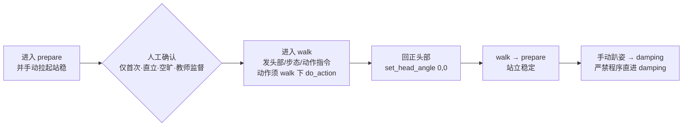

# U1-L4 PPT 内容大纲（确认⑤审核用）

> **课时**：45 分钟　**结构**：五部分 · 约 26 页

---

## 一、标题系统设计（课件规范）

每页 PPT 采用三层标识，使标题既对应课程部分、又呈现本页独立焦点：

1. **章节标签（页眉小字 / 色块）**：对应课程大块，如 `第二部分 · 步态与预定义动作`。
2. **页面主标题（大字）**：本页核心内容，如 `set_head_angle 的参数与约束`。
3. **副标题（主标题下一行，以「——」引出本页聚焦点）**：如 `—— 一个接口，两个角度，只听 walk 的`。

> 约定：章节标签决定“在课程的哪一段”，主标题+副标题决定“本页讲什么”。**不把课程设计的内部思考逻辑写进课件标题**，学生只见学习内容与问题。本课涉及真机移动，安全强约束页面用警示红 `#E5484D` 作点缀（其余仍守清新白底基调）。

---

## 二、页面清单（约 26 页）

| #   | 章节标签                 | 页面主标题                  | 副标题（——）                               | 类型  | 核心内容要点                                                                                                                                                                        |
| --- | -------------------- | ---------------------- | ------------------------------------- | --- | ----------------------------------------------------------------------------------------------------------------------------------------------------------------------------- |
| 1   | 导学                   | 头部、步态与预定义动作            | —— 让 K1 会看、会走、会做                      | 封面  | 单元 U1 人形机器人初探与运动控制／课时 L4／主讲人                                                                                                                                                  |
| 2   | 导学                   | 本课目标                   | —— 一节课我们要带走什么                         | 目标页 | ① 头部坐标系 pitch / yaw，用 `set_head_angle` 控头　② `set_gait` 切换足球 / 标准步态　③ `do_action` 调用预定义动作、用 `TaskHandle` 确认终态，体验开环组合行为                                                         |
| 3   | 第一部分 · 头部坐标系与角度指令    | 从“能走”到“会看、会做”          | —— 脑袋和走路姿势也能编程吗？                      | 互动页 | 回顾上节课已让 K1 按指令走；提问“想让它走路时脑袋转向一边看东西，程序怎么写？”【想一想】                                                                                                                               |
| 4   | 第一部分 · 头部坐标系与角度指令    | 什么是头部坐标系               | —— 以机器人头部为参照的两个角度                     | 知识页 | 头部自身坐标系：`pitch`（俯仰，低头 / 抬头）、`yaw`（偏航，头向左 / 向右）；单位 rad。图文：头部角度示意                                                                                                               |
| 5   | 第一部分 · 头部坐标系与角度指令    | 两个角度的正方向               | —— pitch 正 = 低头 · yaw 正 = 头向左         | 知识页 | pitch 正值 = 低头（看地面）；yaw 正值 = 头向左转。图文：正方向标注图；【注意】与 L3 机身 yaw 同名但控制对象不同                                                                                                          |
| 6   | 第一部分 · 头部坐标系与角度指令    | set_head_angle 的参数与约束  | —— 一个接口，两个角度，只听 walk 的                | 知识页 | `set_head_angle(pitch, yaw)`：两参数同时设置、立即生效；仅 `walk` 有效，`prepare` / `damping` 下报错。表格：参数 / 含义 / 正方向 / 模式约束                                                                       |
| 7   | 第一部分 · 头部坐标系与角度指令    | 头部视野与运动                | —— 边走边转头，能看更宽                         | 知识页 | 头部相机是“看世界”的主要来源；行走中改变 `yaw` 可扫描更宽视野，是后续“看到目标再行动”的基础。图文：视野扫描示意                                                                                                                 |
| 8   | 第一部分 · 头部坐标系与角度指令    | 三个头部动作对照               | —— 低头 / 转头 / 回正怎么写                    | 知识页 | 对照表：`set_head_angle(0.3, 0)` 低头、`(0, 0.5)` 头左转、`(0, 0)` 回正。图文：三动作箭头示意                                                                                                         |
| 9   | 第二部分 · 步态与预定义动作      | 除了脑袋，还能怎么“走”和“做”       | —— 引出步态与动作库                           | 互动页 | 问题式过渡：机器人“怎么迈步”可调吗？厂家还准备好了哪些现成动作？【想一想】                                                                                                                                        |
| 10  | 第二部分 · 步态与预定义动作      | 步态是什么                  | —— soccer 踢球步 vs default 标准步          | 知识页 | `set_gait("soccer" \| "default")`：步态决定“怎么迈步”；足球步态重心靠前、标准步态更稳。表格：两种步态差异                                                                                                        |
| 11  | 第二部分 · 步态与预定义动作      | 预定义动作库                 | —— do_action，一行调用现成行为                 | 知识页 | `list_actions()` 列出动作及 `id`；`do_action(id)` 一行调用，返回 `TaskHandle` 可跟踪任务终态。核心概念：动作库 = 固化好的常用行为，用 `id` 而非名字调用                                                                    |
| 12  | 第二部分 · 步态与预定义动作      | 看清手里的“武器库”             | —— 先列清单，再调用                           | 概念页 | `list_actions()` / `list_gaits()` 只读、不移动；确认每个动作的 `id` 与 `type`（概念预览，代码见实验四 4.1，cell-26）                                                                                       |
| 13  | 第二部分 · 步态与预定义动作      | 本课认知主线                 | —— 头部 + 步态 + 动作 = 组合行为                | 总结页 | 收束：会用三个接口（set_head_angle / set_gait / do_action），下一步把它们组合成“边走边转头”等行为                                                                                                          |
| 14  | 第三部分 · 头部·步态·动作实验与安全 | 动手前，先守规矩               | —— 真机移动与大幅动作的安全底线                     | 过渡页 | 问题式过渡：接下来 K1 会动头部、换步态、做大幅动作，比“原地切换”更需谨慎；引出实验安全规范                                                                                                                              |
| 15  | 第三部分 · 头部·步态·动作实验与安全 | 实验安全规范                 | —— 空旷 · 在场 · 有预案                      | 知识页 | 四条：① 场地空旷、无易撞物　② 教师与同伴在场　③ 明确急停与收尾　④ 大幅动作前确认空间充足。【⚠ 安全提示】红点缀                                                                                                                  |
| 16  | 第三部分 · 头部·步态·动作实验与安全 | 实验准备：连接 K1             | —— 先连上，进实验再看清清单                       | 代码页 | `BoosterRobot()` 建立连接（仅连接，不移动）。对应 2.1（cell-7）；动作库清单在实验四 4.1（cell-26）调用前查看                                                                                                     |
| 17  | 第三部分 · 头部·步态·动作实验与安全 | 进入行走态（仅首次需人工窗口）        | —— 确认后才发 walk，后续只注模式                  | 知识页 | 时序：进入 prepare 并手动拉起 → 人工确认（仅首次）→ 进入 walk → 调头部/步态/动作（动作须 walk 下）→ 回 prepare → 手动趴姿 → damping（严禁程序直进 damping）。Mermaid；【⚠ 安全提示】人工确认红点缀                                          |
| 18  | 第三部分 · 头部·步态·动作实验与安全 | 代码 · 头部控制              | —— set_head_angle(0.3, 0) 等           | 代码页 | 低头 / 转头 / 回正三行；对应 notebook 2.3–2.5（cell-10/12/14）。顶部注明“机器人处于 walk 模式”                                                                                                         |
| 19  | 第三部分 · 头部·步态·动作实验与安全 | 代码 · 步态切换              | —— set_gait("soccer") / "default"     | 代码页 | 足球步态走一段、标准步态走一段对比；对应 3.2/3.3（cell-19/21），进 walk 沿用实验二首次人工窗口（见页 17）。注明“当前在 prepare 直立，直接进 walk”                                                                                |
| 20  | 第三部分 · 头部·步态·动作实验与安全 | 代码 · 预定义动作与 TaskHandle | —— do_action(id) 调用 + TaskHandle 跟踪终态 | 代码页 | 含 4.1 看清单（cell-26）+ 4.2 探究 ActionInfo/TaskHandle 终态（cell-28）+ 4.3 连续编排两个动作（含 upper_body 与 whole_body 各一，cell-30）；对应 4.1 / 4.2 / 4.3（cell-26 / 28 / 30）。顶部注明“机器人处于 walk 模式”    |
| 21  | 第三部分 · 头部·步态·动作实验与安全 | 代码 · 停止与安全收尾           | —— 先回正，再 walk→prepare，严禁程序直进 damping  | 代码页 | 头部回正（cell-14）+ `set_mode("prepare")`；步态实验停止归零 + prepare（cell-23）；动作实验收尾先 prepare（cell-32），再按约定手动趴姿 → damping（严禁程序直进 damping，cell-33 红字）。对应 2.5 / 3.4 / 4.4（cell-14 / 23 / 32） |
| 22  | 第三部分 · 头部·步态·动作实验与安全 | 观察记录任务                 | —— 把“预期”和“实际”的差记下来                    | 互动页 | 不写代码：每组按指令操作头部 / 步态 / 动作，记录实际现象与偏差，填入实训手册 §五 观察表（开环）。同桌交叉核对【动手试试】                                                                                                             |
| 23  | 第四部分 · 拓展与评价         | 拓展：边走边转头扫描             | —— 见附件《K1 综合行为设计任务卡》                  | 知识页 | 非代码情景：把头部控制与 L3 速度控制组合成“前进同时头部左右扫视”。详细步骤、场地、危险区见实训手册附件提示。图文：组合行为示意占位框                                                                                                         |
| 24  | 第四部分 · 拓展与评价         | 分组实操任务卡                | —— 在监督下完成一次组合行为                       | 互动页 | 分组轮换：prepare → 确认 → 进 walk → 低头/转头/回正 → 切换步态 → 调动作 → 停止收尾；每组一名安全员【动手试试】                                                                                                       |
| 25  | 第四部分 · 拓展与评价         | 本课小结                   | —— 带走三件东西                             | 总结页 | ① 头部坐标系：pitch 低头 / yaw 左转　② 步态 soccer/default 切换　③ 预定义动作库 do_action(id)，并用 TaskHandle 确认动作终态                                                                                  |
| 26  | 第四部分 · 拓展与评价         | 学习评价                   | —— 测一测，带得走多少                          | 总结页 | 下发 3 题评价（判断 / 填空 / 选择，与实训手册「七、检查点、思考题与学习评价」一致）；左小结三卡 / 右评价题卡                                                                                                                  |

---

## 三、重点页详述（图文并茂 / 过渡设计）

### 头部坐标系三页（页 4–6，由浅入深）
- 页 4 什么是头部坐标系：用一张“机器人头部朝前，pitch 管低头抬头、yaw 管左右转头”的示意图，建立“头部也有坐标系”的直觉。
- 页 5 两个角度的正方向：左文右图。右侧画头部侧视/俯视图，标注 pitch（低头箭头）、yaw（向左转弧箭头），并写清正方向约定；下方加一句【注意】与 L3 机身 yaw 的区分。
- 页 6 set_head_angle 参数与约束：表格化呈现两参数的含义、正方向、模式约束（仅 walk 有效），作为学生抄写与回忆的“速查表”。

### 步态与动作库页（页 10–12）
- 页 10 步态：用“踢球用足球步、平时用标准步”的类比，引出 `set_gait` 两种取值与差异对照表。
- 页 11 预定义动作库：用“厂家把一些常用行为固化好、一行调用”的解释，引出 `do_action(id)` 与 `id` 的稳定性，并点出调用返回 `TaskHandle` 可跟踪任务是否结束；可配动作缩略图占位。
- 页 12 看清武器库：列出 `list_actions()` / `list_gaits()` 的返回字段（id / type / duration / interruptible），强调“先列清单再调用”。

### 安全与实验页（页 14–22，本课操作主线）
- 页 14 过渡：从“认知”切到“动手”，大号问句“动手前，先守规矩”，配空旷场地 + 监督场景剪影。
- 页 15 安全规范：四条要点 + 【⚠ 安全提示】红点缀卡，是本课安全基调页。
- 页 16–21 代码与流程：每页顶部统一注明 `对应 notebook <小节>（cell-N）`，与实训手册完全一致。
- 页 17 进入行走态：**重点标注“仅首次需人工窗口”**——本 notebook 只有这一次要停下来人工确认已拉起直立，其余步骤（3.2/3.3 切步态、4.2/4.3 调动作）只在该格前注明所需模式，不重复人工窗口。Mermaid 时序图在“人工确认”节点用警示红标记。
- 页 18–20 三个实验代码：头部 / 步态 / 动作各页，版式统一（上说明 + 下代码高亮行），降低认知负担。
- 页 21 停止收尾：把三个收尾（头部回正→prepare、步态停止→prepare、动作后→prepare 再手动趴姿→damping，严禁程序直进 damping）集中呈现，呼应 L2 安全红线。
- 页 22 观察记录：全班暂停写码，只做开环观察填表，教师巡看核对。

### 拓展与评价页（页 23–26）
- 页 23：组合行为示意占位框，页面右下标注“详细图示见附件《K1 综合行为设计任务卡》”，与实训手册 §六 处理一致。
- 页 24：任务卡版式（勾选列表 + 分组轮换 + 安全员职责），与实训手册 §六 一致。
- 页 25：小结三卡（头部坐标系 / 步态切换 / 动作库），一句一卡。
- 页 26：左小结缩略、右评价题卡，题目与实训手册完全一致。

---

## 四、关键页视觉（Mermaid / 表格，供 PPTX 直接渲染）

**页 4 · 头部坐标系（表格）**

| 角度 | 名称 | 正值方向 | 物理限位（约） |
|---|---|---|---|
| `pitch` | 俯仰角 | 低头（看向地面） | -0.3 ~ 1.0 rad |
| `yaw` | 偏航角 | 头向左转 | -0.785 ~ 0.785 rad |

**页 6 · set_head_angle 参数与约束（表格）**

| 参数 | 含义 | 正方向 | 模式约束 |
|---|---|---|---|
| `pitch` | 头部俯仰 | 正值 = 低头 | 仅在 `walk` 模式下有效 |
| `yaw` | 头部偏航 | 正值 = 头向左转 | 仅在 `walk` 模式下有效 |

**页 8 · 三个头部动作对照（表格）**

| 指令 | 动作 | 方向 |
|---|---|---|
| `set_head_angle(0.3, 0)` | 低头 | 看向地面 |
| `set_head_angle(0, 0.5)` | 头向左转 | 向左 0.5 rad |
| `set_head_angle(0, 0)` | 回正 | 中位 |

**页 10 · 两种步态对照（表格）**

| 维度 | `soccer`（足球步态） | `default`（标准步态） |
|---|---|---|
| 适用 | 踢球等前倾动作 | 日常平稳行走 |
| 重心 | 更靠前 | 居中更稳 |
| 本课定位 | 对比体验 | 对比体验 |

**页 11 · 预定义动作库（版式说明）**

| 元素 | 内容 |
|---|---|
| 读取 | `list_actions()` 返回 `ActionInfo`：id / type / duration / interruptible |
| 调用 | `do_action(action_id)`，参数用 `id` 而非名字；返回 `TaskHandle` |
| 本质 | 厂家固化好的常用行为，用 `id` 调用、用 `TaskHandle` 跟踪终态 |

**页 17 · 进入行走态时序（Mermaid flowchart，仅首次人工窗口）**



**页 18 · 头部控制代码（高亮建议）**

```python
robot.set_head_angle(0.3, 0)    # 低头约 0.3 rad（walk 模式下）
robot.set_head_angle(0, 0.5)    # 头向左转 0.5 rad
robot.set_head_angle(0, 0)      # 回正
```

---

## 五、代码展示页对应 cell（高亮建议）

| 页面 | notebook 位置 | cell | 高亮 |
|---|---|---|---|
| 16 | 2.1 连接 | cell-7 | 高亮 `BoosterRobot()` |
| 17（人工窗口说明） | 2.3 进入行走态（首次） | cell-9（红字确认）/ cell-10 | 高亮“手动拉起、walk 模式”确认与首个 head 指令，页顶部加【⚠ 安全提示】人工确认条（仅首次） |
| 18 | 2.3–2.5 头部控制 | cell-10 / cell-12 / cell-14 | 高亮三行 `set_head_angle` |
| 19 | 3.2 足球 / 3.3 标准（进 walk 沿用页 17 窗口） | cell-19 / cell-21 | 高亮两 `set_gait` 与 `set_velocity` |
| 20 | 4.1 看清单 / 4.2 探究 / 4.3 连续编排 | cell-26 / cell-28 / cell-30 | 高亮 `list_actions`、`do_action(id)` 与 `TaskHandle` 的 `wait()` / `done()` |
| 21 | 2.5 / 3.4 / 4.4 收尾 | cell-14 / cell-23 / cell-32 | 高亮回正、`set_mode("prepare")`（动作后严禁程序直进 damping，见 cell-33 红字） |

> 代码页顶部统一注明 `对应 notebook <小节>（cell-N）`，与实训手册完全一致，便于学生对照抄写。仅页 17 因涉及“首次进入 walk 的手动拉起”加一行警示红提示条；其余页按改轻后的约定，只在代码前用一句话注明所需模式。

---

## 六、互动 / 演示页设计

- **页 3 导入**：口头提问“想让它走路时脑袋转向一边看东西，程序怎么写”，让学生先猜再讲；不给答案，留到页 4–6 揭示。
- **页 9 引出步态与动作库**：大号问句“除了脑袋，还能怎么‘走’和‘做’”，让学生意识到步态可调、动作可调用。
- **页 15 安全规范**：投影此页时同步宣布安全纪律，确认全班站位与急停手势后再进实验区。
- **页 17 进入 walk**：投影时序图时强调“人工确认节点仅首次、不可跳过”，教师逐组核对“已直立站稳”后才允许运行；后续进 walk 只注模式不重复窗口。
- **页 22 观察记录**：全班暂停写码，只做开环观察填表；教师逐组巡看，要求同桌互报核对后签字。
- **页 24 分组实操**：分组轮换，每组指定一名安全员；教师先完整示范一遍再放手。
- **页 26 评价**：当堂独立完成 3 题（判断 / 填空 / 选择，题目与实训手册「七、检查点、思考题与学习评价」一致），教师收后讲评。

---

## 七、备注

- 全册沿用 U1-L1 / L2 / L3 已确认的视觉模板（§8.12：清新白底 · 微软雅黑 · 页脚仅页码 · 代码页浅色底）；本课新增**警示红点缀**用于页 15（安全规范）、页 17（首次人工确认窗口）的安全提示元素，不改变整体基调。
- 图文并茂页（头部坐标系页、动作对照页、步态对照页、组合行为页）需配头部角度示意、动作方向箭头、步态差异图、组合行为示意，图片素材后续统一准备（与实训手册附件《K1 综合行为设计任务卡》协同）。
- 涉及行走 / 大幅动作的配图须选取周围空旷、有人监督的规范场景照片，避免示范出不安全画面。
- 代码页（页 16–21）保持与 notebook 完全一致；cell 编号以当前 notebook（42 cells）为准。
- 核心概念标注：俯仰角 A08、偏航角 A09 为本课引入（A09 在 L3 作“机身 yaw”轻量引入，本课扩展到“头部 yaw”需明确区分）；本课仍严格开环，不引入闭环 / 里程计 / IMU（属 U2 / U4）。
- 与 L3 一致：安全页的“人工窗口”按 L4 改轻后的约定——仅首次进入 walk 保留完整人工确认，其余步骤仅注模式，不逐格重复拆分（见 §3.8 修订与实训手册 §二、2.3 注释）。
