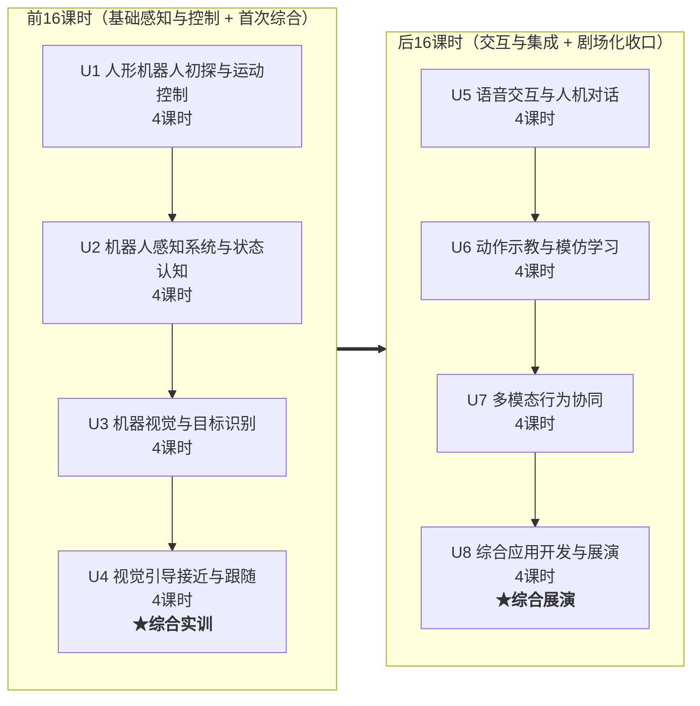

# X 课程大纲（v5.0）

> **U4最新主线（2026-10-29）**：L2实测框高停止阈值；L3跟随移动目标，视觉决定方向与跟进/暂停；L4加入连续到位、致意前复核和流程交接。IMU/里程计记录机身运动，结束后分析位移与朝向。[重设与验证](实验验证/U4-L3-L4_视觉移动跟随重设与验证.md)；旧静止双对照和里程计到位方案不再用于新L3/L4。

> **U4后续课同步（2026-10-29）**：L3明确方向反馈与行进量同循环，记录比较条件；L4通过函数返回连接流程，框高仅作启动触发，未接入L2视觉停止程序。L2三组记录分别引用，触发位置另行标定。[同步审查](实验验证/U4-L3-L4_承接新版L2的同步审查.md)；控制代码和确认状态不变。

> **U4-L2现稿同步（2026-10-29）**：用户重开发稿已逐格回读，第五部分按实际行走/速度比较、框高标定核对、阈值程序重写；36格（26 Markdown/10代码）。目标、反比例解释及生成器已同步，用户代码和执行信息保留；未新增确认①②或P2通过。[阶段依据与待验项](实验验证/U4-L2_重开发回读与第五部分同步.md)。L2采用分组实验记录，不再要求同一次停靠强制取得三项距离；L3/L4既有控制流程未据此改写。

> **v5调整（2026-10-28）**：按用户授权重排U7、U8。U7以多路数据和多模态流程为主线，引入足球定位、机器人坐标与自动踢球；U8明确为“导览、踢球”二选一的应用开发项目。U1～U6沿用v4现状，历史确认不延伸至新写代码。U7/U8八课为P1新稿，待确认①及逐格真机②。
>
> **本版范围**：保留32课时、每单元4课时。L1的订阅回调不以先学线程为条件；L3正式引入线程与共享数据。多传感器融合在U7-L1定义并说明与联合判断的区别，多模态指视觉、语音与动作等信息和行为方式的协作。足球使用视觉估计的机器人坐标，不假定检测框自带距离；不开展深度学习、强化学习训练或自动导航算法教学。

> **U6重构（2026-10-26）**：现行分工见本文件U6表；实施节奏与验证项见[单元重构记录](实验验证/U6_单元重构与动作编排核验.md)。新稿待确认①与受影响内容确认②。

> **U4距离实验审核（2026-10-26）**：[复评与文字校对](实验验证/U4-L2-L4_距离实验复评与文字校对.md)指出1.2米处框截断、拍摄姿态变化、已知起步间距与自主测距的区别，建议策略2主线。三课文字已校对，实验与代码未变；课程主线和标题调整留待方案确定，未登记新确认。

> **代号**：X 课程（最终名称待定）
> - 具身智能应用与开发
> - 人形机器人开发实训
> - 具身智能机器人实践
>
> **定位**：以 K1 机器人为载体、BoosterOS SDK 为核心的实训实操基础课
>
> **总课时**：32 课时（8 单元 × 4 课时/单元，每单元 2 次课 × 90 分钟连排）
>
> **v4历史调整（U7/U8以本版新表为准）**：
> 1. **单元重新排序并均一化**：8 单元统一为每单元 4 课时（原 v3 为 2/4/6 不等）。
> 2. **U2 前置为「机器人感知系统与状态认知 + ROS2 通信基础」**，把原 U1 的 ROS2/传感器内容下沉，并为 U4 融合控制预埋传感基础。
> 3. **U3 机器视觉与目标识别**承接原 v3 的视觉单元；U4 升级为**视觉引导接近与跟随（闭环与多路信息综合实训）**，引入「闭环/反馈控制」新主线，并让学生通过不同距离线索的对照练习误差核查。
> 4. **U6保留4课时「动作示教与模仿学习」**：L1概述，L2录制与回放，L3通过动作工坊开展视频动作训练，L4混合素材编排（2026-10-26重构）。
> 5. **U7 重构为「多模态行为协同（面向小剧场预演）」**，U8 定为 **4 课时「综合剧场设计与展演」**，形成后 16 课时的剧场化收口。
> 6. **明确不引入 ArUco/OpenCV 二维码库**：U4 联合参考相机、里程计和 IMU 的读数，理解各自用途，并用视觉距离线索和卷尺核查里程计推算结果；不要求实现统一定位、误差优化或传感器融合算法。

---

## 一、课程定位

### 1.1 在课程体系中的位置

```
通识理论课         →    数采课程(具身智能基础,挂起)  →   X课程(本课程)          →   Z课程(AgentFramework)
(具身智能/AI概念)     (采集/标注/训练全链路)            (BoosterOS SDK          (Agent开发框架,
                                                      实训实操基础)             含界面与生命周期的应用开发)
```

> 数采课程当前挂起。**U6动作示教与模仿学习**结合轨迹录制与回放、动作工坊训练实践和动作编排。学生通过Studio使用视频提取、重定向与Booster Train强化学习训练流程，不要求编写训练算法；`.btraj`直接回放与训练策略分别说明。动作工坊新SDK入口测试中，用户确认后接入作品。

### 1.2 顶层目标

1. **衔接前置（非必须前置）**：把「具身通识理论课」的抽象概念（计算机视觉、运动控制、传感器、语音等）通过 K1 实操具象化。
2. **SDK 能力全覆盖**：以 BoosterOS SDK 为核心，系统性练习 K1 的各类接口。
3. **双阶段、双综合**：前 16 课时（U1–U4）建立「感知—控制」基础并完成**第一个综合实训（U4 视觉引导接近与跟随）**；后 16 课时（U5–U8）进入「交互—集成」并完成**应用开发与展演（U8）**。
4. **轻任务、多实践**：每单元一个轻量项目，U4 与 U8 为两个综合性验收节点。

### 1.3 设计原则

- **均一课时**：每单元 4 课时，匹配 90 分钟连排课，便于「2 次课完成一个单元」。
- **双主线**：每单元明确「具身智能知识线 + 技能/应用线」。
- **前后可拆**：前 16 课时（U1–U4）可独立开课，后 16 课时（U5–U8）可续接。
- **新知识随综合项目引入**：U4 引入「闭环/反馈控制」作为全新知识脊柱，串联视觉伺服、距离线索的粗略标定、多路信息的分工与误差核查。
- **行业/职业认知融入**：在知识线中设置可选「行业/职业认知」了解模块（轻量、不占主课时），帮助学生建立"所学即所用"的岗位连接。主要锚点：**U1 人形机器人产业与岗位地图 → U4 机器人应用开发工程师职责 → U8 智能服务机器人行业趋势与职业路径**，三个锚点首尾呼应形成一条认知线。

### 1.4 先修假设

- 学生已完成「具身智能通识 / AI 通识」等理论课程（了解基本概念词汇） ——（非必须）
- 学生已具备 Python 基础、Linux 基础操作能力 ——（非必须）
- 学生**未**接触过 K1 机器人（U1 承担 SDK 入门任务）

---

## 二、课程总览

| 单元     | 标题                 | 课时     | 占比        | 小项目产出                  | SDK 能力覆盖                                            | 阶段         |
| ------ | ------------------ | ------ | --------- | ---------------------- | --------------------------------------------------- | ---------- |
| U1     | 人形机器人初探与运动控制       | 4      | 12.5%     | 模式/运动调试工具              | 连接/信息/模式/速度/头部/步态/预定义动作                             | 前16·基础     |
| U2     | 机器人感知系统与状态认知       | 4      | 12.5%     | ROS2 CLI 操作 + 状态监视器    | ROS2 通信五元组/相机/IMU/里程计/电池/摔倒                         | 前16·基础     |
| U3     | 机器视觉与目标识别          | 4      | 12.5%     | 方位检测器                  | 目标检测/结果解析/置信度/多目标                                   | 前16·基础     |
| **U4** | **视觉引导接近与跟随（综合实训）** | **4**  | **12.5%** | **「接待员机器人」行为原型**       | **L2核对位移与标定框高阈值；L3/L4视觉控制移动跟随与到位，IMU/odom记录位移、方向和朝向** | **前16·综合** |
| U5     | 语音交互与人机对话          | 4      | 12.5%     | 迎宾语音 Agent             | ASR/TTS/LLM 对话                                      | 后16·交互     |
| U6     | 动作示教与模仿学习          | 4      | 12.5%     | 两版轨迹 + 视频训练任务 + 混合动作作品 | 示教/回放/骨架提取/重定向/参考动作训练/编排                            | 后16·交互     |
| U7 | 多模态行为协同 | 4 | 12.5% | 多路观测、足球坐标与踢球实验、并发与流程片段 | 订阅/队列/多传感器融合概念/足球检测与坐标/自动踢球/线程/多模态交接 | 后16·集成 |
| U8 | 综合应用开发与展演 | 4 | 12.5% | 导览或踢球项目、测试记录与答辩 | 需求拆解/模块接口与分工/程序整合/彩排复测/展演答辩 | 后16·综合 |
| **合计** |                    | **32** | **100%**  |                        |                                                     |            |



---

## 三、各单元详细设计

### U1：人形机器人初探与运动控制（4课时）

> **定位**：学生第一次具身智能的实体机器人开发，本单元将建立“具身智能→人形机器人→应用”的知识线以及“机器人基本结构→机器人连接→执行器开环控制”的实操活动。本单元为**开环**操作（发指令、看结果），初步建立机器人操作的基本认知，并将与 U4 的「闭环」形成对照。
> **知识锚点**：「具身智能橄榄」「机器人结构」「执行器控制」「开环操作」
> **注**：U1-L1 实验代码包已交付（`实验代码/U1-L1_K1连接与信息/`）。

| 课时    | 主题             | 具身智能知识线                                           | 编程/应用线                                                                                                         | 核心概念                                        | 轻量概念                         | 轻任务                                           |
| ----- | -------------- | ------------------------------------------------- | -------------------------------------------------------------------------------------------------------------- | ------------------------------------------- | ---------------------------- | --------------------------------------------- |
| **1** | 具身智能概览 + 连接 K1 | 人形机器人系统组成：感知→计算→运动→电源；具身智能定义                      | `pip install boosteros` → `BoosterRobot()` → 连接验证；`robot_info`/`list_joints()`/`list_actions()`                | **SDK(E06)**：操作机器人的统一入口                     | 关节状态(A10)                    | ① 连接 K1，打印 `robot_info`，浏览关节与动作列表             |
| **2** | 运行模式与安全        | 机器人运行模式：damping/prepare/walk；安全规范（STAND 确认、模式优先级） | `set_mode("prepare")` → `set_mode("walk")` → `set_mode("damping")`                                             | **终端调试(E07)**：print/log 是第一调试手段             | 参数(C08)轻量引入                  | ② 模式切换练习：damping→prepare→walk→damping，记录各模式特征 |
| **3** | 基本运动控制         | 运动模型：`vx/vy/vyaw` 速度控制；机器人坐标系定义                   | `set_velocity(vx, vy, vyaw)` → 前进/后退/左转/右转实验                                                                   | **偏差(A05)**：目标位置 − 当前位置；**开环(B09)**：发指令不管结果 | Pitch/Yaw(A08/A09)：低头抬头/左右转头 | ③ 基本运动实验：前进 1m/s 走 2 秒→后退→转向，观察轨迹             |
| **4** | 头部、步态与预定义动作    | 头部控制与视野；步态对效率/稳定性的影响；预定义动作库                       | `set_head_angle(pitch, yaw)`（walk 模式）→ 边走边扫描；`set_gait("soccer")` vs `"default"`；`do_action("wave"/"bow"/...)` | —                                           | —                            | ④ 组合运动：边走边转头扫描；⑤ 足球步态 vs 默认步态对比；⑥ 调用 3 种预定义动作 |

**单元产出**：机器人信息报告 + 模式切换脚本 + 基本运动脚本 + 头部/步态/动作演示记录

> 💡 **行业/职业认知（可选了解模块）**：人形机器人产业现状与典型岗位地图（本体厂商研发 / 系统集成 / 应用开发 / 运维实施），建立"学这门课将来能干什么"的初步认知。

---

### U2：机器人感知系统与状态认知（4课时）

> **定位**：围绕具身智能「感知自身」和 ROS2 通信基础进行设计。本单元对传感器采取**监测/观测**视角（读懂数据含义），为 U4 的「用传感器做控制」铺垫——U2 看数据，U4 用数据。
> **知识锚点**：「ROS2 通信」「IMU/惯性」「里程计」「机器人状态管理」

| 课时    | 主题           | 具身智能知识线                                              | 编程/应用线                                                                  | 核心概念                                                              | 轻量概念              | 轻任务                                                                |
| ----- | ------------ | ---------------------------------------------------- | ----------------------------------------------------------------------- | ----------------------------------------------------------------- | ----------------- | ------------------------------------------------------------------ |
| **1** | ROS2 通信基础 | 多个机器人功能之间的数据交换；ROS2 与 Ubuntu 的关系；发布与订阅 | `ros2 topic list` / `info` / `echo --once` / `hz`；Studio 发布、订阅体验 | **节点(C01)+话题(C02)+发布(C03)+订阅(C04)+消息(C05)** | 事件循环(E01)+回调(E02) | ① 观测 `/boostercamera/head/rgb`；记录消息类型、端点数量和本机观测频率；比较 Studio 订阅前后变化 |
| **2** | 传感器速览 | 相机、IMU、里程计、关节、电池的数据含义与消息类型；快照与订阅 | Studio 看相机；`get_imu()`、`get_odom()`、`get_joint_states()`、`get_battery()`；`subscribe_imu()` 与退订 | 消息类型(`sensor_msgs/Image`、`sensor_msgs/Imu`、`nav_msgs/Odometry`) | — | ② 读取加速度、角速度、RPY、位置、关节角、电量；比较时间戳，订阅 IMU 并记录接收条数 |
| **3** | IMU 与里程计（观测） | 加速度、角速度与姿态估计；位置估计、漂移与清零的作用；一般原理与 K1 已核实接口的区别 | `get_imu()` 读加速度和角速度；`get_odom().rpy` 读姿态，`pose_2d` 读平面位姿；`reset_odom()` 重设参考 | **坐标变换(A11)**：目标的 odom 坐标→机器人前方、左侧距离 | 定时器(C09)：以循环体验定时采集 | ③ 支撑下缓慢侧倾，比较静止基准；④ 用 90°、180° 假设位姿解释方向；⑤ 0.2 m/s 走 2 秒后停止，比较指令距离、里程计与卷尺位移 |
| **4** | 状态监测与融合 | 电池、摔倒状态与模式的含义；多来源状态综合判断与融合算法的区别 | `get_battery()`、`get_fall_down_state()`、`get_mode()`；循环读取、联合告警与起身条件检查；教师确认后可演示 `get_up()` | **多传感器融合(B08)**：从多来源信息的综合判断入门 | — | ⑥ 状态监视器；⑦ 电量与模式的联合告警，用四个假设情景检验分支；⑧ 起身条件检查，不制造摔倒 |

**单元产出**：ROS2 CLI 观察记录 + 传感器读数与订阅记录 + 姿态变化记录 + 坐标换算与三距离对照 + 状态监视、联合告警与起身条件检查代码

> **概念范围**：C09 在本单元用 Python 循环与等待体验定时采集，不创建 ROS2 Timer；B08 从多来源状态的综合判断入门，不实现姿态融合算法。相机编程取数留在 U3。

---

### U3：机器视觉与目标识别（4课时）

> **定位**：建立「机器人视觉 ≠ 图片观赏，而是从图像中提取结构化信息」的认知。本单元只做**感知**（看见并理解检测框），**不触发运动**——与 U4「据所见去行动」形成明确分界。
> **知识锚点**：「计算机视觉」（目标检测、置信度、检测框）
> **与 U2 的边界**：U2-L2 只用 BoosterStudio **观察**相机话题在流数据（图形化看见画面），**不写任何相机代码**；相机的编程取数（抓帧、图像编码、订阅与保存帧从 U3-L1 开始；图像坐标系从 U3-L2 开始）**全部属本单元独占**。

| 课时    | 主题      | 具身智能知识线                           | 编程/应用线                                        | 核心概念                                    | 轻量概念                                                           | 轻任务                                     |
| ----- | ------- | --------------------------------- | --------------------------------------------- | --------------------------------------- | -------------------------------------------------------------- | --------------------------------------- |
| **1** | 机器人"眼睛" | 相机成像（方格阵列/感光单元→像素）、位深（黑白/灰度/彩色）、图像编码格式（nv12/bgr8/rgb8/mono8/mono16；**单通道≠灰度**；命令行 nv12 vs Python bgr8 揭示 SDK 做了格式转换） | `get_image()` / `get_image(img_type="depth")` / `subscribe_image()`、回调中保存图像帧；`ros2 topic echo --field encoding` 查编码 | —                                       | **CvBridge(E05)**：ROS 消息↔OpenCV 图像 | ① 订阅相机图像流实时显示，按快捷键保存当前帧                 |
| **2** | 目标检测入门  | 目标检测概念（模型输入→推理→输出检测框），不涉及训练原理；图像坐标系（像素坐标：bbox 中心点 / 画面比例，为 U3-L4 方位判断铺垫）     | `Detection(model="default")` → `.detect()` 调用；从检测框读 `center_x`/`center_y`/`bbox` | **YOLO 检测(A01)+检测框(A03)**：模型"圈出"目标位置与类别 | **图像坐标系(A04)**：左上角(0,0)，x→右，y→下 | ② 加载检测模型，对保存图像执行检测，打印 JSON 结果           |
| **3** | 置信度与多目标 | 置信度含义；多目标选择策略                     | JSON 提取：`class_name`/`confidence`/`bbox`；阈值筛选 | **置信度(A02)+归一化(A06)**：坐标缩放到 0–1，不依赖分辨率  | —                                                              | ③ 置信度实验：confidence=0.3/0.5/0.7 对比同一图像结果 |
| **4** | 方位检测器   | 从检测框到方位判断：bbox 中心→画面比例→三段式判断      | 坐标-比例换算、函数封装——输入检测结果，输出结构化信息                  | **主动感知(B04)**：机器人通过移动/转头获取更好视角          | —                                                              | ④ 方位检测器：输出 `(类别, 方位, 远近, 置信度)`          |

**单元产出**：图像采集脚本 + 检测调用脚本 + 方位检测器

---

### U4：视觉引导接近与跟随（4课时）★ 综合实训

> **定位**：这是前三单元之后的第一个综合实践。学生把U1的运动控制、U2的状态读数、U3的目标检测用于转向、阈值停止和移动目标跟随；方向偏差和框高占比决定运动，IMU与里程计记录机身变化，停稳后核对实际位移与间距。其他观测和实测值能为单一读数提供交叉参照，帮助学生发现估计不一致的情况、检查测量条件。课程不要求优化里程计或实现融合定位，单次对照也不足以判断长期误差规律。
> **知识锚点**：「闭环 / 反馈控制」「多路感知信息的综合判断」「视觉伺服」
> **与 U3 的分工**：U3 学习读取检测结果；U4 将目标框位置用于调整转向，并把里程计估计、相机距离线索和 IMU 读数放在各自的使用环节中核对。课程不要求学生实现统一的位置估计或融合算法。

#### 📋 项目外壳：商业展厅迎宾导览行为模块开发（真实项目载体）

> 本单元以展厅迎宾为情境，练习需求拆解、SDK 集成、读数核对与流程联调。学生将相机、里程计和 IMU 信息用于不同判断，并通过测量核查单次结果；课程不要求实现融合定位算法。

- **项目背景（客户委托）**：某科技展厅委托开发 K1 人形机器人的「主动迎宾导览」行为模块——来宾进入展区时，机器人应自主感知、主动接近、礼貌致意并简要介绍。对应岗位：**机器人应用开发工程师**。
- **需求拆解 → 四课时映射**：
  - 转向来宾（L1）：来宾不在正前方时，机器人需转向正对（先转头量出方位、再把身体转过去）
  - 走近来宾（L2）：接近至"舒适社交距离"约 **1.2 m**，不过近也不过远
  - 跟住来宾（L3）：来宾缓慢移动；水平偏差调整方向，框高达到L2实测阈值后暂停前进，远离后可再次跟进；结束后读取位移与朝向。
  - 接待来宾（L4）：发现单一来宾并视觉跟随，连续到位后复核目标和动作空间，再致意；未完成条件阻断后续。
- **验收标准**：
  1. 根据目标框的横向偏差完成转向对准（偏差绝对值小于本实验阈值），并能解释渐进调节比例系数对调整速度、来回摆动的影响；「来宾进入3 m内、约5秒对准」作为任务情境与调参参考，不作硬性计时验收。
  2. 逼近至 **1.2 ± 0.2 m** 舒适距离后自动停稳
  3. 到位后执行教师确认的U1预定义致意动作，区分任务状态和现场效果；语音问候留待U5学习后的应用整合
  4. 能说明视觉的方向/框高反馈与IMU/里程计记录的分工；实际演示近处停止前进、目标远离后重新跟进，记录停止及流程阻断原因，停稳后报告位移与朝向；异常由教师人工中止。不考核侧倾/打滑识别，不制造打滑或行走中的外力扰动。
  5. 引用L2行走、框高标定核对与阈值程序的有效记录，分别用卷尺检查实际位移或间距，解释差异与适用条件；跨次实验注明条件，不拼接为同一次停靠，不要求自动修正里程计。

> 第 1 项按2026-10-22用户反馈调整，5秒不作计时达标要求；当前L1以瓶子作对准目标，不据此宣称已实现3 m来宾触发。第4、5项按多路感知联合使用的入门目标修订；当前接待以单一可用来宾框开始，不设置3 m自动触发；第3项的语音能力留待U5后的应用整合，本轮不提前使用。
- **可选团队分工（轻任务）**：学生分组扮演真实协作——**感知组**（检测 / 方位）、**控制组**（转向 / 逼近闭环）、**集成组**（联调 / 验收），模拟机器人应用开发项目团队。

| 课时    | 主题               | 具身智能知识线                                                                                                         | 编程/应用线                                                                                                                                                                                                                                     | 核心概念                                                                                                | 轻量概念 | 轻任务                                                     |
| ----- | ---------------- | --------------------------------------------------------------------------------------------------------------- | ------------------------------------------------------------------------------------------------------------------------------------------------------------------------------------------------------------------------------------------ | --------------------------------------------------------------------------------------------------- | ---- | ------------------------------------------------------- |
| **1** | 转向来宾（视觉对准）       | 把图像里的框偏差直接当控制量；每轮由偏差决定头转多少；**转头量到的总转角就是目标方位角**（相机在头上、头零位＝身体正前方）；据此把身体转到位；头部量程有限、偏太多时转不到（引出第二种做法）；工程上先转头（快、稳）再转身 | `bbox.center_x` 求偏差；`set_head_angle(0, head_yaw)` 按 `−Kp·error` 增量转头，并记下起始偏差；`odom.pose_2d[2]` 提供自身航向；转身两做法——固定角速度＋里程计阈值（`turn_rad<abs(head_yaw)` 停）／`yaw_rad−Kp·error` 累加＋`time.sleep` 间歇；额外知识 `Kpx = −degrees(head_yaw)/error0` 反标（只算不用） | **P 控制(B01)**：调整量∝偏差；图像特征当控制量（B10 视觉伺服在本课只做**首次体验**，正式介绍移到 L3）                                      | —    | ① 两法对比：只转头（框居中、身体没动）vs 转身对准（头部角度、身体朝向各记一列）              |
| **2** | 走近来宾（距离估计与核对） | 区分计划行进量、里程计位置分量和实际间距；相近条件下比较速度；理解框高反比例近似与实测阈值的用途 | `reset_odom()`清零；STEP04按里程计行进量停止，STEP05比较vx；STEP06取图、检测和画框，STEP07独立核对框高估距，STEP08自主编写阈值停止程序 | **标定(B11)**：已知距离对应与独立核对；**传感局限(B12)**：视野、目标、姿态、起停与测量条件 | — | ② 行走/速度比较及卷尺记录；③ 框高标定、独立误差和停止阈值验证；不要求优化漂移 |
| **3** | 跟住来宾（闭环与视觉伺服） | 单一目标缓慢移动；L1方向反馈与L2框高阈值共同控制，近处暂停而继续观察；IMU/odom另作记录 | 静态分支→短步跟随；偏差大先转向，达到占比后vx=0，目标远离可再跟进；无效目标结束；finally零速度；停稳后算dx/dy、直线位移及方向 | **闭环(B09)**与**视觉伺服(B10)**；位移方向与机身朝向的区别 | — | ④ 跟进—暂停—再次跟进与小幅偏转；⑤ 停稳位移/方向、IMU记录及现场核对 |
| **4** | 接待来宾（视觉跟随与流程联调） | 单一来宾缓慢移动后停留，连续到位与致意交接；视觉控制，其他状态用于运动说明 | 等待→视觉跟随→连续3次到位→现场确认后新观测→预定义动作；函数返回、有限等待、保留旧句柄和退出；不输入起步间距规划总路程 | **多路信息联合使用**：不合成统一位置估计；函数返回和条件交接 | — | ⑥ 一次接待及失败阻断、致意终态与现场表现、停稳位移与朝向记录 |

**单元产出**：转向脚本 + 里程计行走/速度比较、框高标定与阈值验证记录 + 移动跟随及位移/朝向记录 + **「接待员机器人」行为原型**（含一次运行结果及局限说明）

> 💡 **行业/职业认知（可选了解模块）**：商业服务机器人（展厅 / 商场 / 酒店迎宾）是高职机器人专业真实就业方向；了解"机器人应用开发工程师"的岗位职责（需求拆解、SDK 集成、联调验收）与本单元任务高度一致。

---

### U5：语音交互与人机对话（4课时）

> **定位**：引入 K1 的语音-语言能力，建立「语音交互闭环」概念。后 16 课时的新领域入口（同 v3，不变）。
> **具象化锚点**：「ASR」「TTS」「LLM」「人设/角色扮演」

| 课时    | 主题     | 具身智能知识线                            | 编程/应用线                                                          | 核心概念                                    | 轻量概念 | 轻任务                                          |
| ----- | ------ | ---------------------------------- | --------------------------------------------------------------- | --------------------------------------- | ---- | -------------------------------------------- |
| **1** | 语音识别入门 | ASR 概念（声波→文本）；流式 vs 整句识别；延迟对体验影响   | `audio_manager.start_recording()` / `stop_recording()` / `get_recording_duration()` → `AudioData`（`save()`）→ `play_sound()`；`record_stream(chunk_bytes=…)` 拿块 → `play_stream(queue_size=…, overflow=…)` 写块播出；`Speech.recognize_stream(on_result=…)` | **QoS(E03)**：一次拿多少、队列多深、溢出了怎么办——音频流对延迟敏感，缓冲大小与溢出策略决定可靠性/延迟权衡  | —    | ① 我是翻译官：录一句 → 听回放 → 再识别一次，把听到的和认出来的摆在一起对比                       |
| **2** | 语音合成   | 声音怎么造出来（正弦波）；TTS 概念（文本→语音）；音色对体验影响 | `Speech.synthesize(text, voice=…)` + `Speech.list_voices()`；`audio_manager.play_stream()` 写自算 PCM                        | **服务(C06)+动作Action(C07)**：同步调用与异步调用（凭任务句柄取结果）   | —    | ② 自己造一段波形写进播放流；再用两个音色各说一遍同一句话                      |
| **3** | LLM 对话 | LLM 概念（“文字接龙”，不涉及 Transformer）；知识从哪来（训练截止、没写进去的不知道）；幻觉与工程边界 | `Speech.chat(config=ChatConfig(system_prompt=…, welcome_msg=…))` ＋ `enable_subtitle_log=True`——`chat()` 在本课首次出场             | —                                       | —    | ③ 人设实验：3 种 system_prompt（解说员/科普老师/迎宾员）问同问题对比 |
| **4** | 语音会话管理 | 采音、ASR、LLM、TTS、播放的功能关系；一轮问答与持续会话；应用状态与任务状态的区别 | 理解`chat()`返回的任务句柄与无结果数据；查看`trace_id/status/error/done()`，登记状态回调；取消并有限等待、核查终态；用字符串、条件和函数管理开始/查看/停止，阻止未结束时重开 | **状态机(B05)**：待机→会话已发起→停止请求已发出；确认终态回待机，转换依据应用操作与任务结果 | — | ④ 会话管理：连续问答、拦住重复开始、确认停止、重新开始并记录实际状态 |

**单元产出**：ASR测试记录 + 波形与TTS试听记录 + 人设对照记录 + 持续会话管理脚本、状态图及操作记录

> **U5-L4确认①与P2（2026-10-26）**：U5-L4《语音会话管理》于2026-10-26由用户确认①通过，学生设计稿定稿。按用户指令进入P2；文稿与控制逻辑复核完成，整课真机确认②依据待齐，确认③暂不登记。27格（18 Markdown/9代码）主稿原字节保留，生成器已反向同步用户最后两处文字调整。复核及待补依据见`实验验证/U5-L4_P2复核与定稿记录.md`，未进入P3。

> **U5更新（2026-10-23）**：L4第二轮Notebook为27格（18 Markdown/9代码），新增句柄与状态观察实验，待新确认①②；教学审阅与测试步骤见[确认文档](实验验证/U5-L4_教学审阅与真机验证建议.md)。保留持续会话管理方向，停用单轮/分段计时，未引入U7。L1～L3已按用户反馈完成P2修订，保留历史真机确认②及原执行信息，改码部分待定向补验，尚未定稿；详见[P2记录](实验验证/U5-L1-L2-L3_P2复核与修改方案.md)。

---

### U6：动作示教与模仿学习（4课时）

> **定位**：L1为知识引入与方向概述，保留轨迹读取练习；L2完成示教录制、保存读回、实际回放与改录比较；L3通过动作工坊创建视频动作训练任务，承接L1的Booster Train参考动作跟踪；L4围绕具体场景整合素材、顺序编排、试演与改进。直接回放轨迹不等于训练新策略。
> **具象化锚点**：「模仿学习」「动作规划」「机器人轨迹」「数据驱动 vs 规则驱动」「示教再现」「行为克隆」「奖励函数」

| 课时    | 主题           | 具身智能知识线                                                                                                                                                  | 编程/应用线                                                                              | 核心概念                                                                                                   | 轻量概念                       | 轻任务                                     |
| ----- | ------------ | -------------------------------------------------------------------------------------------------------------------------------------------------------- | ----------------------------------------------------------------------------------- | ------------------------------------------------------------------------------------------------------ | -------------------------- | --------------------------------------- |
| **1** | 动作的来源        | 规则驱动：人编写条件、点位与运动程序；示教器与示教再现；模仿学习以行为克隆为例，解释输入—示范动作数据和训练过程；强化学习的观察、动作、奖励与策略；Booster Train 参考动作跟踪中模仿目标与 PPO 训练的结合。比较各自条件与局限，区分 `.btraj` 直接回放和示范数据用于策略训练两条流程 | 读一条教师预录轨迹，打印标识、关节名、时长和采样点数（`TrajectoryData.load()`）；本课不录制或执行动作                      | **模仿学习(B02)**：利用示范学习策略，行为克隆是其中一种；**数据驱动 vs 规则驱动(B07)**：比较动作依据的形成；**强化学习(B18)**：根据环境交互与奖励改进策略，可用于参考动作模仿 | —                          | ① 比较动作依据与两条数据流程；读取并解释预录轨迹信息             |
| **2** | 动作录制与回放      | 示教采集关节时序；录制停顿、节奏与首尾姿态对回放的影响；文件核对与执行效果的区别                                                                                                                 | `with hand_guiding_manager`内录制并停止→退出上下文→保存→读回核对→`execute_trajectory()`；改录第二版比较      | **示教/遥操作(B13)**；**轨迹(B14)**；**回放/重演(B15)**                                                             | —                          | ② 两版轨迹及本课回放观察，说明一项调整及效果                 |
| **3** | 视频动作训练（动作工坊） | 视频骨架提取→imretarget重定向→Booster Train强化学习训练；参考动作与策略、训练结束与效果的区别                                                                                              | 拍摄检查MP4/MOV→创建K1训练任务→记录可见阶段→对照原片与结果→提出第二版方案；未当堂完成时用教师样例并补查本组结果                      | **模仿学习(B02)**与**强化学习(B18)**：参考动作模仿目标与强化学习训练结合；**数据驱动 vs 规则驱动(B07)**复用                                  | 骨架动作、重定向：结合输入输出引入          | ③ 视频、任务记录、结果对照与有证据的调整方案                 |
| **4** | 动作编排         | 不同来源的动作承担场景表达；任务顺序与物理姿态衔接分别检查                                                                                                                            | 3～5步作品脚本；预检全部素材；`execute_trajectory()`与`do_action()`混合顺序执行、等待成功、记录异常及复测；工坊作品按确认接口接入 | **行为编排(B17)**；**预定义动作(B16)**复用U1，不重复设一课                                                                | 状态机与行为树(B06)仅作组织方式拓展，不要求实现 | ④ 至少录制轨迹与内置动作两类素材的作品、日志、修改说明；第三类按可用条件加入 |

**单元产出**：两版`.btraj`及回放比较 + 动作工坊输入视频、训练任务与结果对照 + 混合素材作品脚本、日志与修改说明。演示视频按课堂条件安排；训练未结束或接口未接入的项目标明待补，不作已完成成果。

---

### U7：多模态行为协同（4课时）

> **任务**：为导览与足球两类短场景准备可核对的数据和行为片段。先解决“读到了什么、还能不能用”，再解决“球在哪里、怎样交给踢球控制”，最后处理检测与播报的等待及流程交接。每课从具体工程问题进入，知识讲解与实验相邻安排。

| 课时 | 主题 | 新知与工程问题 | 实践与SDK | 核心概念 | 本课产出 |
| --- | --- | --- | --- | --- | --- |
| 1 | 多传感器订阅 | 同一观察时刻如何查看各路最近数据？回调中保存什么，处理慢时保留什么？定义多传感器融合、多模态及联合判断的区别；解释接收时间与源时间戳 | 图像、IMU、里程计同时订阅；短回调保存数据；定时打印数值、源时间戳、接收后经过时长；queue_size=1比较drop_oldest/drop_newest；with退订 | E09时序观察与比较前提；融合概念不等于已实现融合估计 | 三路状态快照、队列比较、数据是否可用的判断 |
| 2 | 足球定位与自动踢球 | 像素坐标如何变为机器人坐标？球在左侧为何y为正？机器人转动后为何必须更新球坐标？自动踢球由谁控制运动？ | soccer模型筛选实测Ball类别；固定相机条件下地面位置近似标定，卷尺独立核对；SoccerKickManager的start/update_command/update_ball/stop；有限窗口内持续更新，丢球退出 | A11坐标变换、B03感知与行动；标定适用条件 | 球坐标核对表、一次受控踢球观察、实际停止原因 |
| 3 | 多线程协作 | 播报期间如何继续处理图像？共享结果怎样完整交给读取方？停止请求为何不等于线程已退出？ | 一个检测工作线程＋主线程；Thread、Lock、Event、join/is_alive；比较播报前后检测记录、接收后年龄与停止 | E08并发；复用L1数据检查，不宣称精确同步或无延迟 | 感知与播报并发记录、旧结果拒用、线程退出记录 |
| 4 | 多模态流程衔接 | 视觉、语音与运动/动作如何交接？播报之后是否需要重新确认目标？不同API怎样判断任务结束？ | 导览定点介绍与足球短片段；感知→播报→新观测→一次行为；足球只由管理器控制；普通函数与返回原因、任务句柄/管理器状态分别处理 | B17行为编排；程序结果与现场效果 | 两类局部片段的交接表、实际结果与待查问题 |

**课时分工**：L1保持静止，无需自行创建线程；L2完成坐标与踢球基础，标定矩阵求解由有说明的附件承担，不要求学生推导；L3先在不运动条件下观察并发，避免同时增加运动调试负担；L4组合已学片段，提供局部参考，不替学生完成U8整套项目。

**足球实验条件**：使用K1；相机分辨率、头部姿态、机器人站姿与平整地面必须符合标定记录。以同一只球的检测框下缘中点作近似线索，经至少四个不共线标定点建立映射，再用未参与拟合的点核对。该映射不能抵消步态、俯仰及遮挡造成的误差；误差未达到教师依据球与动作范围确定的容许值时，仅做静态定位，不启动踢球。运行中丢球、数据变旧或异常即停止管理器，不反复发送旧坐标。SDK未提供本课可用的“本次踢球成功”返回值，进球与踢出效果由现场或视频记录，不把循环结束当作踢球成功。

**单元产出**：三路数据与队列实验、静态标定及独立核对、踢球记录、并发退出记录、两类流程交接片段。所用数值均为实测或注明假设的练习值；新P1未继承旧U7确认。

---

### U8：综合应用开发与展演（4课时）

> **任务**：小组在“导览、踢球”中二选一，用已学模块完成一项有明确需求与验收条件的应用。重点是需求拆解、接口和分工、程序整合、彩排复测及展演答辩。复用函数时说明来源与修改，不以新增复杂API或算法作为评分要求。

| 主题 | 基础任务 | 可选扩展与范围 |
| --- | --- | --- |
| A 导览 | 在指定接待点检测单名来宾，介绍本组核对过的内容并致意；按现场条件选择已验证的短距离移动 | 定点讲解也可达成；短距离移动需有场地、来宾位置与停止条件。自动导航、真实路线规划、自动返回起点不作基础要求；持续对话按U5-L4管理整个会话 |
| B 踢球 | 检测足球、更新机器人坐标，使用自动踢球管理器完成有限时段的尝试，记录是否踢出及指定目标区的实际结果 | 先通过U7标定核对和管理器实测；选择方向、力度、起点与目标区作为本组需求。自动管理器已控制运动时不另发速度或预定义踢球动作 |

两主题作品原则上不超过2分钟；单次演示5分钟还包含场景说明、运行与证据展示。无需为了延长演出增加重复动作。自主多轮、线程和状态机按需求选择，不强制全部使用。

| 课时 | 学习内容 | 学生应交产物 |
| --- | --- | --- |
| 1 选题与任务拆解 | 读委托、二选一、写完成标准与未完成处理；拆模块、定接口和分工 | 需求验收表、流程、模块接口表、素材与分工清单 |
| 2 核心模块开发 | 阅读功能片段，按本组约定修改模块；分别测试，再接为最小可运行流程；明确跨课文件与版本 | 本组程序、模块测试、接口修订、未解决项 |
| 3 真机彩排与联调 | 按正常与未完成用例测试；据记录改一个要素；同条件复测；核对退出及人工复位后的重跑 | 版本、彩排记录/视频、修改前后对照、验收状态 |
| 4 成果展演与答辩 | 对照需求演示；随机解释两个本组实际使用的概念；说明模块交接、修改依据和局限 | 真机展演、证据、评分与个人说明 |

**评价**：功能完成度30%、概念理解20%、工程组织20%、演示表达30%。工程组织依据接口、分工、版本及修改复测记录；表达依据需求、演示、证据与答辩，动作复杂度不加分。未测或未完成项按实记录。

**实施**：四课均交完整学生Notebook；L1/L4可主要使用Markdown，仍需任务示例、记录、检查和评价。45分钟单场按4组、每组5分钟演示＋3分钟答辩安排；组数超出时分场或在有设备与指导人员的条件下分站，不挤掉切换与收尾。同一机器人只有一名操作员，分组并行不意味着同时发运动指令。

**U7与U8分界**：U7教可复用的技术片段和交接原则；U8要求学生面向本组需求自行取舍、连接和验证。U7的时间戳/队列/线程/坐标不在U8重新开理论课；旧U7完整三幕与幕级日志中适合项目组织的内容移到U8按需使用。

---

## 四、前后 16 课时拆分

| 维度          | 前16（U1–U4）                                      | 后16（U5–U8）                          |
| ----------- | ----------------------------------------------- | ----------------------------------- |
| **主题**      | 感知与控制基础 + 首次综合                                  | 交互与集成 + 剧场化收口                       |
| **SDK 覆盖**  | `BoosterRobot` 核心类：连接/信息/传感器快照/检测/运动/IMU/里程计/状态 | 语音(ASR/TTS/LLM)/示教/多传感器联动/综合编排      |
| **ROS2 覆盖** | 通信五元组（U2 集中）+ 定时器 + 参数                          | 服务 + Action           |
| **综合节点**    | **U4「接待员机器人」**（相机、里程计和 IMU 分工参与接近流程；L2 分别核对里程计行进、视觉估距与实测停止阈值） | **U8导览/踢球应用**（按需求选择视觉、语音与动作） |
| **新知识脊柱**   | U4 引入「闭环/反馈控制」「视觉伺服」「多路信息的分工与核查」「距离线索标定」；不实现融合定位算法 | 多路数据、足球坐标、自动踢球、线程与项目整合 |
| **独立开课**    | 可作为「K1 机器人感知与控制基础」独立开课（U1 连接即可开始）               | 可作为「K1 机器人交互与集成实践」续接（需前 16 基础或等效经验） |
| **具象化概念**   | 机器人系统、计算机视觉、运动控制、传感器、闭环控制                       | 语音处理、对话状态机、动作编排、多模态、剧场表达            |

---

## 附：v4 关键设计决策记录（备查）

1. **U4 的多路信息探究层次**：标准 `detect()` 返回二维检测框，学生用已知距离上的框高比例作粗略距离线索，与里程计推算和卷尺实测并列记录。目标是发现本次读数差异、检查测量条件并确定下一步核查方式；卷尺用于核对实际间距。单次比较不能证明持续漂移，也不要求修正里程计或把读数合成为统一位置估计。深度图的坐标映射、单位换算和无效值处理超出本单元目标。
2. **U4 不引入 ArUco**：本单元已有相机、里程计和 IMU 的读数，可用于练习分工、反馈控制及误差核查；本课不要求自动定位，因此不因缺少统一定位值而增加第三方库。
3. **姿态与角速度字段的使用边界**：U2-L3 已用 `get_odom().rpy` 观察受支撑机器人缓慢侧倾，U4 不重复该操作，也不模拟打滑。U4-L3 的示例读取 `get_imu().angular_velocity[2]`，表示绕竖直轴的角速度；它不能判断 roll 侧倾或打滑，阈值分支也不是安全检测。`IMU orientation` 字段可能为空，不把线加速度读数称为侧倾或打滑检测。
4. **U6训练环节**：L3通过Studio使用动作工坊，理解骨架提取、重定向与Booster Train强化学习训练。教师准备已完成样例应对后台训练跨课时；不要求学生编写算法，也不假定`.btraj`能直接输入训练工程。L4的工坊SDK接入待用户确认。
5. **U2-L2 不写相机代码（2026-09-03 修订）**：原 U2-L2 大纲编程线写 `subscribe_image()`，导致与 U3-L1 重复（抓帧、深度图、订阅相机三处撞车）。修订为：相机在 U2-L2 仅用 BoosterStudio **观察**话题在流，编程取数改用 `subscribe_imu()` 与 `get_imu()` 对照演示「订阅 vs 快照」。跨单元的「速览→深入」会造成"我学过了"的倦怠，同单元内的递进（U2-L2 读 IMU → U2-L3 讲 IMU）才是有效铺垫。
6. **U3-L1 加回 nv12 + 图像坐标系移到 U3-L2（2026-09-07 修订）**：① U3-L1 原「不讲 nv12」取舍撤销——实测命令行 `ros2 topic echo --field encoding` 确实显示 `nv12`，而 Python/SDK 读到 `bgr8`，这一「命令行 vs Python 编码不一致」的认知冲突恰是讲解「SDK 做了格式转换」的最佳入口，故 nv12 加回为主线；知识线随之扩展为「成像→位深→nv12→编码全景→深度 mono16」的认知冲突驱动叙事线。② 图像坐标系(A04) 从 U3-L1 移到 U3-L2：原「画中心十字 / 三等分分区」是为 U3-L4 方位检测器铺垫，改由 U3-L2 讲检测框 / bbox 坐标时承接，避免 U3-L1 知识线过载。

## v5开发与验证记录

2026-10-28按本版重写U7/U8八课P1。最新状态见[X课程当前进度](X课程当前进度.md)；技术依据、迁移范围与逐课测试清单见[重构记录](实验验证/U7_U8_v5重构与验证清单.md)。v4保留作历史对照。
