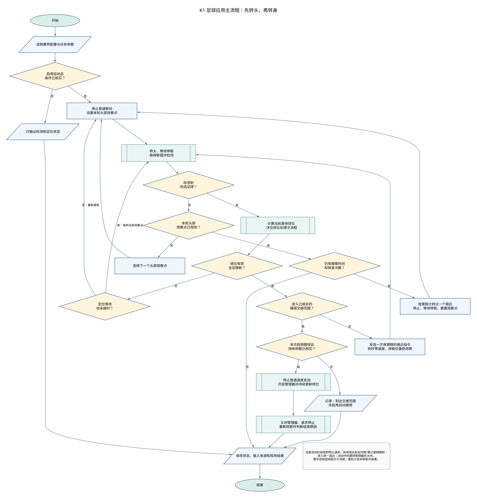
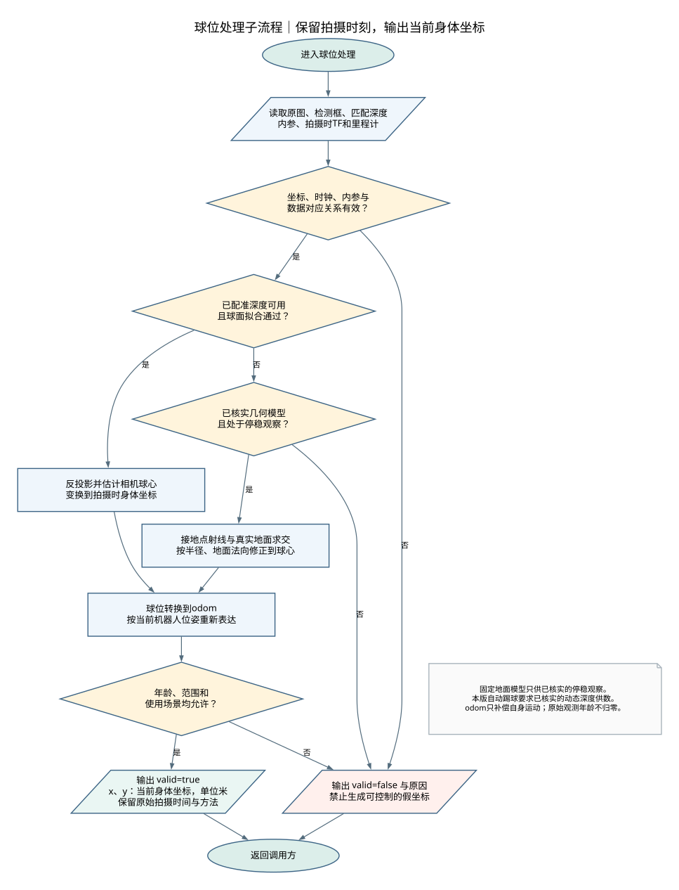
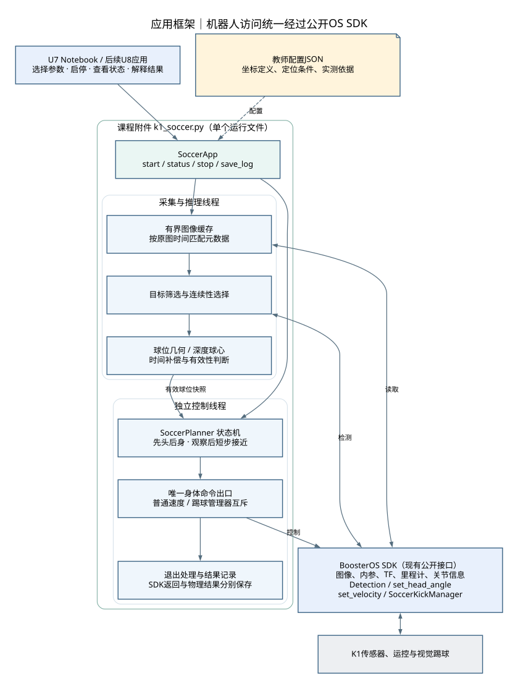
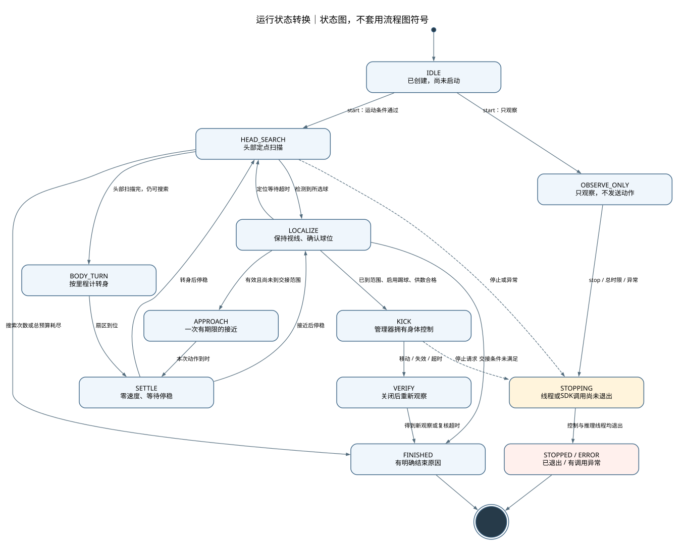

# K1足球全流程与OS SDK课程应用策划案

日期：2026-11-02。用途：为“X课程→U7开发-分支”提供能力依据、应用结构、程序附件和开发约定。

2026-11-03补充：第17节回答新旧策略、教师JSON与SDK封装分工，并保留用户转述的开发者仿真案例。程序更新为v0.1.1-draft，修正合法零坐标被拒绝的问题；37项离线检查通过，仍未运行机器人。

本案采用用户已经认可的技术方向：机器人访问统一使用BoosterOS SDK，课程附件承担状态机、目标筛选、球位计算和退出判断。本次交付策划案、标准图示和单文件程序草案；U7正式Notebook在用户指定的分支中另行开发。

**当前交付状态：设计和离线程序已形成，真机视觉米制定位、持续供数和完整踢出尚未验证。** 现有第4轮记录仍按原结论使用，不因本案或离线检查而升级。

## 1. 项目目标与可实现范围

目标是在经过核实的场地和设备条件下，让K1先用头部寻找足球，必要时再转身体；找到球后计算当前身体坐标，逐次接近；到达交接范围后，由自动踢球管理器完成后续调整与踢球尝试。程序持续观察，并保留各次输入、动作调用和结束原因。

| 需求 | 本案采用方式 | 当前依据或限制 |
| --- | --- | --- |
| 尽可能依赖OS SDK | 图像、检测、内参、TF、里程计、头部、速度、踢球均走公开接口 | 不在课程应用层直接使用ROS节点、DDS发布器或底层运控客户端 |
| 先转头，再转身体 | 定点转头→停稳→新图检测；本轮未找到再转一个身体扇区 | 避免慢检测期间持续扫头导致姿态错配 |
| 检测结果变成踢球输入 | 检测框→相机球心→身体球心→当前身体平面x/y | 相机尺度、配准、坐标原点、时间关系须落实 |
| U7难度适合高职 | 学生选择参数、调用附件、解释状态和结果 | 矩阵、球面拟合、缓存和线程清理由附件实现 |
| 供后续课程调用 | 一个运行文件 `k1_soccer.py`，另附教师配置JSON | 文件是课程应用代码，不是SDK原生模块 |
| 完整踢球 | 在有效球位持续供给的条件下接入管理器 | SDK四方法已调用；完整物理踢出仍待现场证据 |

“依赖OS SDK”允许应用使用Python和NumPy处理数据。SDK提供数据和控制能力；教学代码组织流程并计算球位。没有足够数据时，附件返回无效原因，不构造假球位继续运动。

## 2. 参考资料的分工与采用范围

| 资料 | 本案采用内容 | 需要修正或重新核实的部分 |
| --- | --- | --- |
| DetectBall Workshop | 检测结果结构、头部跟随、丢球后的搜索顺序 | 原程序未包含走近和踢球；头部参数不能照搬本机限位之外的值 |
| 工训课chapter11 | 足球检测、原图像素框、原图时间戳 | 用OS SDK Detection替换独立YOLO/ROS检测节点 |
| chapter12，及14—18中的对应定位模块 | 内参反投影、球面拟合、射线与地面求交 | 深度0.001比例、彩深对应、外参和地面高度不直接沿用 |
| chapter13—15 | 搜索、追球、条件切换的行为分解 | U7采用有限状态机，省去行为树框架与ROS工程组织 |
| chapter16、18 | 将机器人球位x/y写入Kick消息，持续交给VisualKick | 改由SoccerKickManager封装；丢球或超时不记作踢球成功 |
| 本机第1—4轮记录、信息状态采集 | 实际标签、接口返回、相机标识、关节限位、TF清单 | 列表或调用成功不等于定位、动态供数和物理效果通过 |

第18章的定位核心与第12章一致，踢球核心与第16章一致，主要改变了包装和章节说明。复用重点是数据计算与输入约定，学生不需要照搬整个本科工程。

## 3. 能力迁到OS SDK的映射表

“对应方式”分为现有SDK接口与课程自编逻辑。表内自编名称均位于本次 `k1_soccer.py` 中。

| 旧程序调用或结构 | OS SDK中的对应方式 | 迁移后由谁承担 | 必须保留的输入约定 |
| --- | --- | --- | --- |
| ChannelFactory、B1LocoClient初始化 | `BoosterRobot()`，由调用方创建并传入附件 | SDK；Notebook复用已有robot | 不重复创建底层通信客户端 |
| ROS RGB订阅、CvBridge取图 | `subscribe_image(..., img_type="rgb")`；`.to_numpy()` | SDK取图；附件缓存 | 使用原图header、尺寸、相机帧 |
| ROS深度订阅 | `subscribe_image(..., img_type="depth")` | SDK取图；附件按时间匹配 | 与RGB匹配；不按推理结束时再取最新深度 |
| CameraInfo话题/默认内参 | `get_camera_info(camera_id="head")` | SDK提供；附件检查 | k、d、尺寸、frame必须与图像对应 |
| 独立YOLO检测节点 | `Detection(model="soccer").detect(image.to_numpy())` | SDK检测 | 当前实测足球标签为Ball；处理原图像素框 |
| select_best_ball、BallInfo筛选 | `select_ball()` | 课程附件 | 类别、置信度、边界、数值有效性、同目标连续性 |
| /head_pose加硬编码相机外参 | `get_transform(target_frame="trunk", source_frame=图像帧)`，再按已核实关系转换到控制身体坐标 | SDK返回TF；教师确定含义；附件换算 | 数值方向、原点和拍摄时间对应；避免重复叠加相机外参 |
| 头部RotateHead | `set_head_angle(pitch, yaw)` | SDK执行；状态机调度 | rad；先按list_joints核查本机限位 |
| HeadController误差累计跟随 | 定点观察为基础；后续可增加像素误差跟随 | 附件应用逻辑 | 当前慢检测条件下先保持头部稳定 |
| BodyController.Move(0,0,vyaw) | `set_velocity(0,0,vyaw)` | SDK执行；状态机按odom判断扇区到位 | vyaw为rad/s；到时或到位发送零速度 |
| stable_chase_controller速度策略 | `set_velocity()`加有限期限，停稳后重新观察 | 附件 | 不在推理调用中阻塞运动结束 |
| 像素射线/深度球位计算 | `ray_ground_center()`、`depth_sphere_center()`、`locate_ball()` | 课程附件 | 单位米；区分球心、表面点和接地点 |
| 机器人位移、朝向与跨时刻换算 | `get_odom()`；需要时可使用`subscribe_odom()`扩充历史缓存 | SDK提供；附件使用pose_2d | odom是短时间运动参考，不能当成绝对场地定位 |
| 原程序IMU观察 | `get_imu()`/`subscribe_imu()` | 按学习任务选用 | 本版不依赖可能为空的orientation，不凭角速度判断打滑 |
| /vision/ball_position_base JSON | `BallEstimate`对象 | 课程附件 | valid、当前球位、原图时间、方法和原因分别保存 |
| ChangeMode(kSoccer)、VisualKick(True,kV2) | `SoccerKickManager(robot).start()` | SDK管理器 | start可能等待模式切换；返回None不表示踢球完成 |
| 直接发布/kick_ball的球位x/y | `SoccerKickManager.update_ball(x,y)` | SDK管理器 | 必须是当前机器人坐标，x前、y左，单位米 |
| Kick.goal_x/goal_y等目标字段 | `update_command(direction,power)` | SDK管理器 | direction为相对调用时机器人朝向的rad；power范围1—10 |
| 每帧重复发送固定kick方向 | 任务开始时设置一次；确需改变目标时再更新 | 附件/学生参数 | 本机实现会重建odom中的虚拟目标，不能无意每帧重置 |
| FSM/行为树 | `SoccerPlanner`有限状态机 | 课程附件 | 明确进入条件、退出条件和当前身体控制者 |
| VisualKick(False)、Move(0,0,0) | `manager.stop()`后请求零速度 | SDK执行；附件独立记录各次调用 | stop不等于退出原始kSoccer，也不证明物理停稳 |
| 球远了、球丢了、到时即SUCCESS | `ball_moved_observed`、`unconfirmed:*`等独立原因 | 课程附件＋现场观察 | 不自动把流程结束认作踢出或进球 |

本机当前可见28个TF帧。它们提供身体各部位之间的变换名称，不意味着有28种“像素转米制”方法。像素点不属于TF树中的一个三维坐标系；须先通过深度或已核实的地面模型建立尺度。当前清单也没有提供可直接调用的ball、field或odom TF帧。

## 4. 用映射表建立课程能力标准

能力标准以学生能完成的动作和能解释的证据表述，不以附件内部算法的行数衡量难度。

| 能力 | 学生应完成的操作 | 可核对的证据 | 教师/附件承担 |
| --- | --- | --- | --- |
| 选择SDK能力 | 根据寻球、走近和踢球需求，选择图像、TF、odom及控制接口 | 一份需求—输入—接口—输出映射 | 保留本案完整技术映射作为教师依据 |
| 理解检测输出 | 从多个检测结果中识别Ball，说明bbox和置信度 | 原图、检测框、类别与置信度记录 | 筛无效值、越界框和多球连续性 |
| 区分坐标与单位 | 区分像素、相机三维、身体米制与odom坐标 | 同一球位的像素值和米制值；说明x/y正方向 | 内参、外参、球心估计和时间补偿 |
| 使用反馈控制 | 比较前后两次球位，判断继续接近、停止或返回搜索 | 状态、观察时间和一次动作记录 | 有期限的速度控制与独立停止调度 |
| 管理行为交接 | 说明普通速度和踢球管理器何时接管身体 | 状态转换、管理器启停与最后一次球位输入 | 保证同一阶段只有一个身体命令出口 |
| 解释结果 | 根据日志和现场观察，区分调用返回、球移动、踢出和进球 | 程序结束原因＋现场记录，不强制写成成功 | 原图时间保留、异常记录、线程退出检查 |

学生必修侧重输入输出、参数选择、条件判断和结果解释。球面拟合、矩阵推导、时钟匹配和异常清理属于教师附件技术内容；可提供扩展阅读，不作为U7从零编写任务。

## 5. 坐标与定位方案

### 5.1 明确定义所用坐标

| 标记 | 定义 | 用途 |
| --- | --- | --- |
| I | 原始彩色图像，u向右、v向下，单位像素 | 检测框与取深度区域 |
| C | 与该图像相符的相机光学坐标，通常x右、y下、z前 | 内参反投影 |
| T | SDK TF中的trunk | 相机到身体的中间表达，不能仅凭名称认定地面或控制原点 |
| B | 与踢球控制及odom平面姿态一致的机器人身体参考，x前、y左 | 管理器输入x/y的目标表达 |
| O | odom短时间运动参考 | 补偿拍摄后机器人自身平移和转向 |

B是本案的数学记号；不假设TF树里存在名为B或kick的帧。若经核实T与B完全一致，可以将B←T设置为单位矩阵，并保存对应证据；本案示例配置保留null，避免默认认定一致。

### 5.2 深度球心路线

检测框内筛选足球区域的有效深度点。若深度表示光轴方向距离Z，则：

```text
Xc = (u - cx) / fx × Z
Yc = (v - cy) / fy × Z
Zc = Z
```

程序对这些点拟合球面，检查点数、估计半径与残差，再得到相机球心。当前草案采用球心作为统一物理点，输出它在B中的x/y；这一取点约定还须与实际控制表现核对。

```text
p_B(拍摄时) = T_B←T × T_T←C(拍摄时) × p_C
```

从相机直接查询到trunk的TF已经包含相应相机安装与头部关系。使用这条完整变换时，不再叠加本科程序里默认的T_cam_to_head，以免计算两次。

彩色图与深度必须经过实际配准，尺寸、视场和像素对应成立。仅按宽高比例缩放检测框无法普遍解决两相机的视差。草案先支持与彩色图同网格的深度；未配准的深度需要专门的投影与遮挡处理，本版不猜测该关系。

### 5.3 停稳时的几何路线

用检测框底边中心近似球与地面接触的位置，得到相机射线。地面在B中用一般平面表达：

```text
n · p + d = 0
ray_B = origin_B + λ × direction_B
λ = -(n · origin_B + d) / (n · direction_B)
```

射线接近平行地面、交点在相机后方或超出应用范围时，返回无效。按已测半径沿地面向上的单位法向修正，得到球心。框底边并非天然等于真实接地点，遮挡、检测误差和草地边缘都可能改变估计，必须用实际球位核对适用范围。

**trunk原点处的z=0不自动等于地面。** 本版使用明确配置的地面平面，几何法只在教师核实过的停稳姿态下使用。步态中的身体高度、俯仰和横滚改变后，固定平面可能失效。

### 5.4 方法选择

草案优先采用通过质量检查的深度球心；不满足时，只有在几何模型已核实且处于停稳观察阶段，才使用几何法。两条路线都不可用时返回无效原因。

本版没有把“深度中位数对应的可见表面点”直接当成球心作为踢球输入。相机畸变非零且图像未经处理时返回`image_requires_undistortion`；后续可在已确认的图像链中加入去畸变，而不默默忽略d。

**本版自动踢球要求已核实的动态深度供数。** 几何路线可以支撑停稳观察与逐次接近；若要用于管理器自主移动期间，另需建立随姿态变化的地面模型并完成相应核实，不能延伸固定姿态下的结论。

## 6. 时间、数据有效性与慢检测处理

现有记录中，检测中位耗时约2.2—2.4秒。以0.2m/s前进2.3秒为例，自身位移约0.46m，旧图像中的身体球位不能直接作为当前输入。

采集阶段保留原图时间、图像帧、匹配深度、内参、拍摄附近的TF和odom。当前公开get_transform只有最新值，草案在采集时读取并检查它与原图的时间差。若无法满足对应条件，拒绝定位；不在推理结束后用最新姿态替换拍摄姿态。

```text
p_O = T_O←B(拍摄时) × p_B(拍摄时)
p_B(当前) = inverse(T_O←B(当前)) × p_O
```

此换算短时间假设足球未移动。它补偿自身运动，不估计足球滚动，也不能消除里程计漂移。每次补偿仍保留原图时间；高频发送预测球位不代表获得了同等频率的新视觉观测。

| 检查 | 不满足时的行为 |
| --- | --- |
| 检测来自新图，序号和原图时间更新 | 不重复启动同一缓存帧的推理 |
| 目标类别、框边界、置信度和数值有效 | 只报告未选到球，不生成控制坐标 |
| 内参对应当前图像尺寸和帧；畸变满足算法条件 | 返回具体原因，保持观察 |
| 深度与RGB时间及像素对应合格 | 尝试已核实的停稳几何法；否则无效 |
| TF与odom足够接近拍摄时间 | 无效，不用最新姿态覆盖原时刻 |
| 当前球位年龄和范围允许 | 无效；活动管理器停止供数并进入退出 |
| 控制期间odom时钟持续正常前进 | 异常退出，不跨越时钟重置继续换算 |
| 停稳后取得的新帧属于当前动作阶段 | 丢弃上个观察方向或上次移动前的迟到结果 |

程序同时使用传感器时间与本地单调时间。传感器时间用于数据对应和跨时刻位置换算；单调时间用于动作期限、等待与总超时。示例配置中的`clocks_verified`需要实测依据，不能通过直接改为true来建立时钟一致性。

基础控制采用“观察→短步→停止→重新观察”。慢推理放在独立线程；短步到时由控制线程停止。自动踢球阶段还需要足够快的新观测：当前默认踢球年龄上限比2秒检测更短，目的是让不满足供数条件时明确结束；不能把上限随意改大当成延迟已经解决。

## 7. 标准流程图与应用框架

流程图采用常用程序流程图符号：椭圆表示开始/结束，矩形表示处理，平行四边形表示输入/输出，菱形表示判断，矩形内两侧竖线表示预定义子流程。判断出口标注“是/否”或条件结果。框架图和状态图分别使用自己的图例，避免将所有图都画成处理框串联。

### 7.1 主流程



本图保留“先头后身”；定位失败时允许保持视线重新观察或回到搜索。接近动作均有期限。任意活动阶段的停止请求、异常、总时限或累计里程限制，都转入统一退出处理。

### 7.2 球位处理子流程



有效输出是当前B中的米制球位。即使目标检测成功，数据条件不足也会返回valid=false。判断记录应能区分“未检测到”和“检测到了但定位无效”。

### 7.3 模块框架



框架中只有控制线程发送身体命令。采集回调只保留有界图像缓存；推理线程选球、计算并发布球位快照。外部Notebook可播报或保存信息，须复用应用状态；应用活动时不另开检测器争抢同一模型，也不另发身体运动指令。

### 7.4 状态转换



STOPPING为对外运行状态：停止已请求，但至少一个线程尚未退出。它不表示机器人正在主动执行新动作。阻塞中的检测或SDK调用可能尚未返回，因此不会提前报告“全部线程结束”。

## 8. 状态机与控制交接约定

| 状态 | 进入后做什么 | 转出条件 | 身体控制 |
| --- | --- | --- | --- |
| IDLE | 保存对象和配置，不连接额外客户端 | 调用start | 无 |
| OBSERVE_ONLY | 读图、检测、尝试定位并记录 | stop、总时限或异常 | 不发送头部和身体动作 |
| HEAD_SEARCH | 在本轮观察点转头，停稳后用新图检测 | 选到球→LOCALIZE；点用完→BODY_TURN；预算耗尽→结束 | 发送零速度，身体保持停止请求 |
| BODY_TURN | 用odom判断转过扇区；到位或超时停止 | 到位→SETTLE；超时→ERROR | 普通速度 |
| SETTLE | 发送零速度，等待已核实停稳时段 | 转身后回头部扫描；接近后回LOCALIZE | 普通零速度 |
| LOCALIZE | 保持当前视线，等待当前阶段有效球位 | 远球→APPROACH；近球→交接判断；等待超时→搜索 | 普通控制已停止 |
| APPROACH | 按方向先转向或短步前进 | 本次期限到→SETTLE | 普通速度，有限期限 |
| KICK | 开启管理器、设置一次目标，持续更新当前球位 | 球移动、新球位失效或阶段超时→VERIFY | 仅自动踢球管理器 |
| VERIFY | 先关闭管理器，再请求零速度，等新图重新观察 | 得到新观察或复核超时→结束 | 零速度，等待观察 |
| FINISHED | 保留明确结束原因，清理资源 | 本次运行结束 | 请求停止 |
| STOPPED / ERROR | 保存人工停止或调用异常，逐项清理 | 全部线程返回 | 尝试关闭管理器和零速度 |

管理器开启前，先停止普通速度发送。管理器活动期间，附件拒绝普通速度命令。关闭后才能恢复普通控制；本版一次踢球尝试结束即记录，不自动无限重踢。

start可能等待模式切换。草案在start返回后重新检查球位年龄，防止将开启前已经过期的球位送入控制。外部stop只发出停止请求，由控制线程清理；SDK调用尚未返回时，status保持STOPPING，不承诺硬实时停止。

`manager.stop()`关闭视觉踢球并清空参考，不保证退出底层kSoccer。本机公开get_mode可能仍显示walk；不能据此判断原始模式。本附件不自动切换prepare/damping，不自动站起。课程中的首次进入walk和结束后的姿态收尾仍按已有规则安排：prepare下人工确认STAND后再进walk；运动后先稳定进入prepare，坐下后才可进入damping，禁止walk直接切damping。

## 9. 单文件程序交付与调用约定

### 9.1 文件结构

```text
OSSDK足球全流程策划/
  K1足球全流程_OSSDK策划案.md      本策划案
  K1足球全流程_OSSDK策划案.html    离线可浏览版
  k1_soccer.py                    唯一运行模块，v0.1.1-draft
  teacher_profile.example.json    未核实的教师配置示例
  图示/                          4幅图的DOT、SVG、PNG
```

测试、图示生成器与交接记录位于本次任务上下文目录，不需要一起部署到机器人。运行侧除已有SDK及视觉依赖外使用NumPy；导入k1_soccer不连接或驱动机器人，直接运行该文件只打印版本说明。

### 9.2 对外接口

| 接口/对象 | 输入与作用 | 返回或说明 |
| --- | --- | --- |
| `Calibration.load(path)` | 可选的JSON读取入口；也可直接构造Calibration | 保留未核实项；不能把示例文件当成现场标定 |
| `SoccerConfig(...)` | 搜索、速度、时限、交接和检测参数 | 默认allow_kick=false；数值是开发起始值 |
| `SoccerApp(robot, detector, calibration, config)` | 复用调用方已有robot和Detection | 不自行创建第二份机器人连接 |
| `app.start(enable_motion=False)` | 默认启动只观察；显式启用运动需通过配置检查 | 无任务句柄；推理和控制各用一个线程 |
| `app.status()` | 查询运行状态 | 字典：状态、原因、上次观测、线程存活情况等 |
| `app.stop(timeout_s=3)` | 请求退出并有限等待 | 返回状态；线程未退出时为STOPPING |
| `app.save_log(path)` | 保存状态、配置与最近事件 | JSON；不写非标准NaN或Infinity |

底层函数`select_ball`、`locate_ball`、`current_ball`和`SoccerPlanner`可供教师离线检查或后续拆分实验使用。学生主线使用SoccerApp，避免把状态机代码整体复制进Notebook。

### 9.3 只观察的调用示例

以下代码供用户在机器人环境运行，本次未执行。已存在robot和detector时直接复用，省去相应构造。

```python
from boosteros.robots.booster import BoosterRobot
from boosteros.brain import Detection
from k1_soccer import Calibration, SoccerConfig, SoccerApp

robot = BoosterRobot()
detector = Detection(model="soccer")
profile = Calibration.load("teacher_profile.example.json")
app = SoccerApp(robot, detector, profile, SoccerConfig())
app.start()                       # 默认只观察，不发送动作
```

随后在独立单元格查看和停止：

```python
app.status()
```

```python
app.stop()
app.save_log("soccer_session.json")
```

使用示例配置时，检测仍可输出，米制球位会报告未核实。元数据暂不可用时也保留像素检测结果，分别报告定位失败原因；模型推理异常则结束本次运行。

### 9.4 运动与踢球的调用区别

教师有证据的配置保存为独立文件后，复用同一调用结构，仅显式选择`enable_motion=True`。附件要求已核实坐标、时钟、至少一条定位路线及运动参数；还核对本机头部关节名称和限位，并要求调用前已由教师完成站立walk准备。它不会自行跨越人工站立环节。

`allow_kick=False`时，到达交接范围就记录`ready_for_kick_without_activation`并停止。开启踢球还要求动态深度供数已核实及当前球位足够新。学生不通过修改配置中的核实字段来完成任务；现场教师提供已核实的版本。

### 9.5 输出与日志的解释

| 输出 | 意义 | 不能据此声称 |
| --- | --- | --- |
| detected=true | 最近一次检测选中了足球 | 已有可靠米制坐标 |
| last_observation.valid=true | 最近一次原始定位通过条件检查 | 该观测永远有效；它仍保留拍摄时间 |
| age_s / predicted | 观测年龄、是否作过跨时刻表达 | 获得了新的视觉观测 |
| ready_for_kick_without_activation | 已进入程序交接范围，未启动管理器 | 已踢出 |
| kick_feed_too_old | 接近完成，但供数年龄不符合踢球条件 | SDK踢球方法不可用 |
| ball_moved_observed | 在odom参考中观察到球位置变化 | 一定是脚踢动、方向准确或进球 |
| ball_not_moved_observed | 停止后新图仍在原位置附近 | 底层控制一定没有尝试 |
| unconfirmed:kick_ball_feed_lost / kick_timeout | 因数据失效或时限结束，无法确认物理结果 | 已成功完成踢球 |
| physical_kick_confirmed / physical_stop_confirmed=false | 本草案没有自动取得这两项物理证据 | 实际一定未踢或未停；现场记录需另填 |

status中的`last_observation`按名称保留上一次原始结果，不冒充当前控制输入。实际控制每次调用current_ball重新判断年龄并换算；日志中的action与observation用序号和原图时间关联。

## 10. 目标筛选与退出判断细则

### 10.1 目标筛选

先筛Ball、置信度、数值有限性和完整图像边界，再按已选目标的像素邻近和框大小连续性选择。初次选择按置信度、面积排序；持续跟踪优先同一目标。踢球期间失配即停用该球位，不无提示切换到另一颗球。

当前连续性策略是简单应用规则，不是经过验证的多目标跟踪器。多球交叉、遮挡或框大小突变时，宁可返回未选到；正式课程的基础场景限定单球，复杂多球跟踪不纳入本案。

### 10.2 退出触发与清理

| 触发 | 行为与记录 |
| --- | --- |
| stop、Notebook用户中断后显式stop | 发出停止请求，控制线程执行清理；确认workers_alive全部false后再重启 |
| 搜索次数耗尽、总时限、累计odom路径到限 | 请求零速度，保存具体原因，不继续无期限搜索 |
| 一次短步结束 | 独立于检测线程发送零速度，停稳后等待新观察 |
| 踢球期间球位过旧或不可用 | 关闭管理器，零速度，进入VERIFY；不持续复发一个旧值 |
| 图像元数据暂不可用 | 保留检测结果、记录定位无效；不下发球位 |
| 检测器/SDK调用异常 | 保存异常来源，逐项尝试清理 |
| 关闭管理器失败 | 记录失败，仍独立尝试零速度；不报告物理停稳，现场接管 |
| 旧推理仍在阻塞 | 状态STOPPING；迟到结果丢弃，同对象重启被拒绝 |

Python线程不能强行取消SDK内部的阻塞推理；终止内核或进程也不能保证退出代码执行。独立控制线程解决正常运行中“慢检测拖延短步停止”的问题，不能替代现场停止手段或把非实时Python程序变成硬实时系统。

## 11. U7课程开发的承接建议

以下为指定分支中的设计输入，未据此改写现有Notebook，也不登记新的①—⑥。

| 课时 | 建议主任务 | 学生直接操作 | 附件提供 | 能力证据 |
| --- | --- | --- | --- | --- |
| U7-L1 | 从足球/接待需求选择感知和控制能力，确定取数安排 | 使用映射表，比较读取与订阅，说明数据单位与时间 | 可引用只观察状态和采样记录 | 需求—输入—SDK—输出表、初步方案 |
| U7-L2 | 检测框、身体坐标与踢球输入的关系 | 观察Ball框与定位状态；在教师已核实条件下选择方向、力度并调用 | 定位计算、搜索、接近及交接 | 区分检测与定位；解释当前可运行到哪个状态 |
| U7-L3 | 检测与播报的并发及退出 | 复用app状态播报，不再复制一个检测控制循环 | 独立推理/控制、状态快照、统一退出 | 慢检测下退出记录、线程存活检查 |
| U7-L4 | 将观察、说明与行为片段衔接 | 播报后重新读取当前状态，确认有效输入再选择行为 | 当前球位校验与控制互斥 | 交接条件、结束原因和现场表现 |

如果定位条件尚未建立，U7仍能开展静态检测、接口映射和控制输入分析，正式稿应据实设置任务。只有当现场输入已经可靠，才把相应运动段纳入必达任务。完整寻球、走近和踢球作为一个可复用应用供教师展示或U8选用，避免U7四课同时承担系统从零开发。

U8可要求学生选择起点、目标方向、展示范围和结果记录，整合已经验证的附件。自动进球、全场定位、比赛决策和任意滚动球跟踪不设为默认成果。

## 12. 配置依据与参数管理

| 配置组 | 必须说明或记录什么 | 本次状态 |
| --- | --- | --- |
| 设备与版本 | 机器人、BoosterOS版本、当次固件来源；记录与哪个配置对应 | SDK1.2.2和既有K1记录可追溯；当前新方案未实测 |
| TF及控制原点 | 相机帧、矩阵方向、B←T、odom平面与控制坐标一致性 | 相机→trunk已取得矩阵；控制解释待核 |
| 深度 | 原始比例、无效值、配准、单位是Z还是量程、有效范围 | mono16/uint16可读；以上语义未全部落实 |
| 球与地面 | 实球半径、接地点取法、平面系数和允许姿态 | 示例保留null，不填本科默认半径 |
| 时间 | 各数据时钟、同步误差、推理耗时、新观测周期 | 既有检测约2秒；新方案对应关系与动态供数待核 |
| 头部与普通运动 | 本机限位、保守观察角、停稳时段、短步速度和期限 | 本机头部限位已知；应用参数需现场核实 |
| 自动踢球 | 交接范围、实时输入年龄、更新方式、停止表现和踢出证据 | 四方法调用和部分运动响应已证实；完整尝试待核 |

示例中0与65535只是保守过滤的候选原始值，不能据此宣称已经确认相机无效值协议。深度比例、实球半径、地面和身体关系都保留空值。核实后形成带记录依据的教师配置文件；原始证据与配置文件一起保存。

源码中的速度、时限、点数、误差阈值、交接距离均为开发起始值，未选作课程验收阈值。需要根据现场误差、运动表现和测量方法确定允许范围。本案不另造一套学生必须完成的从零标定任务。

## 13. 开发与核实安排

| 工作包 | 产出 | 完成判据 | 承担者 |
| --- | --- | --- | --- |
| A 能力与接口建构 | 本策划案、迁移映射、坐标约定、图示 | 每个机器人访问均能对应公开OS SDK；自编逻辑明确标识 | 本次已形成 |
| B 单文件草案 | k1_soccer.py、示例配置、离线检查 | 几何、时间、状态、退出及只观察边界通过模拟检查 | 本次已形成；不等于真机通过 |
| C 静态球位落实 | 同步原图/深度/姿态、实际球位与计算输出、教师配置 | 说明坐标原点、尺度、对应关系和误差；不止有valid=true | 用户现场运行，助手回读实际数据 |
| D 逐次接近与交接 | 新观察触发一次短步、到时停止、重新观察的记录 | 迟到结果不会再次发起运动；交接范围有实际依据 | 指定分支中按现场条件落实 |
| E 管理器持续供数 | 当前球位连续更新、失效退出、完整物理尝试记录 | 有可追溯输入和现场效果，分别判断调整、踢出和目标区结果 | 用户现场运行，助手分析 |
| F U7正式课程 | 分课Notebook、教学内容与证据任务 | 按已证实能力设置目标，再走原P1—P6及①—⑥流程 | 在“X课程→U7开发-分支”启动 |

C—E按数据和实际效果推进，不重新拆成“每个方法一轮”。本案不新增逐轮测试Notebook。已有证据直接复用，缺的是坐标和应用表现时，只补相应数据。

静态核实时至少要能比较前方、左侧、右侧已知球位以及不同已批准观察角下的输出；数量和误差范围由现场量法确定。动态核实要观察机器人移动后当前球位是否随之正确变化。完整踢球记录须包含实际接近、调整、触球及球运动的现场证据；None、FINISHED或丢球不能替代该证据。

## 14. 本次离线检查与已知局限

初版32项标准库unittest检查通过；2026-11-03补充5项后为37项，全部通过。检查使用合成球面、已知平面、坐标变换和模拟SDK，覆盖选球、非零地面高度、近地平线拒绝、球心恢复、姿态时间错配、跨时刻补偿、先头后身、短步独立停止、控制互斥、供数失效、阻塞推理退出、关闭失败后的零速度尝试与只观察无动作等。新增检查覆盖零坐标定位、零坐标年龄判断、连续供数到零、复发旧球位不能更新观测年龄，以及零坐标原样传入管理器。

四幅图已渲染为SVG和PNG，并在HTML浏览版中检查。节点文字未发现越界、边线标签未发现压住节点；浏览版在1600像素视口下无整页横向溢出。图示制作时对中文字体宽度作了显式尺寸修正，未将渲染器的默认字宽当成最终结果。

测试文件与执行记录位于 `99-task-contexts/20261102-OSSDK足球全流程策划/`。它们验证应用逻辑和数据约定，不验证相机精度、头部真实到位、物理停稳、底层控制效果或足球踢出。

本版尚未实现未配准双相机重投影、非零畸变去除、步态中动态地面估计、滚动球状态预测和多球身份跟踪。TF采用采集附近最新值加时差检查；若现场无法满足这一对应条件，需在公开SDK基础上维护更完整的历史采样/插值方案，或向SDK方明确所需的按时间查询能力。

这些局限通过无效返回和阶段条件表达。它们决定本机当前能运行到哪一步，不能靠修改日志中的成功标记绕过。

## 15. 分支启动时的交接内容

在“X课程→U7开发-分支”中引用本策划案和同目录程序，先读取现有U7材料及本机审核记录。按映射表建立课程能力，按本案接口引用附件；保护已有Notebook格序、用户代码和执行信息。需要修改正式材料时按该分支任务和课程规则推进。

本案与单文件草案不自动取代当前学生附件，也不修改既有ball_position.py、x_lab、生成器或课程确认。后续若采纳新附件，应逐一替换调用入口，避免两套定位或两个运动循环同时活动。

可直接使用同任务上下文中的 `01-U7分支启动提示.md` 作为新分支首条说明。本次不代用户创建、启动或发消息到另一个对话。

## 16. 依据入口

- OS SDK公开API：`01-booster-kb/07-tech-platform/booster-sdk.md`，重点为传感器、TF、Detection、运动和SoccerKickManager。
- 本机清单与限位：`01-booster-kb/07-tech-platform/booster-sdk-k1-info-state.md`。
- 当前实测结论：`05-internal-materials/vocational-planning/03_X课程项目/实验验证/足球SDK完整测试_回读与U7课程边界.md`。
- 管理器本机实现：`实验验证/足球测试结果/第4轮完整_20261102_140630_773208/SoccerKickManager_本机实现.txt`，重点为update_ball、update_command、stop与Kick字段映射。
- TF本机实现：同一原始记录目录中的`RosAdapter_get_transform_本机实现.txt`，内部使用lookup_transform(target, source, 最新时间)。
- Workshop：`D:/A_Project/BoosterRobotics/培训、案例、项目/培训/足球追踪与丢球找回Workshop/DetectBall`，重点为`03_find_and_track_ball.py`和`tools/k1_football_lib.py`。
- 本科参考：`D:/A_Project/BoosterRobotics/课程&资源/工训课/CourseCode`，重点为chapter12定位工具、chapter16踢球工具与行为节点、chapter18整合代码。默认标定与参数不作为本机已确认值。

本策划案为本次技术与教学设计依据；真机结果仍以对应设备、版本、原始记录和现场反馈为准。

## 17. 新旧策略、配置及SDK封装复核（2026-11-03）

### 17.1 新策略与两类旧策略的区别

三者沿用视觉反馈的基本思路。Workshop的“追踪”主要是头部跟随；本科工训课进一步包含身体接近与视觉踢球。本案保留这些行为，改用OS SDK取数与控制，并针对当前检测速度安排观察和动作。

| 比较项 | DetectBall Workshop | 工训课chapter11—18 | 当前OS SDK应用草案 |
| --- | --- | --- | --- |
| 已有流程 | 检测、头部跟随、丢球搜索 | 检测、定位、头部跟随、身体追球、VisualKick | 寻球、定位、短步接近、管理器交接、结束复核 |
| SDK与工程组织 | ROS节点＋Booster Robotics SDK辅助库 | 多ROS节点、话题、定位/控制辅助库，后期采用行为树 | 公开OS SDK＋单个应用py；有限状态机组织流程 |
| 头部搜索 | 正弦连续扫描；默认只转头，可选约3秒后身体也转、头仍扫描 | 按章节采用头部搜索、跟随与追球策略 | 头部逐点转动、等待停稳、检测新图；一轮失败再转身体扇区 |
| 看见球后的跟随 | 像素误差平滑后调头 | 头部跟随并按球位、距离和角度连续调身体速度 | 本版先保持观察角；停稳观察→有限时长转向/前进→停止→重观察 |
| 球位 | 头部追踪可直接用像素误差，无完整踢球输入链 | 深度/几何定位，相机→头部→基座；部分参数有默认值 | SDK内参和TF＋应用球心计算；尺度、原点与时间由现场确认 |
| 踢球 | 无 | 底层模式控制、VisualKick与Kick消息持续发布 | manager.start→设置一次方向/力度→持续更新当前球位→stop |
| 结束判断 | 找到球后回头部跟随 | 第16章将球远离、丢球或超时转为SUCCESS，并保留原因 | 分别记录球移动、数据失效、超时和未确认；物理结果另行核对 |
| 当前应用代价 | 响应较流畅，依赖及时的目标反馈 | 需掌握ROS、定位、控制与行为组织 | 学生调用较少；移动较慢，教师仍需落实定位与供数 |

“先头后身”在旧Workshop中已有。本案的变化是把连续扫动改成离散观察，把连续追球改成逐次接近。这与本机约2.2—2.4秒的检测记录有关，不能据此宣称其运动表现优于旧策略。球位算法同样继承本科材料中的反投影、球面拟合和几何关系；应用组织和数据检查作了调整。

若后续通过OS SDK取得足够快、时间匹配的检测与定位，可再改为连续跟随。当前草案没有实现完整的像素误差头部跟随，也没有实现滚动球预测，因此不能将所有旧功能都记为已迁移完成。

### 17.2 教师JSON的作用与必要性

`teacher_profile.example.json`是本课程应用的配置载体，OS SDK本身不读取或要求这个文件。`Calibration.load()`将其加载成应用对象；`SoccerApp`也接受直接构造的对象。

```python
# 已有robot与detector时，只观察可省略JSON及Calibration参数。
app = SoccerApp(robot, detector)
app.start()

# 停止并确认前一实例退出后，也可直接传入配置对象。
profile = Calibration(camera_id="head")  # 未核实，仍只适用于观察
app = SoccerApp(robot, detector, calibration=profile)
```

| 配置内容 | 作用 | 是否必须放在JSON |
| --- | --- | --- |
| camera_id、trunk_frame | 选择传感器和TF中间坐标 | 否，可在Python对象中提供 |
| body_from_trunk、深度比例、球半径、地面平面 | 给应用补足未由SDK接口直接确认的物理关系 | 否；所选定位路线依赖的数据必须有来源 |
| tf_direction_verified、clocks_verified等 | 应用层检查是否已有核实记录 | 否；布尔值是人工声明，程序不能借此证明标定正确 |
| motion_profile_verified、kick_feed_verified | 控制本草案是否允许进入相应阶段 | 属于本草案条件，非SDK启用开关 |
| evidence | 指向实际测量、设备版本和验证记录 | 建议保留以便复查；填一段文字不会自动核验原始记录 |

检测和只观察不要求填写完整几何配置；缺失时保留像素检测，米制球位无效。运动需要本草案规定的坐标、时钟、定位和运动条件；自动踢球还要求动态深度供数。深度路线不要求同时标定地面平面，停稳几何路线不要求同时完成深度配准。JSON示例中的null和false应如实保留，不能为了启动而批量改成true。

SDK可提供的内参、TF、里程计和关节限位仍在运行时读取，不另手抄进JSON维护。后续若由设备文档或SDK接口可靠给出深度比例、控制原点等信息，可以减少相应人工配置。本版将几何量、核实声明和证据统一放入Calibration，命名范围较宽；正式整理时可以区分这几类字段，同时保留单文件交付。

### 17.3 与OS SDK封装风格及功能是否重复

**当前草案沿用了部分SDK风格，还不能表述为完全一致或绝无冗余。** SDK已有的硬件能力继续直接调用；本文件是足球应用的组织层。

| 代码部分 | 与SDK的关系 | 本次判断 |
| --- | --- | --- |
| 传入robot、detector；snake_case；配置dataclass；start/stop | 与SDK常见用法接近，复用已有实例 | 保留；无需第二个机器人/检测器封装 |
| `_execute()`中的set_head_angle/set_velocity与管理器四方法 | 集中调度现有SDK，约束身体命令先后关系 | 保留；没有重新实现机器人运控、DDS或Kick消息构造 |
| SoccerPlanner | SDK没有该足球应用的寻球/接近/交接状态机 | 应用必需；不能用TaskHandle替代行为决策 |
| select_ball | SDK返回检测列表；应用需选定同一颗球 | 类别、边界及目标连续性保留；confidence下限与detect参数有一次重复检查，可作为独立函数输入保护 |
| BallTarget.center及只保存bbox/confidence | SDK BoundingBox2D已有center_x/center_y/area，DetectionResult已有这些原始字段 | 有局部重复；后续可直接引用SDK结果，减少镜像字段，不能宣称当前完全无冗余 |
| Capture、BallEstimate | 加入采集时刻、当前控制坐标、定位方法和失效原因 | 与原始DetectionResult不同；这些应用信息仍需保存 |
| depth_sphere_center/ray_ground_center/locate_ball | 当前核对的公开接口未提供同等像素到米制球心能力，实测distance_m为空 | 保留应用计算；未重新实现检测模型或SDK TF求解 |
| to_odom/from_odom/current_ball | SDK管理器内部也有平面变换，但公开update_ball接收的是当前身体坐标，且没有原图时间参数 | 公式相似，处理时段不同；应用补偿拍摄→当前，管理器内部主要维护虚拟目标及指令更新。不能调用私有函数代替公开能力 |
| `_rgb`、`_depth`缓存 | SDK queue_size约束待执行回调队列；应用缓存保留时间匹配所需图像 | 用途不同；深度历史缓存保留，RGB只取最新一帧，其两帧缓存可精简为单个最新值 |
| 置信度、power范围、头部限位预检查 | SDK已有部分校验；应用在启动运动前提前拒绝无效配置 | 有意的提前检查，不再增加另一套范围来源；头部限位继续取list_joints |
| app.start/status/stop | SDK SoccerKickManager同样有start/stop；SDK高级异步任务另有TaskHandle | 此app自行管理线程，start返回None，status为字典；不会出现在get_active_tasks中，也不支持SDK任务回调/取消协议 |

当前文件没有自建虚拟球门，没有重新拼Kick消息，也没有绕开管理器直接启用VisualKick；这些功能已交给SDK。`current_ball()`也不会二次转换已经是当前坐标的输入：它从保存的拍摄时刻球位生成当前输入，再交给manager.update_ball，后者按本次传入值直接发布Kick.x/y。

课程侧建议保留一个`SoccerApp`入口和内部纯计算函数；若进一步精简，应先减少原始检测字段的复制、RGB多余缓存及对外展示的教师内部辅助函数。无必要为了名称一致而实现另一套SDK任务系统。SDK的TaskHandle由SDK提供，应用代码不直接构造或冒充。

本次只修复零坐标兼容性并补充审核说明，未进行上述结构重构。单文件部署可以包含多个内部类/函数；“一个py文件”并不要求重新封装其中每个SDK调用。

### 17.4 用户转述的开发者案例及其对方案的影响

来源：2026-11-03用户补充的SDK开发者说明。原话为：“update_ball，需要持续更新球的位置直到0，只发一帧指令不会触发踢球动作，真机测试注意找一个大一点的场地，机器人向前踢完可能会向后退几步。”本次未运行以下程序，开发者案例不记作本机新增实测。

```python
import time
from boosteros.robots.booster import BoosterRobot, SoccerKickManager

def main():
    """按已观察有效的坐标序列执行一次仿真踢球实验."""
    robot = BoosterRobot(use_sim_time=True)
    soccer_kick = SoccerKickManager(robot)
    try:
        soccer_kick.start()
        soccer_kick.update_command(direction=0.0, power=4.0)
        # 0.99 → 0.98 → ... → 0.01 → 0.00，零值恰好 1 帧。
        for step in range(1, 101):
            soccer_kick.update_ball(x=(100 - step) / 100, y=0.0)
            time.sleep(1 / 30)
    except KeyboardInterrupt:
        pass
    finally:
        soccer_kick.stop()
        print("本轮结束，已关闭视觉踢球", flush=True)

if __name__ == "__main__":
    main()
```

代码发送100次球位，名义约30Hz，依次为0.99m至0m，累计sleep约3.33秒，另有接口与调度耗时。它只在开始时设置一次方向与力度，随后连续更新球位，与本机管理器实现一致。`use_sim_time=True`用于选用仿真时钟，不能单独据此断言已经启动仿真或不会连接真实机器人。

该序列是预设输入，没有图像、检测、深度或真实球位反馈。它可作为管理器连续供数的仿真参考；真机视觉流程中应将循环内的值替换成有效的当前身体球位，不能让x按时间自行递减，也不能在丢球时发(0,0)。

| 影响项 | 本次复核结果 |
| --- | --- |
| 单帧发送 | 应用于持续球位流。知识库旧版SDK示例只发一帧后立即stop，只能展示调用写法，不足以演示完整踢球；本次已作说明 |
| 现有草案持续更新 | KICK状态每个控制周期调用kick_update；默认control_period_s=0.05，即名义20Hz。开发者案例采用30Hz，但没有给出最低所需频率；20Hz尚未验证充分 |
| 检测速度与观测年龄 | 当前检测约2.2—2.4秒，kick_max_ball_age_s=0.35。按默认条件通常无法进入KICK，或进入后因供数过旧退出；把同一旧结果发30次不会解决此问题 |
| “直到0”的含义 | 本机公开Python封装只校验数值有限，未见x==0专用分支；底层实现未据此核实。开发者的连续供数要求保留，0是示例终点还是额外协议触发条件仍待明确 |
| 零坐标兼容 | v0.1.0中locate_ball与current_ball使用x<=0拒绝，确实会挡住合法零值；v0.1.1改为x<0。保留年龄、范围和有效性检查，不生成零值、不将零值当作完成信号 |
| 近脚供数 | 必须验证相机视场、深度有效范围及遮挡下能否持续获得接近阶段球位；动态深度核实标志本身不能解决盲区 |
| 踢后动作与结束 | 依据开发者提醒，场地应覆盖前进、转向、侧移及踢后退步。不能看见球离开就推定底层动作、收脚或后退已结束 |

本版ball_moved_observed触发退出、manager.stop的调用时机与停止表现，还需连同踢后退步一起核实。现有接口没有踢球完成句柄，不能从sleep结束、球位达到零或stop返回推断动作已经物理完成。基础场地范围、一次尝试结束的判据及观察时段应根据真机表现确定，不凭示例增设固定等待秒数。

本次没有通过放宽0.35秒门槛来掩盖慢检测，也没有将开发者预设序列接入真机。OS SDK覆盖图像、检测、TF和踢球控制；当前落实全流程的主要问题仍是及时、可靠、覆盖近脚范围的米制球位流，以及经现场确认的动作结束处理。
