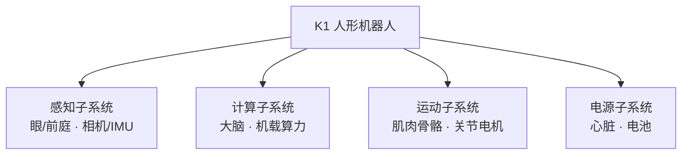
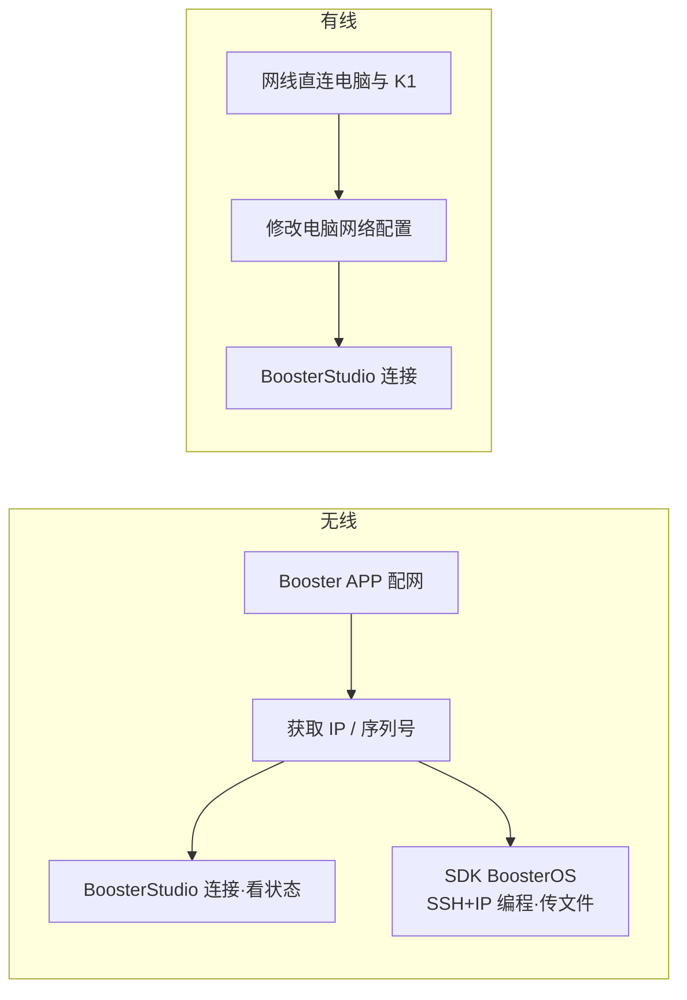
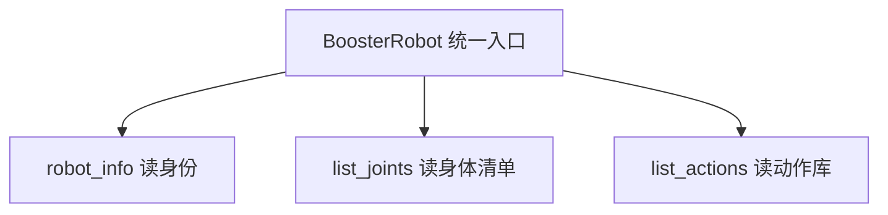

# U1-L1 教学设计（教师用）

## 一、课时目标

1. 建立对具身智能与人形机器人系统组成（四大子系统）的整体认知；
2. 学会用 BoosterOS SDK 连接 K1，并读取其身份、关节、动作、状态等“身体清单”；
3. 理解“用程序操控实体机器人”的基本范式。

> 教学提示：认知层面建议点出当前具身智能研究的前沿，比如VLN、 VLA、 世界模型，目标是了解信息开眼界；学习的重心还是要放在具身智能的应用方面，比如机器人操作、运动控制、手眼协调。讲授时避免只灌名词或只讲工具，两个方向都带一点，学生既见方向也能上手。

## 二、重难点

| 类型  | 内容                                                                             | 教学建议                                                     |
| --- | ------------------------------------------------------------------------------ | -------------------------------------------------------- |
| 重点  | 具身智能概念； 人形机器人四大子系统（感知 / 计算 / 运动 / 电源）                                       | 用学生熟悉的“数字大脑”（豆包 / Seedance / WorkBuddy）反衬“有身体才会看、会动、会交互” |
| 重点  | `BoosterRobot()` 连接范式；`robot_info` / `list_joints()` / `list_actions()` 三个只读接口 | 先 GUI（BoosterStudio）建立直觉，再代码对照                           |
| 重点  | 型号 / 序列号 / 固件版本字段含义                                                            | 用“身份证”类比讲序列号；多机场景强调核对序列号防连错                              |
| 难点  | 学生未接触过真实机器人，对“程序如何连上并远程操控实体设备”缺乏概念                                             | 先用“电脑经网络 SSH 远程连接 K1、SDK 是操作接口”的框架讲清，再配网实操               |
| 难点  | “离身智能”与“具身智能”的区分（认知层面易混）                                                       | 用数字大脑反衬；强调离身智能解决不了“把杯子拿稳”这类物理问题                          |

## 三、环节时间轴

| 时间    | 环节     | 形式       | 内容                                                                                             |
| ----- | ------ | -------- | ---------------------------------------------------------------------------------------------- |
| 0-04  | 导入     | 视频+提问    | 人形机器人应用短片（展厅/足球/搬运）；提问“智能在哪”→ 引出“离身 vs 具身”：豆包/Seedance/WorkBuddy 是数字大脑，K1 是有身体的                |
| 04-12 | 讲授①    | 讲解+时间线   | 具身智能定义（见实训手册 §1.1）+ 发展脉络（见实训手册 §1.3 表：符号→行为主义→深度学习→大模型与 VLA）；点出研究重心“双口味”                                     |
| 12-20 | 讲授②    | 讲解+图示    | 四大子系统（见实训手册 §1.2 表：感知/计算/运动/电源）；SDK 与 BoosterRobot（见实训手册 §1.4）：代码即“遥控器”                                      |
| 20-29 | 实操前准备  | 演示+实操    | BoosterStudio（见实训手册 §2.1）+ 配网/看 IP/连接（见实训手册 §2.2 前置）：先 GUI 建立直觉，强调同一 WiFi、核对序列号                              |
| 29-43 | coding | notebook | 运行「二、连接 K1」步骤 1–6（连接→robot_info→list_joints→list_actions→get_mode/get_battery→选做关节角度），每步对照 GUI |
| 43-45 | 评价+扩展  | 个人+阅读    | 学习评价 3 题；引出「四、扩展阅读：行业与职业认知」（产业链+岗位地图）                                                          |

## 四、教学环节详解

### 环节 1·导入（0-4min）
- 【投影】：人形机器人应用短片（展厅 / 足球 / 搬运）。
- 【演示】：播放短片，暂停在“机器人端水杯”画面。
- 【提问】：“智能在哪？它怎么知道杯子在哪、手怎么伸过去？”
- 【话术】：“大家平时用的豆包、Seedance、WorkBuddy，都是性能卓越的‘数字大脑’——只会算、只会生成，藏在屏幕后面。今天这台 K1 不一样：它既能算，也有身体，能看、能动、能在真实世界里交互。这叫**具身智能**。”

### 环节 2·具身智能定义与发展脉络（4-12min）
- 【投影】：实训手册 §1.3 发展脉络四阶段（符号智能 → 行为主义与机器人学 → 深度学习赋能感知 → 大模型与 VLA）。
- 【板书】：离身智能 vs 具身智能 对照表（呼应 §五 板书1）。
- 【话术】：“前两个阶段机器人像提线木偶，后两个阶段才真正‘自己看、自己想、自己动’；最后一行 VLA 把‘看—想—动’连成一体。”
- 【核心概念】：研究重心“双口味”——前沿（VLN / VLA / 世界模型）与应用（机器人操作 / 运动控制 / 手眼协调），与后续课程直接相关。
- 【FAQ】：“这些前沿和我们什么关系？”→ 答：“它们是方向，你们先把手能碰到的操作 / 控制 / 协调做扎实。”
- 【FAQ】：“为什么‘具身’重要？”→ 答：“智能离不开身体与环境的真实交互，离身智能解决不了‘怎么把杯子拿稳’这类物理问题。”

### 环节 3·四大子系统 + SDK（12-20min）
- 【投影】：实训手册 §1.2 表（感知 / 计算 / 运动 / 电源）。
- 【板书】：四大子系统框图（呼应 §五 板书2）。
- 【话术】：“SDK（BoosterOS）是 Booster Robot 公司提供的‘遥控器说明书 + 万能钥匙’；`BoosterRobot` 是操作 K1 的统一入口，一行代码建立连接，之后所有读 / 写都通过它。本课只读，已能体会‘用程序操控实体机器人’的基本范式。“
- 【注意】：本环节可点一句“后面单元会逐一展开”——该前向引用仅全课程第一课（U1-L1）允许，其余各课禁用（见 §8 第 4 条）。

### 环节 4·BoosterStudio 与连接准备（20-29min）
- 【核心概念】：K1 是实体机器人（有芯片、有操作系统）；电脑经网络与 K1 远程连接（实际为 SSH），在电脑端编写并下发程序；SDK（BoosterOS）是操作 K1 的程序接口集合。两种连接方式——无线（Booster APP 配网 → 获取 IP / 序列号 → Studio 连接、SSH+IP 编程传文件）；有线（网线直连 → 改电脑网络配置 → Studio 连接）。
- 【投影】：两种连接方式对照。
- 【演示】：展示 BoosterStudio 界面（连接状态 / 关节姿态 / 模式切换 / 指令发送）。
- 【步骤】：开机 → 配网（无线）或接网线改配置（有线）→ 用 APP 或 Studio 查 IP / 序列号 → Studio 连接 → 观察实时画面。
- 【注意】：多台机器人同场时，务必按 IP / 序列号核对再连，避免连错设备。

### 环节 5·notebook 运行（29-43min）
- 【步骤】：顺序即 notebook「二、连接 K1」步骤 1–6；逐 cell 运行，每步对照前面 GUI 画面。
- 【注意】：本节只读不写，无运动风险；`serial_number` 即机器人“身份证号”，多机实训时靠它区分设备。
- 【注意】：步骤 6（关节实时角度）为选做，可演示或留作有余力学生探索。

### 环节 6·评价与扩展阅读（43-45min）
- 【步骤】：收学习评价 3 题。
- 【投影】：引出「四、扩展阅读：行业与职业认知」（产业链 + 岗位地图）。
- 【话术】：“今天认识了 K1 的‘身份证’‘身体清单’和连接工具，下节课让它真正动起来。”

## 五、板书设计

**板书1 ·  离身智能 vs 具身智能**

| 维度 | 离身智能 | 具身智能 |
|---|---|---|
| 核心 | 只会算 / 生成 | 既能算，也有身体 |
| 位置 | 藏在屏幕后 | 能看 · 能动 · 能交互 |
| 例子 | 豆包 / Seedance / WorkBuddy | K1 |

**板书2 ·  人形机器人四大子系统**

**板书3 ·  电脑与 K1 的连接**

**板书4 ·  SDK 读写范式**

## 六、学习评价

> 题目与实训手册「三、学习评价」一致，答案供教师批改参考。

**一、判断题**
1. 本实验全部为只读操作，不涉及机器人任何运动，可以放心运行。（    ）
   **答案：√**

**二、填空题**
2. `robot.robot_info` 返回的对象中，相当于“身份证号”、用于多机环境区分与定位设备的字段是 ______。
   **答案：`serial_number`（序列号）**

**三、选择题**
3. 在 `list_actions()` 返回的动作信息中，可作为 `do_action()` 的参数来指定要执行哪个动作的字段是（    ）。
   A. `type`　　B. `id`　　C. `duration`　　D. `interruptible`
   **答案：B. `id`**

## 七、常见问题 FAQ

| 问题 | 解答 |
|---|---|
| `ModuleNotFoundError: No module named 'boosteros'` | 未安装 SDK，运行 `pip install boosteros` |
| 连接超时 / 连不上 | 检查 K1 是否开机、电脑与 K1 是否同一 WiFi、IP 是否正确 |
| 多台机器人如何避免连错 | 用 BoosterStudio 按 `serial_number` 找自己的设备再连 |
| `robot_info` 某字段为空字符串 | 该机型/固件未填此信息，属正常，不要求 |
| 关节数量不是 22？ | 以 `len(list_joints())` 实际返回为准，不同机型可能不同 |

## 八、安全与设备准备

- 设备：K1 × N（按分组）、同一 WiFi 路由器、安装 BoosterStudio 与 `boosteros` 的电脑。
- 安全：本节不涉及机器人行动，无运动风险；但仍需提醒学生防止被机器人关节夹伤。
- 前置：学生须先完成 K1 开机、配网、看 IP，并能用 BoosterStudio 连接——未完成则 notebook 无法运行（详见 notebook「二、连接 K1」前置准备与附件《K1 连接与 BoosterStudio 操作图示》）。
