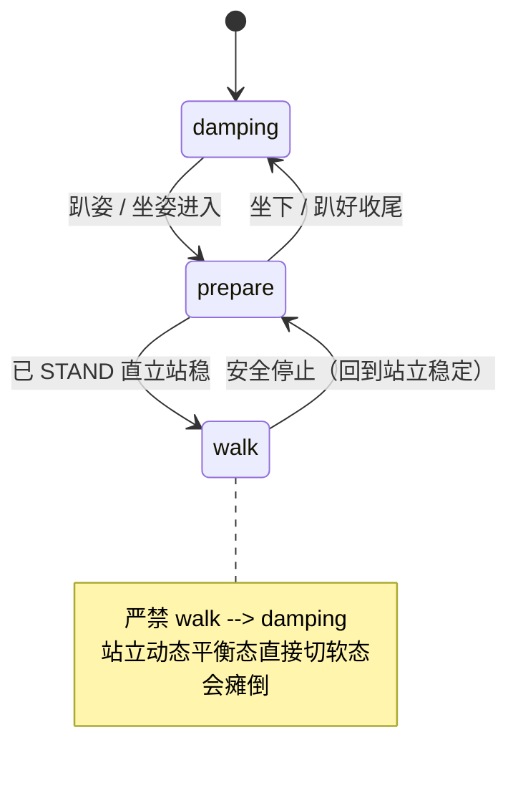

# U1-L2 教学设计（教师用）

## 一、课时目标

1. 认识 K1 的四种运行模式（damping / prepare / walk / custom）及其物理含义与安全要点；
2. 学会用 BoosterOS SDK 以程序方式查看并切换运行模式（`get_mode()` / `set_mode()`）；
3. 理解模式之间的安全切换关系，养成规范、安全的操作习惯。

> 教学提示：本课的安全提示是贯穿全课的——无论从程序还是手柄控制，都要反复强调“walk 只能来自已直立、且处于 prepare 模式”，安全操作规范需要成为习惯。

## 二、重难点

| 类型  | 内容                                                | 教学建议                                                         |
| --- | ------------------------------------------------- | ------------------------------------------------------------ |
| 重点  | 四种运行模式的物理含义与安全要点                                  | 用对照表 + 实物演示：切换时让学生观察关节阻尼差异（damping 软 / prepare 就绪 / walk 可动） |
| 重点  | 用 SDK 查看与切换模式（`get_mode()` / `set_mode()`）        | 先用手动按钮切换、再用程序切换，对比“即时人工操作”与“可流程自动化”的区别，点明学机器人编程的意义           |
| 难点  | 为什么 `walk` 必须由“已直立站稳的 prepare”进入                  | 用“动态平衡”通俗解释：walk 靠持续平衡维持站立，趴姿进入无平衡基础会关节乱踢；可演示一次错误进入的后果       |
| 难点  | 机器人各模式的切换顺序（`walk → prepare`，严禁 `walk → damping`） | 强调“站立动态平衡态直接切软态会瘫倒”，容易误伤邻近人员，损坏物品以及机器人本体                     |
| 难点  | 手柄手动遥控同样须遵守安全顺序                                   | 结合附件《K1 手柄遥控操作图示》先示范，再让学生分组在监督下尝试；反复提醒“禁 walk → damping”     |

## 三、环节时间轴

| 时间    | 环节   | 形式       | 内容                                                  |
| ----- | ---- | -------- | --------------------------------------------------- |
| 0-03  | 导入   | 提问+实物    | K1 是实体机器人，引出“为什么需要运行模式”；提问“机器人要站起来、走起来，底层控制策略有什么不同” |
| 03-11 | 讲授①  | 讲解+图示    | 四种模式对照表（见实训手册 §一、1.1）+ 状态机思想入门：模式之间不是任意切换，而是有安全顺序   |
| 11-18 | 实操1  | notebook | 连接 K1、`get_mode()` 读模式（见实训手册 §二、2.1–2.2）            |
| 18-22 | 观察记录 | 个人（非代码）  | 填写 2.3 观察表，固定“不同模式下的实际状态”（见实训手册 §2.3）               |
| 22-28 | 实操2  | notebook | 趴姿下 `damping ↔ prepare` 切换（见实训手册 §三）                |
| 28-38 | 重点突破 | 演示+实操    | 行走安全路径：多步 + 人工窗口（见实训手册 §四）                          |
| 38-43 | 拓展   | 分组+附件    | 手柄手动遥控 K1（非代码，见实训手册 §五 + 附件《K1 手柄遥控操作图示》）           |
| 43-45 | 评价   | 个人       | 检查点打勾 / 思考题 / 学习评价（见实训手册 §六）；引出 §七 扩展阅读：安全操作与职业素养   |

## 四、教学环节详解

> 每个环节按「操作层（演示 / 步骤 / 活动）→ 内容层（投影 / 板书 / 核心概念 / FAQ）→ 语言层（提问 / 话术）→ 提醒层（注意 / 安全红线）」组织；话术 / 提问引号内为教师对学生原话，注意 / 安全红线写在引号外（详见 §8.13）。

### 环节 1·导入（0–3 分钟）
- 【投影】：K1 实物或图片。
- 【提问】：“机器人要站起来、走起来，底层的控制方式有什么不同？”
- 【话术】：“上节课我们连上了 K1，读到了它的基本参数。今天这节课，我们要让 K1 按我们的指令切换工作状态——比如从趴着，到站起来、准备走。先想一个问题：机器人要站起来、走起来，底层的控制方式其实是不一样的。这个‘怎么切换工作状态’的问题，就是我们今天要学的运行模式。”
- 【注意】：不要用“听话”这类拟人说法，直接用“按指令切换工作状态”指向控制目标，更贴近高职学生的工程表达习惯。

### 环节 2·四种模式与状态机（3–11 分钟）
- 【投影】：实训手册 §一、1.1 四种模式对照表。
- 【板书】：运行模式状态机（呼应 §五 板书2）。
- 【核心概念】：模式之间不是任意切换，而是有安全顺序，为后续行走安全路径做铺垫。
- 【话术】：“K1 一共有四种运行模式：`damping` 是软态，关节有阻尼但不支撑站立；`prepare` 是准备模式，维持站立就绪的姿态；`walk` 是行走模式，靠动态平衡维持站立；`custom` 是进阶模式，需要单独编程，不在我们这节课的操作范围里。“
- 【注意】：讲解时直述“模式之间有安全顺序”即可，不必包装成“埋下伏笔”之类话术。

### 环节 3·连接与读模式（11–18 分钟）
- 【演示】：先确认 K1 已开机、配网、可连接；运行 `BoosterRobot()` 建立连接，再调用 `get_mode()` 读出当前模式；演示用按钮手动切换后再用程序读取，对比两种控制方式。
- 【话术】：“刚才我们用按钮切换模式，适合人即时操作。现在用程序 `set_mode()` 来切换，机器人就能按我们写好的流程自动执行——这就是学机器人编程的意义。“

### 环节 4·观察记录（非代码，18–22 分钟）
- 【活动】：不运行代码，让学生直接观察 K1 在当前模式下的姿态，把结果填入实训手册 §2.3 的表格（damping / prepare / walk 各自的姿态、能否运动、备注）。
- 【话术】：“现在大家不写代码，只看 K1 当前的样子，把它的姿态记到实训手册 2.3 的表里。同桌互相报一下，交叉核对，比只看不记记得更牢。”
- 【注意】：本环节为纯观察记录，不运行任何 cell，确保学生在动手切换前先建立“模式—姿态”的直观对应。

### 环节 5·趴姿切换（22–28 分钟）
- 【演示】：在趴姿下演示 `damping ↔ prepare` 切换，让学生体会关节阻尼差异；强调趴姿最安全，即使切换失败也不会摔倒。
- 【话术】：“我们先在趴姿下练 `damping` 和 `prepare` 的切换。趴着的时候关节软，不会摔倒，最安全。大家注意感受这两种模式下关节硬度的不同。“
- 【注意】：切换异常时立即回到 `damping`，不要在趴姿下尝试进入 `walk`。

### 环节 6·行走安全路径（28–38 分钟）
- 【投影】：实训手册 §四 行走安全路径。
- 【板书】：行走安全路径时序（准备 → 人工确认 → walk → 安全停止（prepare）→ 收尾（damping））。
- 【话术】：“现在走正式的行走安全路径。记住一条红线：绝不允许 `walk` 直接切到 `damping`。站立靠的是动态平衡，直接从行走切到软态，机器人会瘫倒，容易伤到旁边的人、撞坏东西，也会损坏机器人本体。“
- 【安全红线】：本环节必须在教师监督下进行。只有确认 K1 已被手动拉起、直立站稳、周围空旷、教师到场时，才允许运行进入 `walk` 的 cell。任何情况下都禁止 `walk → damping` 直接切换；停止行走必须先回到 `prepare`，再收尾到 `damping`。

### 环节 7·手柄手动遥控（非代码，38–43 分钟）
- 【投影】：附件《K1 手柄遥控操作图示》。
- 【活动】：分组在教师监督下用手柄操控 K1（详细按键布局与界面步骤见附件，学生结合图文完成）。
- 【话术】：“除了写程序，我们也能用手柄直接遥控 K1。控制方式变了，但安全顺序不变——手柄里切到 `walk` 同样要先 `prepare`、直立站稳，停下同样要先回 `prepare`。大家分组在监督下试，记住禁止 `walk` 直接切 `damping`。“
- 【注意】：手柄操控同样须遵守安全顺序；先由教师示范，再让学生分组在监督下尝试。

### 环节 8·评价与扩展（43–45 分钟）
- 【步骤】：回收实训手册 §六 的分步检查点打勾、思考题与 3 道学习评价；引出 §七 扩展阅读。
- 【话术】：“今天我们学会了让 K1 安全地切换工作状态。下节课，我们让它真正动起来。”
- 【注意】：小结用“切换工作状态”收束，与导入呼应；随即引出扩展阅读“安全操作与职业素养”（产业链 + 岗位地图）。

## 五、板书设计

**板书1 · 四种运行模式对照表**

| 模式 | 含义 | 能否运动 | 安全要点 |
|---|---|---|---|
| `damping` | 阻尼 / 软态，关节有阻尼但不支撑站立 | 否 | 开机默认状态 |
| `prepare` | 准备模式，维持站立就绪姿态 | 否（仅就绪） | 行走前必须先到达此模式 |
| `walk` | 行走模式，靠动态平衡维持站立 | 是（需配合速度） | 只能由已直立的 prepare 进入 |
| `custom` | 进阶自定义模式，需单独编程 | 取决于编程 | 未编程前比 damping 更软，不在本课实操 |

**板书2 · 运行模式状态机**

## 六、学习评价

> 题目与实训手册「六、检查点、思考题与学习评价」一致，答案供教师批改参考。

**一、判断题**
1. 调用 `set_mode("walk")` 让机器人获得行走能力前，必须先 `set_mode("prepare")` 且机器人已 STAND 直立站稳。（    ）
   **答案：√**

**二、填空题**
2. K1 四种运行模式中，关节有阻尼但整体是“软”的、无法维持站立、只能在坐姿或趴姿下进入的模式是 ______。
   **答案：`damping`（阻尼模式）**

**三、选择题**
3. 下列哪种切换顺序存在安全隐患，会导致站立的机器人直接瘫倒在地？（    ）
   A. `prepare → walk`　　B. `walk → prepare`　　C. `walk → damping`　　D. `damping → prepare`
   **答案：C**

## 七、教学资源与附件

- **附件**：《K1 手柄遥控操作图示》——手柄按键布局、配对方式、BoosterStudio 手柄控制界面逐步操作。

## 八、安全与设备准备

- 设备：K1 × N（按分组）、同一 WiFi 路由器、安装 BoosterStudio 与 `boosteros` 的电脑、配对好的手柄。
- 安全纪律（贯穿全课）：操作前确认 K1 已开机、周围无遮挡与人员紧贴、地面空旷；进入 `walk` 前必须先 `prepare` 且已直立站稳。
- 前置：学生须先完成 K1 开机、配网、看 IP，并能用 BoosterStudio 连接——未完成则 notebook 无法运行（详见 notebook「二、用程序查看并切换运行模式」前置准备）。
