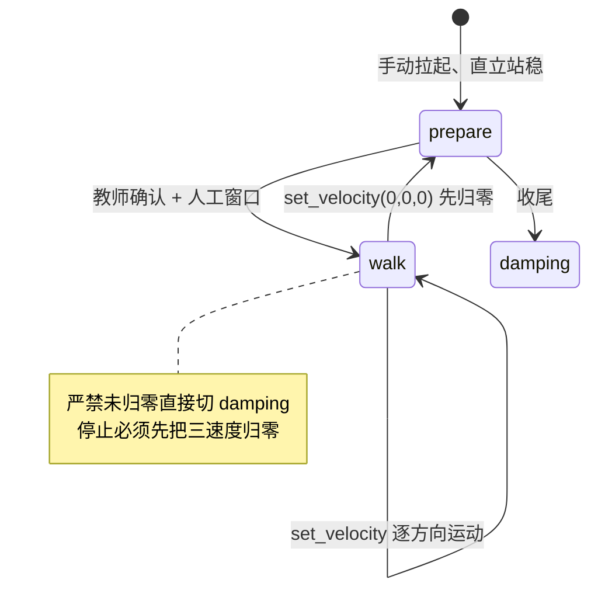

# U1-L3 教学设计（教师用）

## 一、课时目标

1. 理解机器人自身坐标系，读懂速度指令 `set_velocity(vx, vy, vyaw)` 三个参数的含义与正负约定；
2. 学会用 BoosterOS SDK 发送速度指令，完成前进、后退、左转、右转的基本运动；
3. 认识开环控制的特点，会记录并解释指令与实际运动之间的偏差。

> 教学提示：本课是 U1「开环操作」思想的核心落地——学生第一次向 K1 下发运动指令。教学主线是「先讲清坐标系与正负约定 → 再用程序发指令让机器人动 → 最后拿尺子量偏差」，把抽象的「开环」变成可测量的数据。转身用到的「偏航 yaw」概念，与头部运动中的 Pitch/Yaw（A08/A09）在名称上相通，但本课只谈身体转向，不碰头部角度。

## 二、重难点

| 类型  | 内容                                                                  | 教学建议                                                                  |
| --- | ------------------------------------------------------------------- | --------------------------------------------------------------------- |
| 重点  | 机器人自身坐标系与 `set_velocity(vx, vy, vyaw)` 三分量含义（vx 前+/vy 左+/vyaw 逆时针+） | 用对照表（见实训手册 §一、1.1–1.2）+ 实物指向演示：教师站在 K1 前方，说“它的前就是它的前”，消除“以人站位为准”的直觉干扰 |
| 重点  | 用 SDK 发送速度指令完成前进/后退/左转/右转                                           | 先「指令预览（不移动）」再真机执行，对比“只下指令”与“机器人真动”的差别，点明编程控制的意义（呼应 L2 模式切换）           |
| 重点  | 运动实验的安全规范（进入 walk 必须已直立、课堂降速、人工窗口）                                  | 用红色人工确认 + 教师监督执行，把 L2 的「运行模式安全顺序」直接沿用为本课前置条件                          |
| 难点  | 为什么开环下「指令轨迹」与「实际轨迹」会不一致（偏差来源）                                       | 用实训手册 §四 的「量一量偏差」活动，把抽象概念落到具体数字；结合 §一、1.3 偏差来源表逐条对照                   |
| 难点  | 左转/右转正负号易混淆（vyaw 正=逆时针=左转）                                          | 用面向机器人的坐标系图 + 实机左转/右转各验证一次，强化“正=左转”                                   |
| 难点  | 速度指令只在 walk 模式生效，且必须先 prepare 直立                                    | 与 L2 运行模式安全顺序衔接：模式不对指令无效，进入 walk 的前置条件不可省                             |

## 三、环节时间轴

| 时间    | 环节   | 形式       | 内容                                                  |
| ----- | ---- | -------- | --------------------------------------------------- |
| 0-03  | 导入   | 提问+实物    | K1 怎么“走”？引出速度指令与坐标系；提问“想让它往前走，程序里该给哪个数、给多大”      |
| 03-12 | 讲授①  | 讲解+图示    | 自身坐标系与 `set_velocity` 三分量（见实训手册 §一、1.1–1.2）         |
| 12-17 | 讲授②  | 讲解+表     | 开环与偏差来源（见实训手册 §一、1.3）                               |
| 17-25 | 实操1  | notebook | 连接 K1、确认模式、指令预览（不移动）（见实训手册 §二、2.1–2.3）              |
| 25-37 | 重点突破 | 演示+实操    | 进入行走态多步+人工窗口，前进/后退/左转/右转（见实训手册 §三、3.2–3.5）           |
| 37-40 | 收尾   | 实操       | 停止与安全收尾（见实训手册 §三、3.6）                                |
| 40-44 | 记录   | 个人（非代码）  | 四、观察与记录偏差表（量实际落点，算偏差，见实训手册 §四）                       |
| 44-45 | 拓展+评价 | 个人/分组    | 五、场地布置（非代码·附件）+ 六、检查点/思考题/学习评价（见 §五·§六）；引出 §七 扩展阅读 |

## 四、教学环节详解

> 每个环节按「操作层（演示 / 步骤 / 活动）→ 内容层（投影 / 板书 / 核心概念 / FAQ）→ 语言层（提问 / 话术）→ 提醒层（注意 / 安全红线）」组织；话术 / 提问引号内为教师对学生原话，注意 / 安全红线写在引号外（详见 §8.13）。

### 环节 1·导入（0–3 分钟）
- 【投影】：K1 实物或图片。
- 【提问】：“想让 K1 往前走，程序里应该怎么做？”
- 【话术】：“上节课我们学会了让 K1 安全地切换运行状态以及使用手柄控制机器人行走。今天这节课，我们要让它按我们的指令动起来——往前、往后、转弯。先想一个问题：机器人怎么知道‘前’是哪个方向？它又是靠什么数来控制快慢和转向的？这就是今天要学的速度指令和坐标系。”

### 环节 2·坐标系与速度指令（3–12 分钟）
- 【投影】：实训手册 §一、1.1 机器人自身坐标系表、§一、1.2 `set_velocity` 参数表与动作表。
- 【板书】：自身坐标系三轴 + set_velocity 三参数（呼应 §五 板书1）。
- 【核心概念】：K1 的坐标系以机器人自己身体为参照——前进/后退是它自己的前后，左转/右转是它自己的左右；vx 正=前进、vy 正=左移、vyaw 正=逆时针（向左）转。
- 【话术】：“K1 的坐标系不是以我们站的位置为准，而是以它自己身体为准。给 `set_velocity(vx, vy, vyaw)` 三个数：vx 控制前后，正数是前进；vy 控制左右平移，正数是向左；vyaw 控制转身，正数是逆时针、也就是向左转。记住 vyaw 正=左转，这是最容易记反的地方。”
- 【注意】：直接给“正负约定”，不必绕弯子包装成某种“铺垫”话术；正负为什么这样定可结合实机转向验证，不要空讲。

### 环节 3·开环与偏差（12–17 分钟）
- 【投影】：实训手册 §一、1.3 开环控制与偏差来源表。
- 【核心概念】：开环=“发指令、不管结果”；实际轨迹和指令轨迹往往不一致，差的那部分就是“偏差”，来源有地面打滑、重心变化、对指令时长的估算误差等。
- 【话术】：“今天我们是开环操作——发一条速度指令，机器人就按这个数走，但走完我们并不测量它到底到了哪。你想想，它真会停在你想让它停的地方吗？大概率不会。这个‘想让它到哪’和‘它实际到哪’的差，就是偏差。今天实验最后我们要拿尺子量一量这个偏差。”
- 【FAQ】：学生问“那偏差大不大、要不要管？”——答：“开环不怕有偏差，怕的是不知道有偏差。先把偏差量出来，下次学闭环才知道要补什么。”

### 环节 4·连接与指令预览（17–25 分钟）
- 【演示】：确认 K1 已开机配网可连接；运行 `BoosterRobot()` 建立连接，调用 `get_mode()` 确认当前模式；演示实训手册 §二、2.3 的「速度指令预览」——只说明、不移动，让学生看清“下指令”这个动作本身。
- 【步骤】：学生依次运行 §二、2.1 连接、2.2 读模式、2.3 预览；在脑中核对 vx/vy/vyaw 与方向的对应关系。
- 【话术】：“先不急着让它动。我们连上 K1，确认它现在处于什么模式，然后发一条速度指令——但这一条只让你看到‘指令已经发出去了’，机器人不动。先习惯‘写一行、发一条’这件事，真机运动留到安全措施准备好之后。”

### 环节 5·进入行走态与基本运动（25–37 分钟）
- 【投影】：实训手册 §三、3.2 进入行走多步时序、§三、3.3–3.5 各方向动作表。
- 【板书】：运动实验安全路径时序（准备 → 人工确认 → walk → 逐方向运动 → 安全停止 prepare → 收尾 damping）（呼应 §五 板书2）。
- 【演示】：按实训手册 §三、3.2 多步进入 walk（prepare 独立 → 红色人工确认已直立 → walk），先示范前进：发 `set_velocity(0.5, 0, 0)` 持续 2 秒再停止。
- 【活动】：分组在教师监督下依次完成前进、后退、左转、右转（各方向独立 cell，见 §三、3.3–3.5）；每完成一个方向，在脑中记下“指令轨迹”应是什么样。
- 【话术】：“现在走正式的运动实验。进入行走态有红线：必须确认 K1 已被手动拉起、直立站稳、周围空旷、教师在场，才允许运行进入 walk 的 cell。我们先试前进——vx 给 0.5，走 2 秒，然后立刻把速度归零停下。”
- 【注意】：每个方向运动前后都要先确认速度已归零；左转用 vyaw 正、右转用 vyaw 负，提醒学生别把符号记反。
- 【安全红线】：本环节必须在教师监督下进行。只有确认 K1 已手动拉起、直立站稳、周围空旷、教师到场，才允许运行进入 walk 的 cell；任何情况下停止运动必须先 `set_velocity(0,0,0)` 归零，再按 prepare → damping 收尾，严禁未归零直接切 damping。

### 环节 6·停止与安全收尾（37–40 分钟）
- 【演示】：运动结束后先 `set_velocity(0,0,0)` 归零，再 `set_mode("prepare")` 回到站立稳定，最后 `set_mode("damping")` 收尾。
- 【话术】：“运动做完，第一步永远是先把三个速度归零——停稳了再说别的。然后回 prepare 站稳，最后收尾到 damping。顺序不能乱，和上节课学的运行模式安全顺序一致。”

### 环节 7·观察与记录偏差（非代码，40–44 分钟）
- 【活动】：不运行代码，用卷尺或地面标记测量 K1 实际停止位置相对“指令应到位置”的偏差，填入实训手册 §四 偏差表（直线距离测量、转向角度用地面参照物目测）；可多测几次看偏差是否稳定。
- 【话术】：“现在不动代码，拿尺子量一量：刚才让它前进 2 秒，按 0.5m/s 算应该走 1 米，它实际停在哪？差多少？把这个差填到实训手册第四部分的表里。多测几次，你看偏差每次一样吗？”
- 【注意】：本环节为纯观察记录，不运行任何运动 cell，确保“数据来自测量”而非“来自想象”。

### 环节 8·拓展与评价（44–45 分钟）
- 【活动】：引出 §五 拓展活动（运动场地布置与距离测量，非代码，配附件《K1 运动实验场地布置与测量图示》），可课后分组完成；回收 §六 检查点、思考题、学习评价。
- 【话术】：“今天我们让 K1 真正按指令动起来了，也亲手量到了开环下的偏差。课后可以照附件把实验场地标好线、量好距离，下次实验更顺。下节课我们让它头部动起来、做出预定义动作。”
- 【注意】：小结用“按指令运动 + 量出偏差”收束；随即引出扩展阅读“从开环到闭环”（产业链 + 岗位地图）。

## 五、板书设计

**板书1 · 自身坐标系与 set_velocity 三参数**

| 参数 | 含义 | 正方向 | 仅生效于 |
|---|---|---|---|
| vx | 前后平移速度 | 正=前进 | walk |
| vy | 左右平移速度 | 正=向左 | walk |
| vyaw | 转向角速度 | 正=逆时针（左转） | walk |

**板书2 · 运动实验安全路径时序**

## 六、学习评价

> 题目与实训手册「六、检查点、思考题与学习评价」一致，答案供教师批改参考。

**一、判断题**
1. 发送速度指令前，必须先让 K1 进入 `walk` 模式，且在 `prepare` 下已 STAND 直立站稳。（    ）
   **答案：√**

**二、填空题**
2. `set_velocity(vx, vy, vyaw)` 中，`vx` 取正值表示 ______，`vyaw` 取正值表示 ______。
   **答案：前进；向左转（逆时针）**

**三、选择题**
3. 本实验属于开环控制，下列对“开环”的描述正确的是（    ）。
   A. 发出指令后持续读取实际位置并自动修正误差
   B. 发出指令后不读取实际结果，也不自动纠正偏差
   C. 必须保持电路闭合才能运动
   D. 机器人只能走直线，不能转向
   **答案：B**

4. 停止运动并收尾时，下列顺序安全且正确的是（    ）。
   A. `walk` 直接切 `damping`
   B. 直接关闭电源
   C. `set_velocity(0,0,0)` → `walk → prepare` → 坐下/趴好 → `damping`
   D. 先切 `damping`，再把速度归零
   **答案：C**

> 思考题（开放，详见实训手册 §6.2）：① 为什么叫“开环”，要准确到 1 米还需什么信息；② 同指令同 2 秒两次距离不同的至少两个原因；③ vy 左移与 vyaw 左转的本质区别；④ sleep(4) 的预期距离与实际偏差变化。

## 七、教学资源与附件

- **附件**：《K1 运动实验场地布置与测量图示》——实验场地标线、距离测量方法、偏差记录表示例。
- **关联**：U1-L2 运行模式与安全（进入 walk 的前置条件与安全顺序）。

## 八、安全与设备准备

- 设备：K1 × N（按分组）、同一 WiFi 路由器、安装 BoosterStudio 与 `boosteros` 的电脑。
- 安全纪律（贯穿全课）：进入 walk 前必须先 prepare 且已直立站稳、周围空旷、教师到场；任何停止先 `set_velocity(0,0,0)` 归零再收尾；严禁未归零直接切 damping；课堂速度降档为 0.5m/s（大纲原 1m/s 调整为课堂安全值，见实训手册课程大纲映射块）。
- 前置：学生须先完成 U1-L2 运行模式与安全，能正确进入 walk；并完成 K1 开机配网、BoosterStudio 连接。
