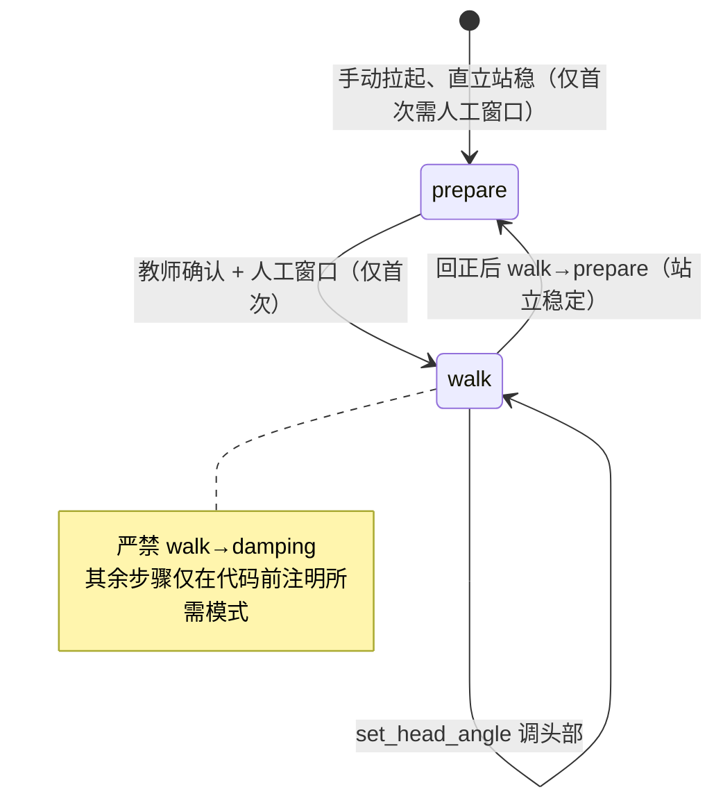

# U1-L4 教学设计（教师用）

## 一、课时目标

1. 认识机器人头部坐标系，理解俯仰角 `pitch`（低头 / 抬头）与偏航角 `yaw`（头向左转 / 向右转）的含义与正方向，会用 `set_head_angle(pitch, yaw)` 控制头部姿态，理解头部视野与运动的关系；
2. 掌握 `set_gait("soccer" | "default")` 切换步态，对比不同步态对行走稳定性与效率的影响；
3. 学会用 `list_actions()` 与 `do_action(action_id)` 调用厂商预置动作，理解“预定义动作库”概念，理解 `do_action` 返回的 `TaskHandle` 与动作元数据 `ActionInfo`，并体验开环方式下的组合行为（连续编排两个动作、边走边转头扫描）。

> 教学提示：本课是 U1 运动控制的收束——学生在 L2 学会“安全切换模式”、在 L3 学会“按指令移动”，本课把控制对象从“机身”扩展到“头部”与“整体行为”（步态、预定义动作）。主线是“先认识头部的两个角度 → 让头部在行走中动起来 → 切换步态走路 → 调用现成动作并组合成行为”。其中 `yaw` 与 L3 机身的 `yaw` 同名但控制对象不同，是本课要重点澄清的认知易错点。

## 二、重难点

| 类型  | 内容                                                                                 | 教学建议                                                                                                                                                                     |
| --- | ---------------------------------------------------------------------------------- | ------------------------------------------------------------------------------------------------------------------------------------------------------------------------ |
| 重点  | 头部坐标系 `pitch` / `yaw` 的含义与正方向（pitch 正 = 低头，yaw 正 = 头向左转）                           | 用对照表（见实训手册 §一、1.1）+ 实物指认：教师指机器人头部“低头看地、抬头看天、向左转、向右转”，让学生把角度和真实动作对应上                                                                                                      |
| 重点  | `set_head_angle(pitch, yaw)` 的用法与模式约束（仅 `walk` 有效）                                 | 强调“调头部前机器人必须在 walk”，把 L2/L3 的“模式前置”经验直接迁移；用 §一、1.2 的约束表对照                                                                                                                |
| 重点  | `set_gait` 切换足球 / 标准步态，对比行走差异                                                      | 先讲“步态决定怎么迈步”，再真机对比：同样 0.3 m/s 前进，两种步态的姿态、步频、稳定感不同（见实训手册 §三、3.2 / 3.3）                                                                                                    |
| 重点  | `do_action` 用 `list_actions()` 返回的 `id` 调用预定义动作，并理解返回的 `TaskHandle` 与 `ActionInfo` | 先 `list_actions()` 看清动作 `id` / `type` / `interruptible`，再 `do_action(id)`；强调用 `id` 而非名字；动作返回 `TaskHandle`，用 `status` / `done()` / `wait()` 跟踪并确认进入终态（见实训手册 §四、4.1 / 4.2） |
| 难点  | 机身 `yaw`（L3）与头部 `yaw`（本课）同名混用                                                      | 用一句话区分：“yaw 都是绕竖直轴转，但一个是整机转向、一个是脑袋左右转”；板书 / 提问反复强化（见实训手册 §一、1.1 注意）                                                                                                      |
| 难点  | 为什么 `set_head_angle` 必须在 `walk` 下、且 `set_mode` 顺序不可乱                               | 结合 L2 运行模式安全顺序：头部指令只在行走中生效，且进入 walk 的前置条件（先 prepare 直立）不能省（见实训手册 §一、1.2 / §二、2.3）                                                                                        |
| 难点  | `TaskHandle` 终态判断与基于 `ActionInfo.type` 的连续编排                                       | 通过 §四、4.2 演示 `status` / `done()` / `wait()` 确认 `SUCCEEDED` / `FAILED` / `CANCELLED`；通过 §四、4.3 任务让学生按 `type` 筛选 `upper_body` 与 `whole_body` 各一连续编排                        |
| 难点  | 开环下的组合行为（边走边转头）如何设计                                                                | 用拓展活动（六）的任务卡，让学生先写“指令顺序 + 所需模式 + 安全注意”，再讨论；不要求当堂真机跑通，重在建立“行为编排”意识                                                                                                        |

## 三、环节时间轴

| 时间    | 环节   | 形式        | 内容                                                       |
| ----- | ---- | --------- | -------------------------------------------------------- |
| 0-03  | 导入   | 提问 + 实物   | 回顾 L3：让 K1 按指令走起来；引出“让它看向想看的方向、做出预设动作”（见实训手册 §一）       |
| 03-12 | 讲授①  | 讲解 + 图示   | 头部坐标系 `pitch` / `yaw`（见实训手册 §一、1.1–1.2）                  |
| 12-17 | 讲授②  | 讲解 + 表    | 头部视野与运动、动作库与步态概念（见实训手册 §一、1.3 / §四、4.1）                 |
| 17-22 | 实操1  | notebook  | 连接 K1、认识动作库与步态（不移动）（见实训手册 §二、2.1 与 §四、4.1）              |
| 22-34 | 重点突破 | 演示 + 实操   | 头部控制实验：首次进入 walk 人工窗口 + 低头 / 转头 / 回正（见实训手册 §二、2.3–2.5） |
| 34-39 | 实操2  | 演示 + 实操   | 步态切换实验：足球 vs 标准步态前进对比（见实训手册 §三、3.1–3.4）                  |
| 39-43 | 实操3  | 演示 + 实操   | 预定义动作实验：探究 ActionInfo / TaskHandle 终态 + 连续编排两个动作（含 upper_body 与 whole_body 各一）（见实训手册 §四、4.2–4.4） |
| 43-45 | 记录评价 | 个人 / 分组   | 五、观察与记录（非代码）＋ 六、拓展活动（非代码·附件）＋ 七、学习评价                  |

## 四、教学环节详解

### 环节 1·导入（0–3 分钟）
- 【投影】：K1 实物或图片。
- 【提问】：“上节课我们让 K1 按指令走起来了。那如果我想让它在走路的同时，脑袋转向一边、看看那边的东西，程序该怎么做？”
- 【话术】：“前两节课，我们学会了让 K1 安全地切换状态、按速度指令走起来。可是光会走还不够——很多任务里，机器人得‘边走边看’‘做出个动作’。今天我们就来管一管它的脑袋、它的走路姿势，还有厂家替我们做好的现成动作。”

### 环节 2·头部坐标系 pitch / yaw（3–12 分钟）
- 【投影】：实训手册 §一、1.1 头部自身坐标系表、§一、1.2 `set_head_angle` 参数与模式约束。
- 【板书】：头部两角度 `pitch`（低头 / 抬头）、`yaw`（头向左 / 向右）；正方向约定（呼应 §五 板书1）。
- 【核心概念】：`pitch` 是头部俯仰，正值 = 低头（看地面）；`yaw` 是头部偏航，正值 = 头向左转。两者单位都是弧度（rad）。
- 【话术】：“机器人头部的角度有两个：pitch 管上下低头抬头，yaw 管左右转头。记住 pitch 正值是低头、yaw 正值是头向左转。这点很容易和 L3 学的机身 yaw 混——那个是整机左转，这个是脑袋左转，名字一样、控制的东西不一样。”
- 【注意】：直接用正方向表讲，不要绕弯子；pitch / yaw 与 L3 机身 yaw 的混淆是本课头号易错点，每出现一次就点一次。

### 环节 3·头部视野与动作库（12–17 分钟）
- 【投影】：实训手册 §一、1.3 头部视野与运动、§四、4.1 动作库与步态列表。
- 【核心概念】：头部相机是机器人“看世界”的主要来源；头部在行走中左右转动（改 `yaw`），能比固定朝前看到更宽的视野。预定义动作库是厂家把常见行为（如打招呼、致意等）固化好、用一行 `do_action(id)` 即可调用的能力。
- 【演示】：运行 `list_actions()` 与 `list_gaits()`，把返回的动作 `id`、`type`（如 `upper_body` / `whole_body`）、时长、是否可打断投影出来，强调 `do_action` 用的是 `id` 不是名字，并提示 `type` 字段将用于后面的连续编排任务。
- 【FAQ】：学生问“为什么不用动作名字？”——答：“名字可能改，id 是稳定标识；写代码用它最稳妥，不容易因为版本更新而失效。”

### 环节 4·连接与认识动作库（17–22 分钟）
- 【演示】：确认 K1 已开机配网可连接；运行 `BoosterRobot()` 建立连接；演示 `list_actions()` / `list_gaits()`（在实验四 4.1 调用前看清清单），只读取、不发送任何运动指令。
- 【步骤】：学生运行 §二、2.1 连接，随后在 §四、4.1 认识动作库与步态，记下自己机器人上可用的动作 `id` 与 `type`。
- 【话术】：“我们先不急着让它动。连上 K1，看看它现在是什么模式，再把动作库和步态清单读出来——这一步只读不写，让你先心里有数：等会儿要调的是哪些动作、它们的 type 是什么。”

### 环节 5·头部控制实验（22–34 分钟）
- 【投影】：实训手册 §二、2.3 进入行走时序、§二、2.4–2.5 各动作。
- 【板书】：头部实验安全路径（首次进入 walk：prepare → 人工确认 → walk → 调头部 → 回正 → walk→prepare）（呼应 §五 板书2）。
- 【演示】：按实训手册 §二、2.3，**首次进入 walk** 时执行 prepare 独立 cell → 红色人工确认已拉起直立 → walk 独立 cell；随后示范低头 `set_head_angle(0.3, 0)` 观察相机视野移向地面。
- 【活动】：分组在教师监督下依次完成低头、转头、回正（各 cell 见 §二、2.4–2.5）；后续进入 walk 的步骤（如本环节收尾后再进步态实验）只需在代码前标注所需模式，不再重复人工窗口。
- 【话术】：“进入行走态有红线：必须确认 K1 已被手动拉起、直立站稳、周围空旷、教师在场，才允许运行进入 walk 的 cell。这是整个 notebook 里唯一一次要停下来人工确认的地方——后面再进 walk，只要它已经站着，确认下环境就能走。”
- 【注意】：`set_head_angle` 只在 walk 下有效；演示时先不发速度，仅调头部，避免边走边调造成不可控。
- 【安全红线】：本环节首次进入 walk 必须在教师监督下进行，确认已手动拉起、直立站稳、周围空旷、教师到场才允许运行；本 notebook 中头部实验与步态实验连续在 `walk` 下进行，最后统一由 §三、3.4 回 `prepare`；若单独停止头部实验，先回正再 `walk → prepare`，严禁 `walk → damping`。

### 环节 6·步态切换实验（34–39 分钟）
- 【投影】：实训手册 §三、3.1–3.4。
- 【演示】：机器人当前已在 prepare 直立（上环节收尾已回 prepare），确认周围安全后进入 walk，切换 `set_gait("soccer")` 发 0.3 m/s 前进约 2 秒停止；再切回 `set_gait("default")` 同样前进对比。
- 【活动】：学生分组在监督下对比两种步态的手感 / 姿态差异，记录到实训手册 §五 观察表。
- 【话术】：“步态就是它‘怎么迈步’。足球步态重心更靠前、适合踢球；标准步态更稳。你们跑同样的 0.3 米每秒走两秒，看看哪种走得更直、哪种更稳。”
- 【注意】：切换步态仍在 walk 下；本环节无需再次手动拉起，代码前已注明“当前在 prepare 直立”，确认环境即可。

### 环节 7·预定义动作实验（39–43 分钟）
- 【投影】：实训手册 §四、4.2–4.4。
- 【演示】：机器人须处于 `walk` 模式（若仍在 prepare，先进入 walk）。先运行 §四、4.2 探究单元格——任选一个动作 `do_action(id)`，打印其 `ActionInfo`（`id` / `type` / `duration` / `interruptible`），并用返回的 `TaskHandle` 通过 `status` / `done()` / `wait()` 确认任务已进入终态（`SUCCEEDED` / `FAILED` / `CANCELLED`）；再运行 §四、4.3 学生任务脚手架，按 `type` 筛选出 `upper_body` 与 `whole_body` 动作各一，连续编排并各自等待终态。
- 【活动】：学生分组运行 §四、4.2 观察 `TaskHandle` 终态；再完成 §四、4.3 连续编排任务（不少于两个动作，至少含 `upper_body` 与 `whole_body` 各一个）。动作幅度大，确认周围空间充足、教师监督。
- 【话术】：“厂家已经把一些常用行为固化成‘预定义动作’，我们一行 `do_action(动作id)` 就能调用——这就是‘预定义动作库’。重点不是记住动作长什么样，而是学会用 `id` 指定、用 `TaskHandle` 判断它到底跑完了没有；最后你们还要自己挑两个不同类型的动作，编排成一段连续行为。”
- 【注意】：`do_action` **必须在 `walk` 模式下调用**（若仍在 prepare，先进入 walk 再调用）；动作多为大幅度肢体运动，须确认空间充足、教师监督；实验结束先 `set_mode("prepare")` 回到站立稳定，再按约定手动趴姿 → `damping`，严禁直接用程序进 `damping`（见 §四、4.4）。

### 环节 8·观察记录与拓展评价（43–45 分钟）
- 【活动】：不运行代码，在实训手册 §五 记录开环下的组合行为观察（头部 / 步态 / 动作）；引出 §六 拓展活动（边走边转头扫描，非代码，配附件《K1 综合行为设计任务卡》）与 §七 学习评价。
- 【话术】：“今天我们让 K1 的脑袋动起来、换了走路姿势、还调用了现成动作，并用 `TaskHandle` 确认每个动作跑到了什么状态。课后可以照附件，设计一次‘边走边转头’的组合行为。下节课开始，我们要让 K1 真正‘看见’东西了。”
- 【注意】：小结用“头部角度 + 步态切换 + 动作库与 TaskHandle”收束；随即引出扩展阅读“预定义动作库与行为工程”（产业链 + 岗位地图）。

## 五、板书设计

**板书1 · 头部坐标系两角度**

| 角度 | 名称 | 正值方向 | 控制对象 |
|---|---|---|---|
| `pitch` | 俯仰角 | 正值 = 低头（看地面） | 头部上下 |
| `yaw` | 偏航角 | 正值 = 头向左转 | 头部左右（注意：与 L3 机身 yaw 同名但不同对象） |

**板书2 · 头部实验安全路径时序**

## 六、学习评价

> 题目与实训手册「七、检查点、思考题与学习评价」一致，答案供教师批改参考。

**一、判断题**
1. `set_head_angle(pitch, yaw)` 只能在 `walk` 模式下调用，在 `damping` / `prepare` 下调用会报错。（    ）
   **答案：√**

**二、填空题**
2. 切换步态用 `set_gait(____)`；若当前不在 `walk` 模式，该设置会 ______（填“立即生效”或“记录并在下次进入 walk 时生效”）。
   **答案：`"soccer"` 或 `"default"`（任写其一）；记录并在下次进入 walk 时生效**
3. 头部俯仰角 `pitch` 的正值表示 ______（填“低头”或“抬头”）。
   **答案：低头**

**三、选择题**
4. 下列接口中，用于在 walk 模式下控制机器人头部姿态的是（    ）。
   A. `set_velocity`　　B. `set_gait`　　C. `set_head_angle`　　D. `do_action`
   **答案：C**

5. `do_action` 指定要执行的动作时，应传入（    ）。
   A. 动作名字字符串　　B. `list_actions()` 返回的 `id`　　C. 动作的 `duration`　　D. 任意整数
   **答案：B**

> 思考题（开放，详见实训手册 §七、7.2）：① 为什么 `set_head_angle` 必须在 walk 下；② `set_gait` 非 walk 下记录、进入 walk 才生效的特性有何用处；③ `do_action` 为何用 `id` 而非名字。

## 七、教学资源与附件

- **附件**：《K1 综合行为设计任务卡》——边走边转头扫描的步骤分解、场地布置与危险区标注（见实训手册 §六 附件提示）。
- **关联**：U1-L2 运行模式与安全（进入 walk 的前置条件与安全顺序）、U1-L3 基本运动控制（速度指令与机身 yaw）。

## 八、安全与设备准备

- 设备：K1 × N（按分组）、同一 WiFi 路由器、安装 BoosterStudio 与 `boosteros` 的电脑。
- 安全纪律（贯穿全课）：进入 walk 的**首次**必须先 prepare 且已直立站稳、周围空旷、教师到场（人工窗口）；其余步骤仅在代码前标注所需模式，不重复人工窗口；`set_head_angle` 仅在 walk 有效；`do_action` **必须在 `walk` 模式下调用**、动作幅度大须确认空间充足；任何停止先回正头部再 `walk → prepare`，严禁 `walk → damping`；课堂速度降档为 0.3 m/s（大纲原 1 m/s 调整为课堂安全值，见实训手册课程大纲映射块）。
- 前置：学生须先完成 U1-L2 运行模式与安全、U1-L3 基本运动控制；并完成 K1 开机配网、BoosterStudio 连接。
