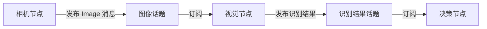

# U2-L1 ROS2 通信基础（教师用）

## 一、课时目标

1. 能用持续拍照的例子解释顺序代码被循环阻塞的原因，并说出机器人模块为什么需要交换数据。
2. 能解释节点、话题、发布、订阅和消息的关系，指出话题名、消息类型及通信配置对消息送达的作用。
3. 能用 `ros2 topic list`、`info`、`echo`、`hz` 查找当前话题、读取消息类型与观测频率，并说出端点数量不能单独证明消息送达。

本课只读取系统信息，并在自建字符串话题上发送测试消息；不下发运动指令。Notebook 的第一个观察实验和 Studio 发布实验都在课堂完成。

> 教学提示：本课先建立通信对象之间的关系，再用 CLI 和 Studio 各看一次消息流。让学生把 `list`、`info`、`echo`、`hz` 的输出分别对应到“有哪些、是什么、有没有消息、发得多快”；端点数量只能作为线索，不能当作消息送达的证明。

## 二、重难点

| 类型 | 内容 | 教学建议 |
| --- | --- | --- |
| 重点 | 顺序代码与持续任务 | 用 Notebook §一的 `while True` 例子问学生哪两行暂时到不了；补充一个进程也可以安排多条执行线，避免“单进程不能并发”的误解 |
| 重点 | 五个通信对象 | 在相机节点发布、视觉节点订阅的具体流程中指出节点、话题、消息、发布与订阅 |
| 重点 | 四条观察命令 | 每条命令对应一个问题：名称、端点和类型、收到的内容、观测频率 |
| 难点 | 端点数量与实际送达 | `info` 只显示当前发现的端点；再用 `echo` 或 Studio 接收组件核对消息 |
| 难点 | 单次发布与历史消息 | 先记录本机 `echo` 和 `hz` 的真实现象，再说明历史消息留存取决于发布端及订阅端 QoS 配置 |

## 三、环节时间轴

| 时间 | 环节 | 形式 | 内容与当堂证据 |
| --- | --- | --- | --- |
| 0–07 | 持续任务与 ROS2 定位 | 提问、讲解 | `while True` 后两行能否执行；Ubuntu 与 ROS2 的分工（Notebook §一） |
| 07–13 | 通信五元组 | 图示、讨论 | 相机节点到视觉节点的数据流；事件循环与回调（§一 1.2、§二） |
| 13–21 | 话题列表与详情 | Notebook | 环境检查、list、计数、info；记录当前 Type 和 Pub/Sub（§三 3.1–3.3） |
| 21–27 | 消息与频率 | Notebook | echo 一条图像消息，hz 读频率并中断（§三 3.4–3.5） |
| 27–38 | Studio 发布与订阅 | Notebook、Studio | 自建话题；一次与多次发布；比较订阅前后端点数，验证接收组件（§四） |
| 38–41 | 观察记录 | 个人 | 填写五行表格（§五） |
| 41–45 | 检查与评价 | 个人 | 核对六项检查点；完成三道评价题（§六） |

思考题第 1、3 题在课堂讨论，第 2 题留作课后验证。观察表随操作填写；如果设备响应较慢，教师演示 Studio 端操作，仍让学生亲自运行四条观察命令。

## 四、教学环节详解

### 环节 1·持续任务与 ROS2 定位（0–7 分钟）

- 【投影】：Notebook §一的拍照循环。
- 【提问】：“循环一直运行时，后面的发送照片和监听停止指令能执行到吗？问题出在执行顺序的哪一步？”
- 【核心概念】：这段代码只有一条顺序执行线。进程、线程、文件是不同概念；一个进程也可以安排多条执行线。ROS2 给相机、视觉、决策等模块提供通信机制。
- 【板书】：Ubuntu 管基础资源；ROS2 运行在其上，提供机器人软件框架及通信工具。
- 【话术】：“ROS 的英文名含 Operating System，但 ROS2 不替代 Ubuntu。我们运行 `ros2 topic list`，是在已有操作系统里查看 ROS2 的通信信息。”

### 环节 2·通信五元组（7–13 分钟）

- 【投影】：Notebook §一 1.2 与 §二。
- 【板书】：按 §五的关系图，画相机节点发布图像话题、视觉节点订阅该话题，再发布识别结果。
- 【核心概念】：节点是参与通信的功能单元，一个进程可容纳多个节点；话题有名称，消息有类型；发布和订阅分别是发送与接收。话题不承担“中央邮箱”的实体角色。
- 【提问】：“图像到达视觉节点后，哪段代码开始处理它？”
- 【话术】：“收到消息后运行的函数叫回调；程序持续等待和处理这类事件的过程叫事件循环。下一课用 `subscribe_imu()` 时还会看到回调。”
- 【注意】：名称和类型相同仍不能保证消息送达，后面用 `info` 与 `echo` 比较。

### 环节 3·话题列表与详情（13–21 分钟）

- 【投影】：Notebook §三 3.1–3.3。
- 【步骤】：运行环境检查、`ros2 topic list` 与 `ros2 topic list | wc -l`，再运行图像话题的 `info`。
- 【板书】：四条命令对照表中 list、info 两行。
- 【核心概念】：`info` 给出 Type、Publisher count、Subscription count。数量表示此刻发现了端点，不能据此断定已经收到了消息。
- 【话术】：“请记录你这台机器上看到的数。节点启动状态、网络或 ROS_DOMAIN_ID 不同，别组的总数可能不同。”
- 【注意】：若图像话题名与教材不同，让学生按 `list` 的实际输出修改后续命令。

### 环节 4·消息与频率（21–27 分钟）

- 【投影】：Notebook §三 3.4–3.5。
- 【步骤】：运行 `echo --once --no-arr`，记录图像宽、高、编码；运行 `hz`，记录 `average rate` 后中断当前格。
- 【板书】：补齐 echo、hz 两行。
- 【核心概念】：`echo --once` 等收到一条才退出；`hz` 根据本机收到的多条消息估算频率。图像数据数组用 `--no-arr` 隐藏。
- 【演示】：在本机 Notebook 中用「内核 → 中断」停止 `hz`，确认下一格还能运行。

### 环节 5·Studio 发布与订阅（27–38 分钟）

- 【投影】：Notebook §四 4.1–4.3。
- 【步骤】：多组共用设备时，先统一修改话题名。Studio 发布组件选择 `std_msgs/String`，填 `{"data": "Hello K1"}`，点一次发布。
- 【步骤】：运行 `info` 并记录；运行 `echo --once`。若持续等待，让 Studio 再发布一条。记录收到的 `data`。
- 【步骤】：运行 `hz`；观测不到频率时保持命令运行，从 Studio 连续发布几条。记录是否出现 `average rate`，随后中断。
- 【FAQ】：“`echo` 读到一条，为什么 `hz` 仍没有频率？”——一条消息不构成连续频率；本课设备曾出现晚加入的订阅者读到先前单次发布消息的情况，取决于发布端生命周期及双方 QoS 配置。警告也可能由名称、网络等问题造成，先核对现场输出。
- 【步骤】：确认 `echo` 已结束、`hz` 已中断。运行一次 `info` 记下 Subscription count；打开 Studio「原始消息」订阅组件，再运行一次 `info` 比较实际数字。在 Studio 再发布新消息，查看组件是否收到。
- 【话术】：“发布端只需按约定的话题名和类型发送，不必先把订阅端的程序地址写进去。`info` 看到端点，接收组件看到消息，这两项证据回答的是不同问题。”

### 环节 6·观察记录（38–41 分钟）

- 【投影】：Notebook §五观察表。
- 【活动】：填写话题总数、图像 Type 与端点数、图像 echo/hz、自建话题 echo/hz、增加 Studio 订阅端前后这五项；没有出现预期输出时照实记录。
- 【注意】：端点数量可能被其他订阅者改变，不要求全班得到同一数字。

### 环节 7·检查与评价（41–45 分钟）

- 【投影】：Notebook §六 6.1–6.3。
- 【活动】：检查六项操作；独立完成判断、填空、选择题。思考题 1、3 口头讨论，第 2 题课后验证。
- 【注意】：已中断 `hz` 才继续后续 Notebook 操作；评价第 3 题只判断下一步排查操作，不把单次发布当作唯一原因。

## 五、板书设计

**顺序执行与模块通信**

| 对象 | 本课观察 |
| --- | --- |
| 顺序代码 | 不退出的循环会阻止同一条执行线上后续语句运行 |
| ROS2 节点 | 各模块通过话题交换消息；节点与进程不固定一一对应 |
| Ubuntu | 承载进程、设备与 ROS2 软件 |

**通信关系**

**四条命令**

| 命令 | 回答的问题 | 局限 |
| --- | --- | --- |
| `ros2 topic list` | 当前发现哪些话题 | 列表随环境变化 |
| `ros2 topic info <名>` | 类型和端点数是什么 | 不证明消息已送达 |
| `ros2 topic echo <名> --once --no-arr` | 实际收到哪条消息 | 无消息会等待 |
| `ros2 topic hz <名>` | 观测到的频率是多少 | 需要多条消息，结束要中断 |

## 六、学习评价

> 题目与 Notebook §6.3 一致，答案供教师批改。

1. `ros2 topic info` 同时显示一个发布者和一个订阅者，就能证明订阅者已经收到消息。（    ）  
   **答案：×。**
2. ROS2 中按名字传数据的通道叫 ______，它上面流动的数据有固定的 ______。  
   **答案：话题；消息类型。**
3. 已核对话题名和消息类型正确，Studio 发布组件仍打开；本组只点过一次「发布」，随后运行 `ros2 topic hz /greeting_u2l1`，观测期间没有再次发布，也没有得到可统计的频率。下一步最合适的是（    ）  
   A. 断定 K1 没有连接  
   B. 在 `hz` 仍运行时从 Studio 再连续发布几条，并查看是否出现 `average rate`  
   C. 断定 ROS2 总会留存最后一条消息  
   D. 将 `hz` 改成图像话题，避开字符串消息  
   **答案：B。**

## 七、安全与设备准备

- 本课不发运动或动作指令；机器人保持安全支撑姿势，无需进入行走模式（WALK）。
- 多组共用设备时，自建话题统一添加组号，并同时改 Studio 配置和 Notebook 命令。
- 前置：已完成 U1 四课，能进入课程指定的机器人开发环境。
