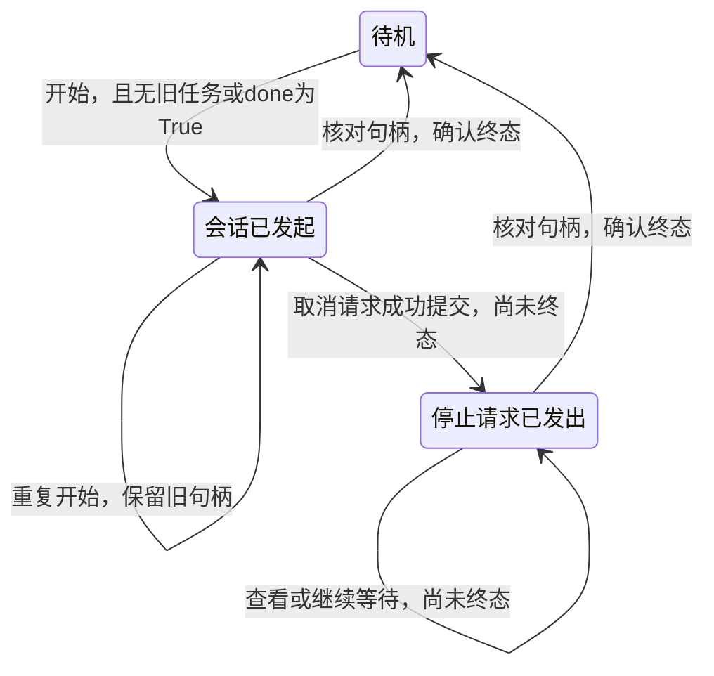

# U5-L4：语音会话管理

## 一、课时目标

1. 能按输入和输出解释采音、语音转写、回复生成、语音合成与播放，说明 `chat()` 如何支持持续问答。
2. 能说明任务句柄的用途，读取任务状态，判断任务是否结束。
3. 能画出会话管理的状态与转换条件，运行并调整程序，完成启动、阻止重复启动、停止和再次启动。

> 教学提示：承接L1～L3已经运行过的语音功能，把注意力转到“程序怎样管理同一个持续会话”。先观察句柄与任务，再画应用状态图。课堂中的开始、查看、停止均通过修改操作文字并运行代码格完成；一轮回答结束、代码格执行结束和整个任务结束要分别判断。函数以定位分支、解释条件为主，不要求学生从空白重写整段程序。

## 二、重难点

| 类型 | 内容 | 教学建议 |
| --- | --- | --- |
| 重点 | 采音、转写、回复生成、合成与播放的输入输出 | 用“刚才提到的语音识别”说明转写文字还需要结合上下文生成回答 |
| 重点 | 保存句柄，读取标识、状态、终态与错误信息 | 对照同一任务的多次输出，避免每次观察都创建新会话 |
| 难点 | 有限等待、取消请求与任务结束的区别 | 先预测再运行，分别记录wait返回、cancel返回和done结果 |
| 难点 | 应用状态怎样约束开始、停止与重开 | 先用状态表画箭头，再在manage_chat中找到对应分支 |

## 三、环节时间轴

| 时间 | 环节 | 形式 | 内容 |
| --- | --- | --- | --- |
| 0–5min | 持续问答与功能关系 | 回忆、配对解释 | 实训手册§一、§2.1；五项功能的输入输出、一轮与会话的区别 |
| 5–13min | 句柄、状态与有限等待 | 预测、运行、比较 | §2.2～2.4、§3.1～3.2 STEP 01～03；任务信息与重复启动记录 |
| 13–25min | 回调、打断与取消 | 运行、问答、观察 | §3.3～3.4 STEP 04～05；登记回调、三项语音打断观察、首次终态 |
| 25–40min | 状态机与管理程序 | 画图、定位代码、补条件 | §四 STEP 06～08；启停操作、状态图、启动条件及记录 |
| 40–45min | 评价与结束会话 | 个人解释、核查、保存 | §4.4 STEP 09、§5.1～5.4；评价、最后终态与课后拓展 |

课前完成网络、SDK环境、语音服务和音量检查，确认没有遗留录音、识别或聊天任务。按设备分组，设操作、提问、记录岗位并错开发声。45分钟包含每组的一轮观察及管理练习；服务较慢或设备轮换不足时另排个人操作，不压缩最后的终态确认。

## 四、教学环节详解

### 环节1·持续问答与功能关系（0–5min）

- 【活动】阅读§一、§2.1，依次给采音、ASR、LLM、TTS、播放配对输入与输出。用同一个追问找出“文字转写”与“结合上下文组织回答”的不同任务。
- 【投影】拟展示：五项功能关系表、单轮问答与持续会话示意；依据：Notebook第2～3格；PPT定位待P5-B回填。
- 【提问】“‘刚才提到的’需要结合什么信息？机器人说完这一句以后，还能继续提问，整个会话结束了吗？”
- 【核心概念】chat组织这些能力供持续问答使用。功能图说明处理关系，各功能可能边接收边处理，不能据此推断内部严格串行时序。

### 环节2·句柄、状态与有限等待（5–13min）

- 【活动】对照§2.2～2.4，区分保存句柄的变量、TaskHandle[None]中的None和最终结果。把六种状态分成未结束与终态，指出错误信息从哪个属性读取。
- 【步骤】确认旧任务结束后只运行一次STEP 01。运行STEP 02，指出`chat_task = speech.chat(...)`保存句柄；连续提问两次，暂时安静后运行STEP 03。
- 【演示】打开Notebook第10、12格，对照wait返回值、当前status、done和trace_id。wait返回后才执行赋值与打印；任务若提前结束，等待可提前返回。
- 【步骤】记下标识后重跑STEP 02，比较是否保留原句柄，再提问。将首次、安静时和有限等待后三行信息填入§5.1，重复启动另作旁注。
- 【投影】拟展示：TaskHandle[None]含义、六状态表、两秒等待与持续任务的时间线、重复启动输出对照；依据：第4～6、9～12格；PPT定位待P5-B回填。
- 【提问】“wait返回RUNNING，结束的是等待还是会话？为什么两次打印的状态有时会不同？”
- 【注意】初始化不能用作清除旧会话的办法。若接续L3，按§3.1引用框回到原内核处理task；未确认done时不覆盖句柄。

### 环节3·回调、打断与取消（13–25min）

- 【步骤】STEP 04为当前句柄登记一次回调。指出on_status的参数接收任务句柄，函数通过status读状态；与L1接收文字的回调比较。登记后问答、安静，记录实际输出。
- 【步骤】STEP 05在机器人回答时尝试语音打断，再运行STEP 03，分别检查播报是否停止、任务是否结束、能否继续提问。随后运行取消格，记录cancel返回、wait返回和done。
- 【核心概念】回调观察绑定的同一个任务；重新创建的任务需要重新登记。听、说、等待提问都可能保持RUNNING，不要求每一轮问答触发状态变化。
- 【投影】拟展示：回调接收对象、语音打断与程序取消的观察表、取消请求到终态的关系；依据：第13～16格、§5.1；PPT定位待P5-B回填。
- 【提问】“说‘停一下’后还能继续问，说明什么？cancel返回True以后，哪项检查才能证明任务结束？”
- 【注意】短暂状态未显示时照实记录，不人为制造CANCELLING，不为测试故障断网。取消尚未结束时保留原句柄，继续查看，暂停新建会话。

### 环节4·状态机与管理程序（25–40min）

- 【活动】阅读§4.1，画出待机、会话已发起、停止请求已发出三个应用状态；箭头写操作及条件，补上重复开始、取消未提交成功时的保留关系。
- 【步骤】STEP 06定义管理函数。在第19格找到核对旧句柄、创建任务、取消、等待、回到待机和返回两个值的位置。先核对实际任务，再解释应用状态，不给SDK只读状态赋值。
- 【步骤】按STEP 07的五项操作逐次修改command并运行：查看→开始→重复开始→停止及查看→终态后再次开始。每次保留函数返回的句柄与应用状态，填写§5.1对应行。
- 【活动】STEP 08在§4.3要求下补写启动条件。每次先运行查看刷新应用状态，再运行判断格；比较使用中与终态后的结果。取消很快时记录实际终态，不强求出现中间状态。
- 【投影】拟展示：三状态图、manage_chat关键分支、五项操作空记录表、and/or条件结构；依据：第17～23格、§5.1；PPT定位待P5-B回填。学生展示内容保留条件空缺。
- 【板书】使用板书2，分别标出SDK状态来源和应用状态来源。
- 【提问】“app_state写成待机，后台任务就会结束吗？can_start保存的是当前计算结果，还是持续更新的开关？”
- 【注意】失败后先记录error并核查原因；函数在处理操作时刷新应用状态，不能将其描述为后台自动监控程序。结束练习使用的仍是原chat_task。

### 环节5·评价与结束会话（40–45min）

- 【活动】完成§5.2三项检查点、§5.3四题和§5.4两问。三道判断题个人作答，状态图同伴检查；解释题引用本组记录，未完成项另记补做。
- 【步骤】运行STEP 09，填写最后一行终态记录。若仍未结束，保留句柄由教师继续处理，不能以代码格停止代替任务结束。
- 【投影】拟展示：评价题目、两道记录解释题及结束会话核查项；依据：第24～26格；PPT定位待P5-B回填。
- 【活动】§六部署拓展课后阅读：结合教师提供的实际服务配置，各写一个联网调用理由和一项连接检查。无需实现端侧模型部署。

## 五、板书设计

**板书1 · 功能与管理对象**

| 对象 | 输入/来源 | 输出/用途 |
| --- | --- | --- |
| ASR | 音频 | 转写文字 |
| LLM | 文字、历史、人设 | 回复文字 |
| TTS与播放 | 回复文字 | 合成音频并发声 |
| chat_task | chat返回的句柄 | 查询、等待、请求取消整个会话 |

**板书2 · 应用状态转换**

取消未提交成功时保留原状态；取消迅速完成时可直接回到待机。SDK更新status，管理函数在每次操作时更新app_state。

## 六、学习评价

> 题目与实训手册§5.3一致。§5.1记录、§5.2检查点及§5.4解释题作为过程评价；参考答案供教师使用，学生PDF删除参考答案、保留题目。

1. 判断：`TaskHandle[None]` 表示 `chat()` 没有返回对象。（　）

   **答案：×。** 返回的是句柄；None表示完成时不提供结果数据。

2. 判断：`RUNNING` 表示整个会话正在执行，不能据此确定此刻正在生成回答。（　）

   **答案：√。** 同一状态也可能对应接收提问或等待下次提问。

3. 判断：`cancel()` 返回 `True`，或有限 `wait()` 已返回，都足以证明任务已结束。（　）

   **答案：×。** 分别说明请求提交或等待返回；需检查done或终态。

4. 按“开始 → 重复开始 → 停止 → 查看 → 再次开始”画出应用状态转换；在允许再次开始的箭头上写出判定条件。

   **参考要点：** 图中包含三个应用状态；重复开始保留句柄，停止后根据实际终态判断。允许启动条件为`app_state == "待机" and (chat_task is None or chat_task.done())`。失败后先核查错误，不凭应用状态推定设备任务结束。

§5.4第1问以本组的播报、后续问答和任务记录分别解释；第2问应指出旧句柄用于继续查询、等待和排查错误，下一次操作前核对status、done及FAILED时的error。

## 七、常见问题FAQ

| 问题 | 解答 |
| --- | --- |
| 重跑STEP 02后标识没变，是否出错？ | 旧任务尚未结束时，这是保留原句柄的预期结果；继续问答核查 |
| 两秒后还是RUNNING，是否没有等完？ | wait已经返回；整个会话仍可能运行。两秒不代表一轮问答时长 |
| 没有看到状态回调连续变化？ | 同一RUNNING任务内的问答不一定改变状态；只记录实际输出 |
| 中断代码格或重启内核能否清除会话？ | 这些操作不能单独证明机器人端任务结束，按原句柄核查与收尾 |

## 八、安全与设备准备

- 机器人保持教师确认的稳定姿态，只使用麦克风与扬声器；本课不发送运动指令。
- 准备可用语音服务、网络、SDK环境；课前试用中断、取消与终态核查，处理遗留任务。
- 每组只保留一个用于本课操作的语音Notebook，适中音量、错开提问；服务等待较长时优先保留任务处理时间。
