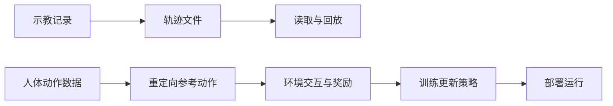

# U6-L1：动作的来源

## 一、课时目标

1. 能说明规则驱动、模仿学习和强化学习怎样获得动作，以及各自的使用条件与局限。
2. 能区分示范采集、轨迹回放和策略训练，并用参考动作跟踪的例子说明模仿学习与强化学习的联系。
3. 能用程序读出一条预录轨迹的标识、关节名、时长和采样点数，解释这些信息能说明什么。

> 教学提示：学生的前置经验是人形机器人基础课与本课程U1～U5，不预设其修过深度学习或强化学习。围绕“动作依据由谁规定、训练时使用什么、运行时依据什么”比较方法。行为克隆的预测—比对—调整用一组观测与示范动作说明；反向传播、PPO等名称只需辨认作用，不要求推导公式、配置训练环境或编写算法。知识概述后安排轨迹读取，让学生检查实际数据能支持哪些判断。

## 二、重难点

| 类型 | 内容 | 教学建议 |
| --- | --- | --- |
| 重点 | 规则、示范数据、交互奖励分别怎样形成动作依据 | 对照同一个取放或挥手场景，填写依据与产物 |
| 重点 | 示范采集、直接回放、训练与运行策略的区别 | 将“记录数据”“更新模型”“用现成规则或模型执行”分别标注 |
| 难点 | 参考动作模仿目标与强化学习训练可以结合 | 用Booster Train的参考动作、评分、策略更新解释，避免将三种方法说成互斥选项 |
| 难点 | 从轨迹字段得出适当结论 | 先读真实输出，再区分文件读取成功、关节实际移动、动作可运行和训练来源 |

## 三、环节时间轴

| 时间 | 环节 | 形式 | 内容 |
| --- | --- | --- | --- |
| 0–5min | 动作依据与策略 | 回忆、辨别 | 实训手册§一；现成动作调用、策略、训练与运行 |
| 5–12min | 规则与示教再现 | 场景比较、讲解 | §2.1～2.2；点位、示教器、离线编程与条件局限 |
| 12–21min | 从示范数据学习 | 数据配对、流程解释 | §3.1～3.2；观测—动作对、行为克隆与适用条件 |
| 21–30min | 奖励与参考动作跟踪 | 讲解、对照 | §4.1～4.3；交互、评分、Booster Train与仿真到真机 |
| 30–35min | 方法比较与数据流 | 填表、判断 | §五、§六、§6.1；工程组合、直接回放与训练链路 |
| 35–41min | 读取预录轨迹 | 学生运行、填表 | §6.1～6.2 STEP 01～02、§8.1；四项输出与解释 |
| 41–45min | 检查与评价 | 个人答题、讨论 | §8.2～8.4；四项检查、三道思考题与三道评价题 |

课前把教师提供的demo.btraj放到当前Python环境能访问的位置，并核对SDK和设备连接。概念讲解按代表例子展开，术语细节由学生课后回读；末段保留代码运行、记录及个人评价时间。单台设备时可共用只读设备信息，轨迹文件读取可各自在已配置SDK的环境中完成。

## 四、教学环节详解

### 环节1·动作依据与策略（0–5min）

- 【活动】阅读§一，回顾U1调用内置动作和U4按偏差计算控制量的经验。让学生分别指出自己规定过哪些条件，以及哪些能力由接口直接提供。
- 【核心概念】策略把可获得的信息与目标转换为动作依据；训练调整模型，运行使用已经给定的规则或模型。仅从do_action名称不能确定所有内置动作的内部算法。
- 【投影】拟展示：动作依据的三种来源、训练与运行的对照；依据：Notebook第1～2格、§5.2；PPT定位待P5-B回填。
- 【提问】“我们调用了挥手动作，能否据此说自己刚刚训练出了挥手策略？”

### 环节2·规则与示教再现（5–12min）

- 【活动】按§2.1给固定点位搬运安排取料、过渡、放料和速度；比较手持示教器点动、直接拖动与电脑离线规划的操作差别。
- 【核心概念】示教器是操作者控制、记录点位的终端；示教再现是记录后按程序执行的方式，二者并非互斥的算法类别。规则也可使用实时传感器反馈。
- 【投影】拟展示：示教器操作示意、固定点位流程、规则驱动的条件与局限；依据：第3～4、12格；PPT定位待P5-B回填。
- 【提问】“加入相机修正，能否单凭这一点判定使用了机器学习？工件位置改变后需要重新检查什么？”
- 【注意】重复性和定位精度受设备、标定及现场条件限制。离线程序仍需现场验证，不把规则驱动解释成永不出错。

### 环节3·从示范数据学习（12–21min）

- 【活动】阅读§3.1，把同一时刻的观测与示范动作配成一对，再比较物体处于不同位置时需要采集的数据。采集频率、示范次数作为例子，不要求背数值。
- 【核心概念】行为克隆使用示范样本训练输入到动作的映射。用“预测动作—与示范比对—调整模型”解释监督学习；前向预测、误差与参数更新均在这个例子中定位。
- 【活动】阅读§3.2，为数据覆盖不足、错误示范和时间未对齐各说明一种可能影响。将长处与相应条件一起写入比较表。
- 【投影】拟展示：观测—动作对、三步训练示意、直接记录与学习映射的区别、数据质量与分布变化；依据：第5～6格；PPT定位待P5-B回填。
- 【提问】“只录下一次关节轨迹再播放，哪一步还没有发生？换一个位置后，训练好的模型一定能完成吗？”
- 【注意】相机和特定深度网络并非定义模仿学习的必要条件；新位置适应能力取决于数据与任务条件，不用神经网络名称代替解释。

### 环节4·奖励与参考动作跟踪（21–30min）

- 【活动】阅读§4.1，给观测、动作、环境反馈和奖励找到具体例子。比较一次得分与一段时间累计结果，说明为什么训练未必每次都改善。
- 【活动】按§4.2给Booster Train标出参考动作提供目标、奖励函数评分、PPO依据交互更新策略三个作用；再指出仿真训练和真机运行发生在不同阶段。
- 【核心概念】本例以强化学习训练实现参考动作跟踪。模仿目标与训练方法可以组合，不能将行为克隆与所有模仿目标等同。
- 【投影】拟展示：交互循环、Booster Train三项分工、训练与部署、奖励设计和仿真差异；依据：第7～8格；PPT定位待P5-B回填。
- 【提问】“只奖励不摔倒，可能学出什么不符合行走目标的做法？仿真得分较好后还需要检查什么？”
- 【注意】抗扰动效果取决于训练、设备和部署条件。固定频率、具体控制器和模型结构不是全部机器人共有的实现，不要求学生以单个工程例子作普遍结论。

### 环节5·方法比较与数据流（30–35min）

- 【活动】用§五表格比较开发者工作、动作依据、产物、运行方式和适用条件。阅读§5.1～5.2，说明同一系统可以分层组合，但具体分工需依据实现核查。
- 【活动】对照§六两条链路，分别标出记录、文件、训练、部署和执行位置。认识拖动示教入口，但本课只读取教师文件。
- 【投影】拟展示：方法比较表、直接回放与参考动作训练两条数据流；依据：第9～12格；PPT定位待P5-B回填。
- 【板书】使用板书1、板书2，把“有没有更新策略参数”写在两条链路之间。
- 【提问】“文件后缀和接口名能证明轨迹曾用于哪种训练吗？控制器有反馈是否就说明正在学习？”

### 环节6·读取预录轨迹（35–41min）

- 【步骤】STEP 01连接并核对型号、序列号与模式；STEP 02将demo.btraj替换成教师文件路径，读出id、joint_names、duration.seconds和len(points)。填写§8.1四项记录。
- 【演示】打开Notebook第14、16格及实际输出，先核对文件位置，再比较对象字段。读取本地文件本身不需要机器人在线，不调用execute_trajectory。
- 【投影】拟展示：四字段含义、实际输出空表及结论判断题；依据：第13～18格；PPT定位待P5-B回填。
- 【提问】“关节名出现在文件里，就说明它一定动了吗？点数更多，能否直接判断动作更复杂？”
- 【注意】点数需结合时长和采样间隔解释；要确认实际移动还要比较关节值，要运行还需另作设备与动作验证。本课不进入示教、行走或回放。

### 环节7·检查与评价（41–45min）

- 【活动】按§8.2四项检查点自查，三道学习评价个人作答；三道思考题分别交小组说明回放与策略、位置变化、采样点比较，全班核对依据。
- 【投影】拟展示：检查点、三道思考题和三道评价题；依据：第18格；PPT定位待P5-B回填。
- 【注意】保留实际文件信息和未能解释的问题。下节课使用本课读取字段的经验检查自己的录制文件，不将本课读取成功记作回放成功。

## 五、板书设计

**板书1 · 动作依据**

| 方式 | 形成依据的过程 | 主要条件 |
| --- | --- | --- |
| 规则驱动 | 人写条件、关系或轨迹 | 条件明确，现场需标定与验证 |
| 行为克隆 | 观测—示范动作配对，训练映射 | 数据质量与覆盖范围适合任务 |
| 强化学习 | 与环境交互，按奖励更新策略 | 奖励、环境与部署条件适合任务 |

**板书2 · 两条数据流**

参考动作说明跟踪目标，奖励评价结果，训练算法更新策略。图示采用本课的两条工程例子，不代表所有模仿学习均需先做人形动作重定向。

## 六、学习评价

> 题目与实训手册§8.4一致。另核对§8.1记录、§8.2四项检查及§8.3三道思考题；参考答案供教师使用，学生PDF保留题目、删除参考答案。

1. 判断：模仿学习必须使用相机和深度神经网络。 （　　）

   **答案：×。** 按所使用的示范数据和学习过程判断，不以相机或指定网络结构作必要条件。

2. 填空：Booster Train 的参考动作跟踪中，参考动作提供模仿目标，________ 对动作结果评分，PPO 根据交互记录和奖励更新________。

   **答案：奖励函数；策略。**

3. 选择：本课调用 `TrajectoryData.load()` 并打印信息，完成的是（　　）。

   A. 读取轨迹数据　B. 训练行为克隆模型　C. 优化强化学习策略　D. 执行轨迹回放

   **答案：A。**

思考题按三项依据评价：固定轨迹与按观测计算动作的区别；未覆盖位置和感知误差造成的限制；点数比较还需时长、间隔、关节变化及记录质量。仅列术语、没有对应解释时继续追问。

## 七、常见问题FAQ

| 问题 | 解答 |
| --- | --- |
| 轨迹文件找不到？ | 检查当前Python工作目录与路径可见性；必要时填写完整路径 |
| 有传感器反馈就一定是强化学习？ | 反馈也可用于人工设计的控制规则，需确认是否经过训练及使用何种训练过程 |
| 模仿学习与强化学习能同时出现吗？ | 可用参考动作规定模仿目标，以强化学习更新控制策略，Booster Train是本课例子 |

## 八、安全与设备准备

- 准备一条可读取的教师预录轨迹、文件路径与已配置SDK的开发环境；提供真实字段，不预填统一关节数和点数。
- 本课只连接、读模式和读文件，不发运动指令，不切换模式、不进行拖动示教；机器人保持教师确认的稳定状态。
