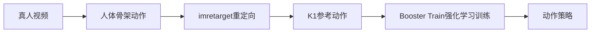

# U6-L3：视频动作训练（动作工坊）

## 一、课时目标

1. 能按要求拍摄、检查并上传一段动作视频，创建面向K1的动作训练任务。
2. 能结合本次任务，说明视频提取骨架、重定向和强化学习训练分别处理什么，区分参考动作与训练策略。
3. 能记录任务进展，比较原视频与可查看的生成结果，指出动作保留、改变或未达到的部分，并提出有依据的改拍建议。

> 教学提示：承接L1的参考动作跟踪与L2的直接回放，围绕本组视频在各阶段的输入输出展开。平台承担训练，学生负责选材、检查、提交、观察与解释，不要求具备深度学习课程基础。训练可能超过一课时，教师须备好可对应原视频的已完成K1样例；本组进展与样例比较分别记录。部署观察和SDK资源调用按条件实施，不以所有小组当堂真机运行作为目标。

## 二、重难点

| 类型 | 内容 | 教学建议 |
| --- | --- | --- |
| 重点 | 按格式、画质、完整出镜及动作条件检查视频 | 看视频详情并完整播放，逐项填写，不能只看文件后缀 |
| 重点 | 骨架、重定向参考动作、训练策略的区别 | 在同一流程上标输入、输出及机器人结构约束 |
| 难点 | 从可见结果提出有限而有依据的判断 | 区分任务结束、预览、虚拟运行、真机运行，未可见的中间结果不编造 |
| 难点 | 把观察转为可检验的改拍方案 | 一次改一个因素，写出预期及下一次检查方法 |

## 三、环节时间轴

| 时间 | 环节 | 形式 | 内容 |
| --- | --- | --- | --- |
| 0–7min | 视频到动作策略 | 讲解、流程配对 | 实训手册§一～二；骨架提取、imretarget、Booster Train与终止条件 |
| 7–16min | 设计与检查输入视频 | 拍摄、完整播放、填表 | §3.1～3.2、STEP 01；格式、画质、稳定性和版本 |
| 16–23min | 创建任务、记录进展 | 平台操作、记录 | §四前置、STEP 02～03；账号额度、目标机型、任务与可见阶段 |
| 23–34min | 比较结果与部署观察 | 分段比较、有条件演示 | §4.1 STEP 04、§4.3；本组或样例、预览与资源调用 |
| 34–41min | 第二版方案与材料整理 | 小组讨论、提交 | §4.2 STEP 05、§五；一项改变、判断方法与补查安排 |
| 41–45min | 检查与评价 | 个人回答、说明证据 | §6.1～6.3；四项检查、三问与三项评价 |

课前确认当前Studio入口、账号与额度、网络、K1已完成样例及其原视频。样例优先选择双脚稳定、小幅上身动作；本组视频可课前准备初版，课内完成检查及必要改拍。上传限长以当前平台为准，手册“一分钟左右”是选材建议。未结束训练安排课后补查，不以等待进度条填满课堂时间。

## 四、教学环节详解

### 环节1·视频到动作策略（0–7min）

- 【活动】对照L2，指出这次输入是真人视频；按§2.1～2.3分别说明人体骨架、适配K1的参考动作和控制策略。把imretarget放在重定向、Booster Train放在训练步骤。
- 【核心概念】人体运动映射到K1后，还需训练如何在动态条件下跟踪参考动作。最大时长或训练终止标准任一满足即可结束；结束不等于质量合格，无法查看具体终止原因时不推定。
- 【投影】拟展示：三阶段输入输出、人体与K1结构差异、L2回放与本课训练对照；依据：Notebook第2～5格；PPT定位待P5-B回填。
- 【提问】“有了适配K1的关节参考动作，为什么还不能据此保证运动稳定？”

### 环节2·设计与检查输入视频（7–16min）

- 【活动】填写§3.2动作设计表，先确定用途、起始、过程、结束及预计难适配部位；教师审看后拍摄。
- 【步骤】STEP 01完整播放，按§3.1检查MP4/MOV、不低于720P与30帧/秒、单人全身、清楚无遮挡、稳定支撑与动作难度；读取视频详情，不合格先改拍。
- 【投影】拟展示：视频检查表、全身出镜示意、动作设计表；依据：第6～7、9格；PPT定位待P5-B回填。
- 【注意】腿部动作也须满足双脚稳定等要求，舞蹈或武术题材不豁免限制。避免跳跃、踮脚、单腿支撑、大幅弯腰后仰和快速动作。保留采用版本及改拍理由，不把预测写作已经观察到的结果。

### 环节3·创建任务、记录进展（16–23min）

- 【活动】阅读§四前置与云算力扩展，说明仿真与策略更新为何需要较多算力、为何平台使用云资源。检查本组账号、可用额度和预计消耗；是否获赠额度以当前账号界面为准。
- 【步骤】按STEP 02打开动作工坊“创建动作”，输入组别与版本名，核对K1机型，上传合格视频；查看预览及实际显示的预计耗时、额度，经教师确认后提交一次。
- 【步骤】STEP 03记录名称、提交时间、任务标识及当前阶段。没有标识时记名称与截图，未开放中间结果时记“不可查看”。在结果比较前再看一次本组进展。
- 【演示】打开当前BoosterStudio动作工坊，指向视频预览、目标机型、额度和任务位置；不按旧设计文档虚构界面按钮。
- 【投影】拟展示：提交前检查清单、云训练条件与三行进展记录表；依据：第8、10～11格；PPT定位待P5-B回填。
- 【注意】上传训练不要求连接实体机器人。训练消耗额度，不重复提交相同视频、不为了课堂结束删除未完成任务。

### 环节4·比较结果与部署观察（23–34min）

- 【活动】STEP 04先注明本组任务或教师样例，将原视频和结果按起始、关键动作、结束对应；逐项记录方向、幅度、停顿、支撑和末姿态的保留、变化或无法判断。
- 【演示】按§4.3先看预览或教师确认的虚拟运行。具备验证条件时再观察真机，记录动作名、版本、机型、环境；没有部署就写未部署。
- 【演示】在条件具备时打开第15格资源调用示例，说明`execute_whole_body_control(resource_path)`接收导出的资源路径，返回句柄，`wait()`等待任务结束。此处为部署操作示例，不是重新训练；等待返回后仍核对实际状态与现场效果。
- 【投影】拟展示：三个片段的输入/结果对照、预览/虚拟/真机三种记录、资源文件到任务句柄的关系；依据：第12、14～15格；PPT定位待P5-B回填。
- 【注意】手册引用的附件《动作工坊训练策略模型导出》尚未在库内找到独立文件。教师须在部署环节提供已核对的导出操作指南或现场演示与可用资源；缺少条件时保留原视频、任务和预览学习，另排部署。资源不是.btraj，不能拿轨迹接口替代。
- 【安全红线】真机部署只由教师在确认设备、版本和场地后组织；按平台及设备规范完成，不把视频暂停或Python中断视为机器人可靠停机方式。

### 环节5·第二版方案与材料整理（34–41min）

- 【活动】STEP 05选择一项有证据的改变，如修正手离开画面的取景或放慢动作；保持其他条件接近，写明预期与下一次检查项。回到§3.2核对初始预测。
- 【活动】按§五整理输入视频、名称版本、进展、比较表和建议；标明比较来源及补查时间。写出本组素材在L4中的作用、首尾姿态与运行条件。
- 【投影】拟展示：观察—改动—预期—验证项四列记录、本组进展与样例来源标记；依据：第13、16格；PPT定位待P5-B回填。
- 【提问】“抬手幅度变小，能仅凭成品认定是视频拍得不好吗？第二版怎样收集更多证据？”
- 【注意】差异也可能来自机型适配或训练表现；没有中间证据时写可能原因，不强判根因。第二次训练按额度及时间另排，不计作已经验证的改进。

### 环节6·检查与评价（41–45min）

- 【活动】按§6.1四项检查点自查，完成§6.3三项评价；§6.2三问分组简答并汇总。指出一项实际证据、一项尚无法判断的结果和补查安排。
- 【投影】拟展示：流程填空、与L2的比较、片段评价要求及三道思考题；依据：第17格；PPT定位待P5-B回填。
- 【注意】本组未生成结果时，允许用教师样例提交比较，但必须另留本组任务及后续补查项；未部署不记为真机运行成功。

## 五、板书设计

**板书1 · 输入与产物**

**板书2 · 证据能说明什么**

| 证据 | 可说明的结果 | 仍需另行核查 |
| --- | --- | --- |
| 视频检查 | 输入满足已检查条件 | 骨架提取和后续效果 |
| 任务状态 | 当前进展或结束 | 动作质量及终止原因是否可见 |
| 预览/虚拟运行 | 相应环境中可见表现 | 真机条件与实际表现 |
| 真机观察与任务状态 | 本次运行和动作表现 | 是否适合下一段作品衔接 |

## 六、学习评价

> 题目与实训手册§6.3一致。§6.1检查点、§6.2思考题及各步骤记录共同评价；参考答案仅供教师，学生PDF删除参考答案。

1. 给本组任务补全数据流程：视频→________→________→强化学习训练→________。

   **答案：人体骨架动作；重定向参考动作；动作策略。**

2. 用一项本课证据说明，它与L2直接回放`.btraj`相比增加了什么过程。

   **参考要点：** 引用本次训练任务或可见阶段，说明由参考动作训练更新策略；L2直接读取、执行轨迹。不能仅用上传按钮证明训练质量。

3. 提交一个动作片段的输入/结果对照和第二版建议，注明使用本组结果还是教师样例。

   **参考要点：** 片段可对应，保留或变化有观察依据；建议说明改变什么、预期及如何验证。样例来源明确，未完成与未部署如实标记。

三道思考题检查：参考动作尚不等于稳定控制；达到最大时长不等于质量合格；单凭成品差异不足以定位具体处理阶段。

## 七、常见问题FAQ

| 问题 | 解答 |
| --- | --- |
| 下课还没训练完怎么办？ | 保留任务，记录名称、进展与补查时间；课内用已完成样例做比较 |
| 看不到骨架或重定向结果怎么办？ | 写不可查看，解释流程原理与记录界面事实分开 |
| 能用execute_trajectory播放导出的资源包吗？ | 不能把策略资源当作.btraj；使用教师确认的资源调用方法和部署条件 |

## 八、安全与设备准备

- 准备Studio账号、额度、网络、拍摄设备、合格原视频及可对应的已完成K1样例；课前确认导出与调用条件。
- 拍摄检查身体稳定、全身出镜和无遮挡；上传训练阶段无须为此启动机器人运动。
- 部署为条件活动，教师先核对当前平台和设备运行规范；课堂比较不以冒险完成真机展示为前提。
