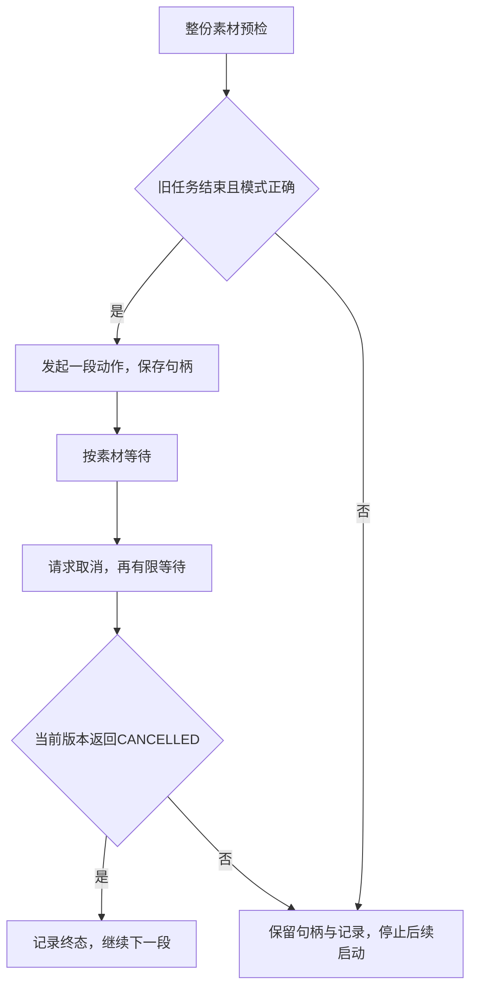

# U6-L4：动作编排

## 一、课时目标

1. 能围绕一个展示任务选择动作素材，标明来源、首尾姿态与使用条件，形成3～5步作品脚本。
2. 能把已验证的录制轨迹与内置动作按顺序编排，结合动作实际表现与取消终态判断结果；未确认结束时不重复启动。
3. 能用一次试演记录找出衔接或表达问题，调整一个方案要素并说明复测结果或待验证事项。

> 教学提示：本课以作品设计、两类素材实际混编和试演改进为主。当前实验版本在各步等待后主动取消，取得CANCELLED才继续；这是本课已经验证的任务释放方式，不能将取消终态直接解释成动作完成。学生同时记录动作是否达到设计要求及SDK任务结果。仅靠状态值无法判断动作是否播完、衔接是否合适。列表、循环和分支围绕现成清单讲解，不增加复杂异常封装或新的状态机实现任务。

## 二、重难点

| 类型 | 内容 | 教学建议 |
| --- | --- | --- |
| 重点 | 场景、动作作用、来源与首尾姿态形成完整作品 | 先填作品表，再写3～5步执行清单，避免按名称随意拼接 |
| 重点 | 素材全清单预检与逐步调用 | 分清准备数据与发起任务，修改清单后重新检查 |
| 难点 | 动作效果、等待、取消请求与取消终态的区别 | 同时填写任务结果与现场表现，解释wait超时不会自动停止 |
| 难点 | 找到一项有证据的衔接修改 | 比较原版和复测，首尾姿态问题回到L2改录并保留版本 |

## 三、环节时间轴

| 时间 | 环节 | 形式 | 内容 |
| --- | --- | --- | --- |
| 0–8min | 场景与作品设计 | 分组设计、素材选择 | 实训手册§一～三；来源、3～5步、动作作用与姿态 |
| 8–16min | 单项与整份清单检查 | 运行、核查、讲解 | §四 STEP 01～02；实际动作ID、文件、prepared_steps与plan_ready |
| 16–27min | 第一轮试演与记录 | 教师监护、运行观察 | §4.2 STEP 03～04、§7.1；等待、取消终态、现场效果与未执行项 |
| 27–36min | 修改与复测 | 调整、重新检查、试演 | §4.3；一个要素、新版本、复测或待验证 |
| 36–41min | 作品说明与评价 | 汇报、定位代码 | §五、§7.2～7.4；编排规则、三问与三项评价 |
| 41–45min | 任务、设备与交付 | 核查、保存材料 | §六；任务终态、按钮收尾、脚本与证据交付 |

课前准备本组或教师已验证的轨迹和内置动作，核对当前机型与动作时长。每组设脚本、操作、观察岗位，教师先审阅相邻姿态与等待参数。45分钟按已完成单项验证的短作品安排；需要重新录制或轮换时间不足时另排补做，不把未执行写成完成。

## 四、教学环节详解

### 环节1·场景与作品设计（0–8min）

- 【活动】阅读§一～三，选择致意或展示场景，说明观众应看到什么。填写3～5步作品表，至少包含一段已验证录制轨迹和一个内置动作。
- 【活动】核对每段的来源、文件/ID、版本、首尾姿态与相邻衔接。L3资源可列完整方案；当前基础脚本只支持trajectory与action，其他类型须另行接入并验证。
- 【核心概念】接口可以顺序调用，不会自动合成两个动作之间的过渡。不同来源的素材是否适合相邻执行，需要单项结果与现场检查。
- 【投影】拟展示：三类素材比较、3～5步作品表、首尾姿态衔接示意；依据：Notebook第2～5格；PPT定位待P5-B回填。
- 【提问】“上一段结束时手还举着，下一段从垂手开始，单纯等任务结束能自动补出过渡吗？”

### 环节2·单项与整份清单检查（8–16min）

- 【步骤】STEP 01只在本课开始运行一次，读取设备和内置动作清单。找到真实ID、类型、时长、可打断性，不从序号或中文名称自行猜SDK ID。
- 【步骤】STEP 02把作品表中已接入的素材写入steps。定位清单长度检查、轨迹读回、有效点数/时长、ID存在与未知类型分支。只在全部通过时plan_ready为True。
- 【核心概念】prepared_steps保存实际执行所需数据；预检通过说明清单数据已准备，不能代替机型、首尾姿态及单项动作验证。是否包含两类素材由作品表和教师核查。
- 【演示】打开Notebook第8、10格，指出active_motion只在首次连接时初始化；在无运动情况下修改一处副本路径或ID，按报错定位并恢复可用清单，不为演示制造真实运动冲突。
- 【投影】拟展示：素材类型与接口对应表、预检分支、实际清单空表；依据：第6～10格；PPT定位待P5-B回填。
- 【注意】L3已有资源调用示例，仍不能把资源包写成.btraj或内置ID。三类整合要增加对应预检及执行分支、完成整套验证；本次基础脚本不冒充已经实现。

### 环节3·第一轮试演与记录（16–27min）

- 【步骤】教师确认当前为行走模式（WALK）、人员退出运动范围、单项及相邻姿态可用。STEP 03先核对plan_ready、上一句柄是否结束及模式，再顺序执行prepared_steps。
- 【演示】逐行定位两类动作调用、active_motion保存、第一次等待、cancel、第二次有限等待、日志和退出条件。轨迹的第一次等待为其时长加1秒，内置动作为5秒；这两个参数须在课前按所选素材核对，不能视为所有动作的完成时间。
- 【核心概念】当前脚本等待后主动取消，再最多等5秒；返回CANCELLED才继续。cancel仅提交请求，最终状态来自wait；CANCELLED表示已取消，动作是否完整仍看实际表现。其他状态含SUCCEEDED均不满足当前代码的继续条件，会停止后续启动。
- 【步骤】STEP 04读来源、素材、结果三列日志，填写§7.1现场效果；未开始调用的步骤标未执行。调用或等待异常也保留记录，不能记作动作完成。
- 【投影】拟展示：等待—请求取消—确认终态的时间线、当前继续条件、任务/现场双列记录；依据：第11～14、18格；PPT定位待P5-B回填。
- 【提问】“CANCELLED能证明动作播完整了吗？如果返回RUNNING，下一步为什么不应启动？”
- 【注意】异常后保留active_motion；不要重跑连接或清空句柄来处理忙状态。脚本只捕获RuntimeError，其他异常中断后由教师核对任务及设备。即使任务已结束，下一轮仍需恢复适合的姿态。
- 【安全红线】wait超时不是停机。教师持续观察，动作未按预期或存在异常时按设备规范处理；不能为了得到某个状态继续试演。

### 环节4·修改与复测（27–36min）

- 【活动】按§4.3选择顺序、素材或录制动作首尾姿态中的一项修改，引用第一轮观察写明原因。改录时回到L2流程并另存，不直接改未验证关节数值。
- 【步骤】保存首轮run_log和作品记录，确认旧任务结束、姿态适合后重新运行STEP 02，再试演及记录。改变等待参数也须教师检查、单独说明，不能用延长等待掩盖动作不合适。
- 【投影】拟展示：原问题—一项改动—重新预检—复测对照；依据：第15格、§7.1；PPT定位待P5-B回填。
- 【注意】工坊资源单独在Studio或SDK示例中运行时标单独运行；未接入完整循环的片段仍标待接入，不并入本轮日志充数。未复测明确写待验证。

### 环节5·作品说明与评价（36–41min）

- 【活动】每组结合§7.2检查作品场景、两类实际素材、任务/现场记录与修改依据。完成§7.4三项评价，在脚本中定位句柄、等待、取消及继续条件。
- 【活动】阅读§五，以U5-L4三个应用状态回顾条件控制；认识状态机与行为树可组织更复杂作品，本课只说明用途。§7.3三问分别讨论衔接、未结束与失败、素材训练和顺序规则。
- 【投影】拟展示：作品评价三项、三道思考题、素材生成方法与编排规则的分工；依据：第16、18格；PPT定位待P5-B回填。
- 【提问】“素材由强化学习训练得到，列表顺序是谁决定的？要让来宾到达后才启动，还需要写哪些条件？”

### 环节6·任务、设备与交付（41–45min）

- 【步骤】按§六确认当前运动任务已经终态，教师检查设备可收尾。实体按钮回准备模式（PREP），直立稳定后人工支撑，按设备规范扶坐并进入阻尼模式（DAMP）。
- 【活动】提交作品脚本、素材清单、两轮日志、现场观察、修改说明与待验证项。有演示视频时标明基础版、完整版本或单独素材。
- 【投影】拟展示：任务核查、设备收尾和作品交付清单；依据：第17～18格；PPT定位待P5-B回填。
- 【安全红线】严禁WALK直接切DAMP；句柄未结束时由教师处理，不以Notebook关闭或重置变量代替任务结束。

## 五、板书设计

**板书1 · 本课执行顺序**

图表示程序如何继续；现场观察另记动作是否完整、姿态与节奏是否合适。取消终态不作效果合格的替代依据。

**板书2 · 作品证据**

| 作品设计 | 程序记录 | 现场判断 |
| --- | --- | --- |
| 场景、3～5步、来源与版本 | 实际调用、任务状态、未执行项 | 动作完整性、首尾姿态、节奏与衔接 |
| 一项调整及原因 | 重新预检与复测日志 | 改善、未改善或待验证 |

## 六、学习评价

> 题目与实训手册§7.4一致。另核对§7.1记录、§7.2检查点与§7.3三道思考题；参考答案供教师，学生PDF删除参考答案。

1. 提交一份至少包含两类可执行素材的作品及试演记录。

   **参考要点：** 3～5步设计可追溯，基础执行实际包含已验证轨迹和内置动作；有任务结果及现场表现，未接入工坊片段、未执行项分别标记。

2. 指出脚本中保存当前句柄、等待任务和判断是否继续的代码位置，解释各自作用。

   **参考要点：** active_motion保存句柄；第一次wait为所选素材提供运行观察时间；cancel提交取消，第二次wait返回结束或超时状态。当前程序仅在CANCELLED时继续，其他结果停止后续启动；done用于重跑前核对，不代表动作质量。

3. 说明一个本次修改及其结果；未复测时说明还缺哪项验证。

   **参考要点：** 引用首轮证据，说明只改变的一项要素和复测表现；未做的验证明确标出，不用预期代替结果。

三道思考题分别检查：等待不自动生成姿态过渡；RUNNING需继续核查仍在执行的任务、FAILED需检查错误及现场；作品顺序由人工清单与分支决定，素材训练方法不自动决定列表顺序。

## 七、常见问题FAQ

| 问题 | 解答 |
| --- | --- |
| 为什么本课CANCELLED后还会继续？ | 当前设备与实验版本采用主动取消释放任务；同时核对动作表现，不能据此推广所有SDK动作都以取消表示完成 |
| 返回SUCCEEDED反而停了？ | 当前代码只接受CANCELLED为继续条件；先记录并请教师核查，不临时改分支凑完整演示 |
| 报Robot is busy executing another action？ | 保留当前及已有句柄，检查遗留运动任务、示教占用及终态；不要连续新建动作或假设可强制清空 |
| 有了L3资源接口就能直接塞入steps吗？ | 还需对应素材类型、资源预检、执行分支、终态处理和衔接验证，不能换个类型名称冒充支持 |

## 八、安全与设备准备

- 准备已验证的K1轨迹、真实内置ID、合适的首尾姿态、可写记录目录和监护场地；先确认每段时长、可打断性与取消表现。
- 试演前教师检查模式、周围空间、前次句柄与动作清单；连续动作全程监护，异常按设备操作规范处置。
- 课内以已验证的两类素材完成基础作品；三类整合、重录和未轮到的实操另排补做，交付中标明范围。
